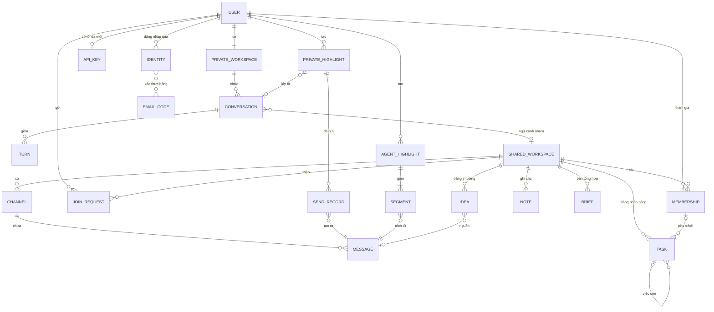
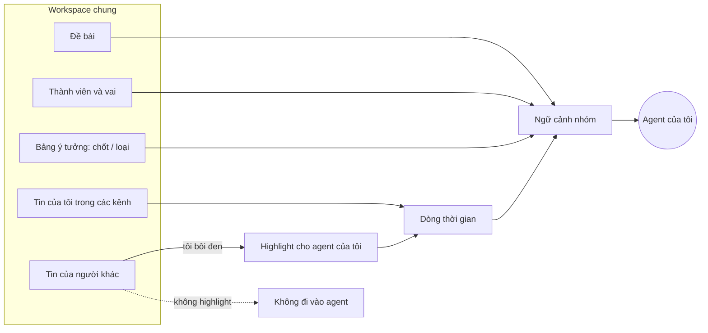
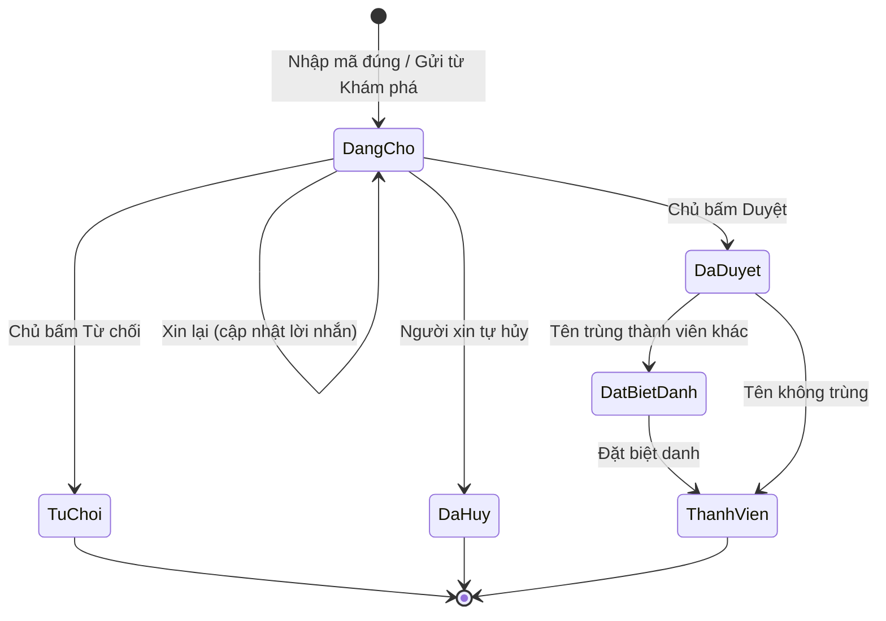
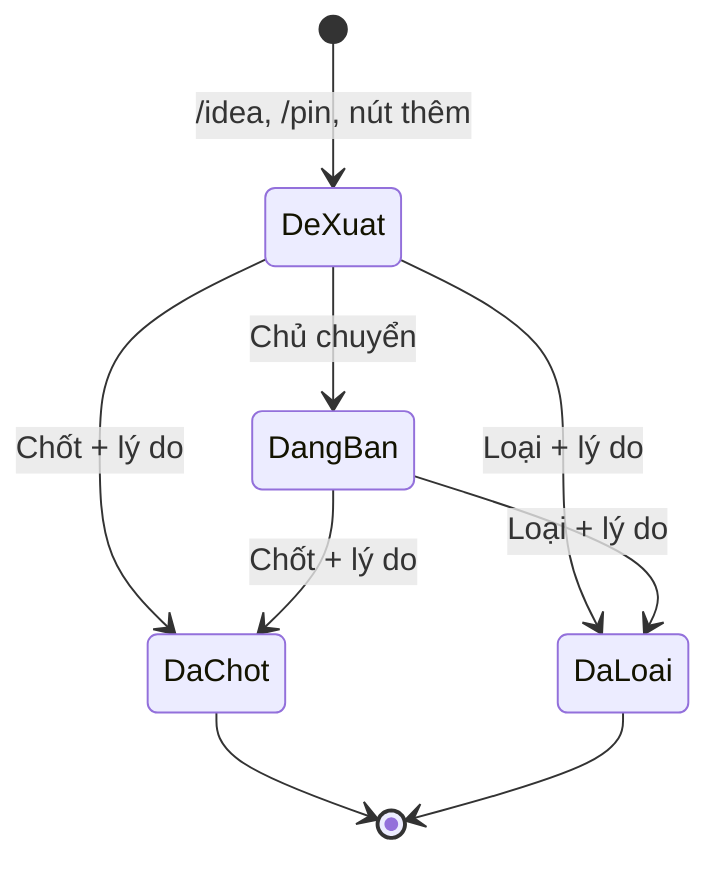
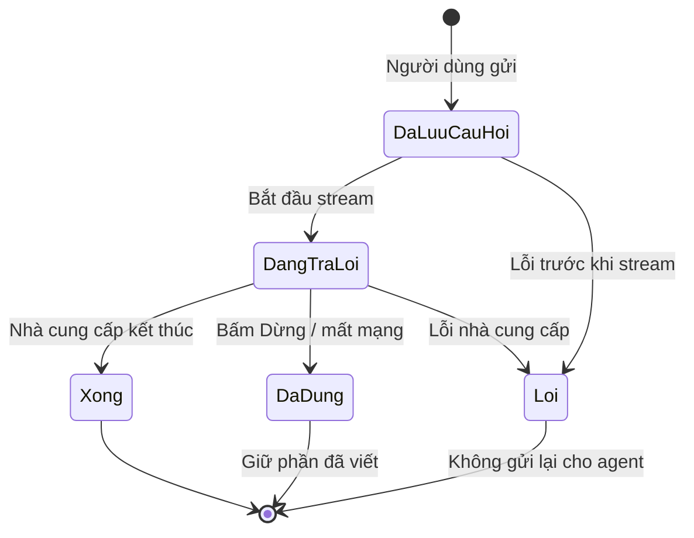
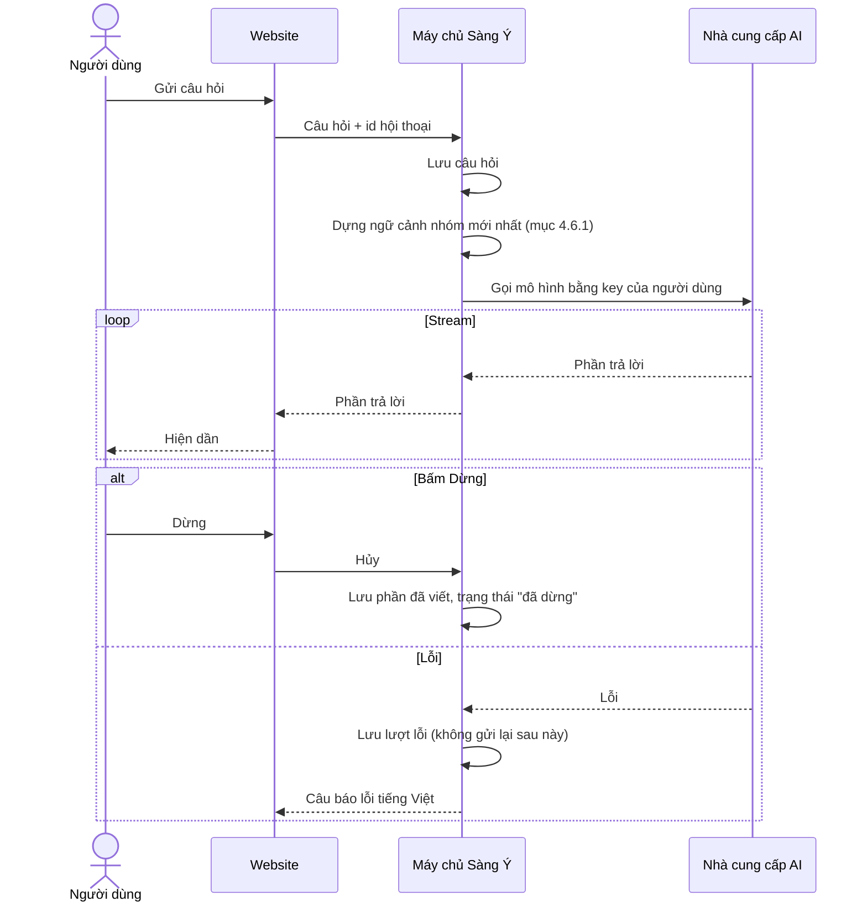
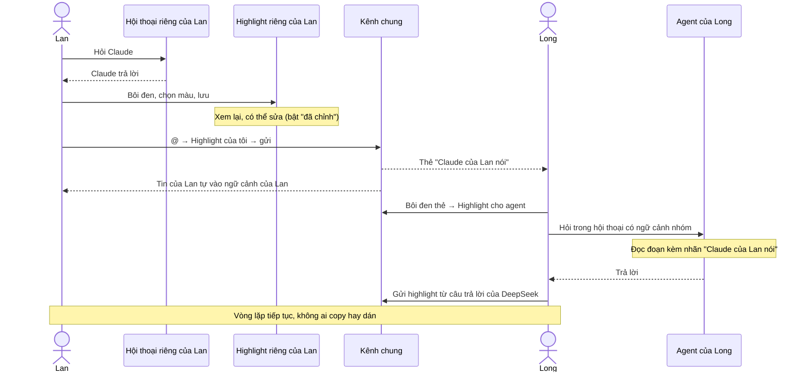
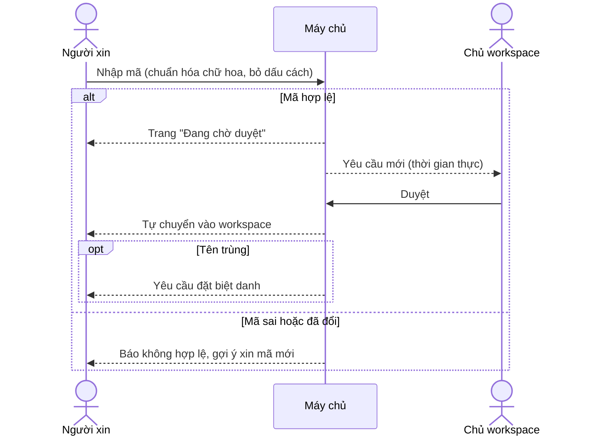

# Đặc tả chức năng: Sàng Ý (SpecGate Workspace)

| Mục | Nội dung |
|---|---|
| Tên hệ thống | Sàng Ý (tên tiếng Anh: SpecGate Workspace) |
| Kỹ thuật cốt lõi | Human-in-the-loop context engineering |
| Tài liệu nguồn | [flow.md](flow.md) (mô tả luồng bằng lời) |
| Loại tài liệu | Đặc tả yêu cầu chức năng (SRS), bản nháp |
| Ngày | 2026-11-21 (cập nhật theo website đang chạy) |

Tài liệu này chuyển nội dung của `flow.md` thành dạng đặc tả: thuật ngữ, vai trò, mô hình dữ liệu, yêu cầu có mã số, quy tắc nghiệp vụ, sơ đồ trạng thái, giới hạn và tiêu chí nghiệm thu. Khi hai tài liệu khác nhau, `flow.md` là bản gốc cho tới khi nhóm cập nhật lại. Những chỗ ghi **(đề xuất)** là phần tài liệu này tự bổ sung để đặc tả đủ chi tiết, nhóm cần duyệt lại. Những chỗ ghi **(chưa chốt)** trỏ tới mục 13.

---

## Mục lục

1. [Giới thiệu](#1-giới-thiệu)
2. [Tác nhân và phân quyền](#2-tác-nhân-và-phân-quyền)
3. [Mô hình dữ liệu khái niệm](#3-mô-hình-dữ-liệu-khái-niệm)
4. [Yêu cầu chức năng](#4-yêu-cầu-chức-năng)
5. [Sơ đồ trạng thái](#5-sơ-đồ-trạng-thái)
6. [Sơ đồ tuần tự các luồng chính](#6-sơ-đồ-tuần-tự-các-luồng-chính)
7. [Giới hạn và hằng số](#7-giới-hạn-và-hằng-số)
8. [Yêu cầu phi chức năng](#8-yêu-cầu-phi-chức-năng)
9. [Thông báo cho người dùng](#9-thông-báo-cho-người-dùng)
10. [Ngoài phạm vi](#10-ngoài-phạm-vi)
11. [Phân đợt triển khai](#11-phân-đợt-triển-khai)
12. [Kịch bản nghiệm thu đầu-cuối](#12-kịch-bản-nghiệm-thu-đầu-cuối)
13. [Vấn đề còn mở](#13-vấn-đề-còn-mở)
14. [Bảng truy vết](#14-bảng-truy-vết)

---

## 1. Giới thiệu

### 1.1 Bài toán

Khi một nhóm cùng lên ý tưởng, mỗi người hỏi một agent AI riêng (Claude, DeepSeek, ChatGPT…). Các phiên chat không thấy nhau, nên agent của người này không biết nhóm đã bàn gì, đã loại ý nào. Kết quả là agent đề xuất lại ý đã bị loại hoặc trả lời lạc hướng, và mọi người phải copy, dán qua lại. Mỗi vòng hỏi đáp giữa hai người tốn khoảng bốn lần copy và dán, và agent không biết câu nào do ai nói.

### 1.2 Mục tiêu

| Mã | Mục tiêu |
|---|---|
| G1 | Bỏ hoàn toàn việc copy và dán giữa các agent của các thành viên. |
| G2 | Agent của mỗi người chỉ đọc những gì con người đã chọn lọc, và luôn biết đoạn nào do ai nói. |
| G3 | Nhóm có một bảng ý tưởng ghi lại ý đã chốt và đã loại kèm lý do, để agent không đề xuất lại ý đã bị gạt bỏ. |

### 1.3 Nguyên tắc thiết kế

| Mã | Nguyên tắc |
|---|---|
| P1 | **Con người quyết định, agent không tự làm gì trong nhóm.** Agent không tự gửi tin, không tự chốt hay loại ý, không tự trả lời trong kênh. |
| P2 | **Lưu lại, xem lại, rồi mới gửi.** Mọi thứ đi từ workspace riêng vào nhóm phải qua danh sách Highlight riêng. |
| P3 | **Luôn ghi người nói.** Mọi đoạn trích (thẻ trích dẫn, highlight, ngữ cảnh agent) giữ đúng người nói gốc và đánh dấu khi đã bị chỉnh. |
| P4 | **Ngữ cảnh là tài nguyên có hạn.** Chỉ đưa vào ngữ cảnh agent: tin của chủ agent và các đoạn chủ agent đã highlight, cùng trạng thái chung của nhóm. |
| P5 | **Bản chụp, không tham chiếu sống.** Thẻ trích dẫn và highlight lưu nguyên văn tại lúc tạo. |
| P6 | **Riêng tư mặc định.** Hội thoại riêng, highlight và key chỉ chủ của chúng thấy. |

### 1.4 Thuật ngữ

| Thuật ngữ | Định nghĩa |
|---|---|
| Người dùng | Người có tài khoản, đăng nhập bằng Google, GitHub hoặc mã một lần gửi qua email. |
| Workspace riêng | Không gian của một người, có sẵn khi tạo tài khoản. Chỉ chứa hội thoại với agent riêng và danh sách Highlight riêng. |
| Workspace chung | Không gian của nhóm: đề bài, kênh, bảng ý tưởng, bảng phân công và bản tổng hợp. Không có agent của riêng nó. |
| Chủ workspace | Người tạo workspace chung, có thêm các quyền quản trị. |
| Thành viên | Người đã được chủ duyệt vào workspace chung. |
| Agent riêng | Mô hình AI người dùng chọn sau khi nhập API key. Mỗi người có đúng một agent. Agent trong workspace riêng và agent có tên trong kênh là cùng một agent. |
| Hội thoại | Một phiên chat giữa người dùng và agent riêng, nằm trong workspace riêng. |
| Ngữ cảnh nhóm | Thuộc tính của hội thoại: "Không có" hoặc một workspace chung mà người dùng là thành viên. |
| Khung "Agent đang đọc" | Khung bên phải hội thoại, hiện chính xác phần ngữ cảnh nhóm sẽ gửi cho agent. |
| Highlight riêng | Đoạn người dùng đánh dấu trong hội thoại riêng, có màu và ghi chú, dùng để lưu và sau đó gửi vào nhóm. |
| Highlight cho agent | Đoạn người dùng đánh dấu trong tin của người khác ở kênh nhóm, để agent riêng của mình đọc. Có nhãn "Quan trọng" hoặc "Cần xem xét". |
| Thẻ trích dẫn | Tin trong kênh được tạo từ một highlight riêng, ghi người nói gốc, ví dụ "Claude của Lan nói". |
| Thẻ tóm tắt hội thoại | Tin đặc biệt trong kênh chứa bản tóm tắt hội thoại riêng do agent viết, ghi "chưa được lọc". |
| Tin hệ thống | Tin do hệ thống tạo, ví dụ thông báo đã thêm ý lên bảng. |
| Tên trong workspace | Tên hiển thị duy nhất của một thành viên trong một workspace chung (mặc định là tên tài khoản, hoặc biệt danh). |
| Vai trong nhóm | Một dòng ngắn tối đa 40 ký tự mỗi thành viên tự ghi về việc mình làm. |
| Bảng phân công | Cây việc tối đa 3 cấp của một workspace chung; mỗi việc có số riêng ("việc 3"), người phụ trách và trạng thái Đang làm hoặc Xong. |
| Mã đăng nhập | Mã 6 chữ số gửi qua email, dùng một lần trong 10 phút, để đăng nhập hoặc xác thực email khi tạo tài khoản. |

---

## 2. Tác nhân và phân quyền

### 2.1 Tác nhân

| Tác nhân | Mô tả |
|---|---|
| Khách | Người chưa đăng nhập. Chỉ truy cập được trang đăng nhập. |
| Người dùng | Đã đăng nhập. Có workspace riêng. |
| Thành viên | Người dùng đã được duyệt vào một workspace chung. |
| Chủ workspace | Thành viên đã tạo workspace chung đó. |
| Nhà cung cấp AI | Anthropic hoặc dịch vụ kiểu OpenAI (OpenAI, Google Gemini, DeepSeek, OpenRouter, Groq, Ollama). |
| Nhà cung cấp danh tính | Google, GitHub. |
| Máy chủ gửi thư | Máy chủ SMTP gửi mã đăng nhập tới email. |

Một người có thể đồng thời là chủ ở workspace này và thành viên ở workspace khác.

### 2.2 Ma trận quyền trong workspace chung

| Hành động | Thành viên | Chủ |
|---|:-:|:-:|
| Xem kênh, gửi tin, dùng `@` và lệnh thường | ✓ | ✓ |
| Xem và chép mã tham gia | ✓ | ✓ |
| Highlight cho agent | ✓ | ✓ |
| Đưa ý lên bảng (`/idea`, `/pin`, nút thêm), thêm ghi chú (`/note`) | ✓ | ✓ |
| Chuyển ý từ Đề xuất sang Đang bàn | | ✓ |
| Chốt hoặc loại ý (`/decide`, nút trên thẻ) | ? | ✓ |
| `/summarize`, `/brief` | | ✓ |
| Xem và tải bản tổng hợp mới nhất | ✓ | ✓ |
| Sửa vai trong nhóm của chính mình | ✓ | ✓ |
| Sửa đề bài, đổi tên, đổi chế độ hiển thị | | ✓ |
| Tạo kênh mới | | ✓ |
| Đổi mã tham gia | | ✓ |
| Xem và xử lý yêu cầu tham gia | | ✓ |
| Xem bảng phân công; thêm việc đứng tên mình; nhận việc chưa có người phụ trách; `/task` | ✓ | ✓ |
| Đánh dấu xong, mở lại việc mình phụ trách (kể cả khi bảng khóa) | ✓ | ✓ |
| Giao việc cho người khác, để trống, sửa, xóa việc | | ✓ |
| Khóa, mở khóa bảng phân công | | ✓ |

`?` là điểm chưa chốt (mục 13, câu 3).

### 2.3 Quyền trên dữ liệu riêng

| Dữ liệu | Ai thấy | Ghi chú |
|---|---|---|
| API key | Không ai (kể cả chủ key) | Chỉ hiện 4 ký tự cuối. |
| Hội thoại riêng | Chỉ chủ | Người khác đoán đường dẫn cũng chỉ nhận "không tìm thấy". |
| Highlight riêng | Chỉ chủ | |
| Highlight cho agent | Chỉ chủ | Vệt phấn trong kênh chỉ chủ thấy. |
| Khung "Agent đang đọc" | Chỉ chủ | |
| Mô hình đang dùng | Mọi thành viên cùng workspace | Hiện ở cột agent và danh sách thành viên. |

---

## 3. Mô hình dữ liệu khái niệm

Đây là mô hình mức khái niệm để thống nhất nghiệp vụ, không phải lược đồ cơ sở dữ liệu.



### 3.1 Thực thể và thuộc tính chính

| Thực thể | Thuộc tính chính | Ràng buộc |
|---|---|---|
| USER | tên hiển thị, ảnh, ngày tạo | Mỗi IDENTITY (Google, GitHub hoặc email) ứng với đúng một USER. |
| EMAIL_CODE | email, mã đã băm, số lần nhập sai, hạn dùng, thời điểm dùng | Một lần, 10 phút, sai 5 lần thì hết hiệu lực. |
| API_KEY | nhà cung cấp, địa chỉ dịch vụ (với loại kiểu OpenAI), key đã mã hóa, 4 ký tự cuối, mô hình đã chọn | Tối đa một key mỗi người. Không đọc lại được key đầy đủ. |
| CONVERSATION | tên (tự lấy từ câu hỏi đầu, sửa được), thời gian cập nhật, ngữ cảnh nhóm | Ngữ cảnh nhóm là "Không có" hoặc đúng một workspace chung. |
| TURN | vai (người hỏi hoặc agent), nội dung, tên mô hình, trạng thái (xong, đã dừng, lỗi), thời gian | Lượt lỗi không gửi lại cho agent. |
| PRIVATE_HIGHLIGHT | loại (đoạn trích hoặc bản tóm tắt), nội dung nguyên văn, người nói gốc, tên mô hình lúc tạo, màu, ghi chú, cờ "đã chỉnh", cờ "hội thoại gốc đã bị xóa", vị trí trong hội thoại | Tối đa khoảng 200 mỗi người. |
| SEND_RECORD | highlight riêng, kênh, thời điểm | Một highlight có thể gửi nhiều lần. |
| SHARED_WORKSPACE | tên, đề bài, chế độ hiển thị (ẩn hoặc công khai), mã tham gia, chủ | Tên không trùng giữa các workspace cùng một chủ. Mỗi người làm chủ tối đa khoảng 10. |
| MEMBERSHIP | vai trò (chủ hoặc thành viên), tên trong workspace, vai trong nhóm (≤ 40 ký tự), màu ảnh đại diện | Tên trong workspace và màu là duy nhất trong mỗi workspace. |
| JOIN_REQUEST | cách xin (mã hoặc Khám phá), lời nhắn, trạng thái, thời điểm xử lý | Tối đa một yêu cầu đang chờ mỗi người mỗi workspace. |
| CHANNEL | tên | Workspace mới có sẵn kênh "chung". |
| MESSAGE | loại (người, thẻ trích dẫn, thẻ tóm tắt, hệ thống), người gửi, người nói gốc, tên mô hình lúc gửi, cờ "đã chỉnh", tin đang trả lời, nội dung bản chụp | Lệnh trong tin của agent không được thực hiện. |
| AGENT_HIGHLIGHT | workspace, nhãn, ghi chú của tôi, thời điểm | Tối đa khoảng 30 mỗi người mỗi workspace. |
| SEGMENT | tin gốc, người nói, nguyên văn | Không sửa được chữ. |
| IDEA | số thứ tự, nội dung, người đưa lên (người hoặc agent của ai), tin và kênh nguồn, cột, lý do quyết định, người quyết định, thời điểm | Đã chốt hoặc đã loại thì không quay lại. |
| BRIEF | nội dung Markdown, thời điểm dựng | Mọi thành viên xem được bản mới nhất. |
| TASK | số thứ tự ("việc N"), mô tả (≤ 200 ký tự), việc cha, người phụ trách, trạng thái, người tạo, người giao | Tối đa 3 cấp; xóa việc thì xóa việc con. |

---

## 4. Yêu cầu chức năng

Mỗi yêu cầu có mã `FR-<nhóm>-<số>`. Mức ưu tiên: **P0** bắt buộc trong đợt này, **P1** làm trong đợt này ở bản tối thiểu, **P2** làm sau.

### 4.1 Tài khoản và đăng nhập (AUTH)

| Mã | Yêu cầu | Ưu tiên |
|---|---|---|
| FR-AUTH-01 | Mọi trang trừ trang đăng nhập đều yêu cầu đăng nhập. Không có chế độ khách, không có đường dẫn cho người lạ vào thẳng workspace. | P0 |
| FR-AUTH-02 | Trang đăng nhập có hai thẻ "Đăng nhập" và "Tạo tài khoản"; mỗi thẻ có nút Google, nút GitHub và ô email nhận mã một lần (ô email chỉ hiện khi máy chủ cấu hình gửi thư). Không có mật khẩu riêng. | P0 |
| FR-AUTH-03 | Lần đầu đăng nhập bằng một danh tính: tạo tài khoản kèm workspace riêng, rồi đưa tới màn nhập API key kèm lời chào. | P0 |
| FR-AUTH-04 | Danh tính đã có: đăng nhập và đưa tới Trang chủ. Không bao giờ tạo trùng tài khoản. | P0 |
| FR-AUTH-05 | Sau đăng nhập không tự vào workspace chung nào. Ngoại lệ: nếu người dùng mở một đường dẫn cụ thể khi chưa đăng nhập, đăng nhập xong được đưa về đúng trang đó. | P0 |
| FR-AUTH-06 | Hủy ở trang của Google hoặc GitHub thì quay về trang đăng nhập, không tạo gì. | P0 |
| FR-AUTH-07 | Phiên đăng nhập kéo dài 30 ngày, được tính lại từ đầu mỗi lần người dùng quay lại. | P0 |
| FR-AUTH-08 | Đăng xuất được từ khung thông tin người dùng ở mọi trang. | P0 |
| FR-AUTH-09 | Đăng nhập bằng email: nhập email, nhận mã 6 chữ số dùng một lần trong 10 phút, nhập mã. Email đã có tài khoản thì vào luôn; email mới thì hỏi tên hiển thị (≤ 40 ký tự) rồi tạo tài khoản. | P0 |
| FR-AUTH-10 | Giới hạn mã: 60 giây giữa hai lần gửi, tối đa 5 mã mỗi giờ cho một email, sai 5 lần thì mã hết hiệu lực; gửi mã mới làm mã cũ hết hiệu lực; câu trả lời khi gửi mã không lộ email đã có tài khoản hay chưa. | P0 |
| FR-AUTH-11 | Màn giả lập nhà cung cấp (khi chưa cấu hình OAuth): tạo tài khoản mới phải xác thực email bằng mã; chọn tài khoản có sẵn thì đăng nhập ngay. | P0 |

### 4.2 Trang chủ (HOME)

| Mã | Yêu cầu | Ưu tiên |
|---|---|---|
| FR-HOME-01 | Trang chủ là nơi đến sau khi đăng nhập và khi bấm logo ở bất kỳ đâu. | P0 |
| FR-HOME-02 | Thanh bên trái (giống mọi trang) liệt kê workspace riêng, các workspace chung đang tham gia, nút tạo workspace, nút nhập mã, nút Khám phá. Workspace đang chờ duyệt hiện mờ. | P0 |
| FR-HOME-03 | Ở giữa có hình minh họa phong cách hoạt hình với chú robot nhỏ và một câu chào ngắn. | P0 |
| FR-HOME-04 | Bên dưới có ít lựa chọn, mỗi lựa chọn là một nút: "Chat với agent của tôi" (mở workspace riêng) và "Vào làm việc với nhóm" (mở một workspace chung). | P0 |
| FR-HOME-05 | Trang chủ **không** hiện thống kê, số tin mới, danh sách hội thoại hay danh sách ý tưởng. | P0 |

### 4.3 API key và agent riêng (KEY)

| Mã | Yêu cầu | Ưu tiên |
|---|---|---|
| FR-KEY-01 | Người dùng chọn nhà cung cấp: Anthropic, hoặc dịch vụ kiểu OpenAI (OpenAI, Google Gemini, DeepSeek, OpenRouter, Groq, Ollama). Loại thứ hai yêu cầu nhập thêm địa chỉ dịch vụ; ô địa chỉ gợi ý sẵn OpenAI, Google Gemini, OpenRouter, DeepSeek, Groq. | P0 |
| FR-KEY-02 | Khi dán key, hệ thống kiểm tra ngay với nhà cung cấp. | P0 |
| FR-KEY-03 | Key hợp lệ: hiện danh sách mô hình chat được của key đó để chọn (bỏ mô hình tạo vector, tạo ảnh, giọng nói…). Mô hình được chọn là agent riêng. | P0 |
| FR-KEY-04 | Key sai, hết tiền hoặc không kết nối được: báo lỗi bằng tiếng Việt dễ hiểu và **không lưu** key. | P0 |
| FR-KEY-05 | Key được lưu mã hóa. Sau khi lưu chỉ hiện 4 ký tự cuối. Không ai xem lại được key đầy đủ. | P0 |
| FR-KEY-06 | Cùng màn hình cho phép đổi mô hình, thay key khác, xóa key. | P0 |
| FR-KEY-07 | Màn nhập key ghi rõ gói thuê bao (ChatGPT Plus, Claude Pro) không phải API key, và API key tạo ở trang nhà phát triển của nhà cung cấp, tính tiền riêng. | P0 |
| FR-KEY-08 | Mọi lời gọi agent đi qua máy chủ, dùng key của chính người dùng; chi phí tính vào key đó. | P0 |
| FR-KEY-09 | Mỗi người có đúng một key và một agent. | P0 |

### 4.4 Chat với agent trong workspace riêng (CHAT)

| Mã | Yêu cầu | Ưu tiên |
|---|---|---|
| FR-CHAT-01 | Cột trái liệt kê hội thoại, mới nhất trên cùng, mỗi mục có tên và thời gian cập nhật. Hội thoại có ngữ cảnh nhóm có biểu tượng riêng. | P0 |
| FR-CHAT-02 | Tạo hội thoại mới, mở lại, đổi tên, xóa. Tên mặc định lấy từ câu hỏi đầu tiên. | P0 |
| FR-CHAT-03 | Câu hỏi hiện ngay và được lưu **trước** khi agent bắt đầu trả lời. | P0 |
| FR-CHAT-04 | Câu trả lời hiện dần từng phần (stream). | P0 |
| FR-CHAT-05 | Hiển thị Markdown: chữ đậm, tiêu đề, danh sách, bảng, khối code. | P0 |
| FR-CHAT-06 | Nút "Dừng" khi agent đang trả lời; phần đã viết được giữ lại. | P0 |
| FR-CHAT-07 | Dưới mỗi câu trả lời có nút "Chép" và "Tạo lại". Mỗi khối code có nút chép riêng. | P0 |
| FR-CHAT-08 | Mỗi lần hỏi, gửi kèm các lượt trước trong cùng hội thoại. Hội thoại quá dài thì chỉ gửi N lượt gần nhất **(chưa chốt, câu 1)**. | P0 |
| FR-CHAT-09 | Nhà cung cấp lỗi giữa chừng: giữ câu hỏi, hiện câu báo lỗi thay cho câu trả lời; lượt lỗi không gửi lại cho agent ở các lần sau. | P0 |
| FR-CHAT-10 | Lịch sử được lưu vĩnh viễn cho tới khi người dùng xóa. | P0 |
| FR-CHAT-11 | Xóa hội thoại xóa toàn bộ nội dung của nó. Tin đã gửi vào kênh không bị ảnh hưởng. Nếu hội thoại có highlight riêng thì hỏi giữ hay xóa (FR-PHL-09). | P0 |
| FR-CHAT-12 | Người khác truy cập đường dẫn hội thoại chỉ nhận "không tìm thấy", không lộ việc hội thoại có tồn tại. | P0 |

### 4.5 Highlight riêng (PHL)

| Mã | Yêu cầu | Ưu tiên |
|---|---|---|
| FR-PHL-01 | Bôi đen một đoạn trong câu trả lời của agent hoặc trong câu hỏi của chính mình thì hiện thanh công cụ nhỏ cạnh vùng chọn. | P0 |
| FR-PHL-02 | Chọn một màu trong bảng màu có sẵn (ví dụ vàng, xanh lá, xanh dương, hồng, tím; **chưa chốt, câu 7**). Màu không có nghĩa cố định. | P0 |
| FR-PHL-03 | Ghi chú ngắn tùy chọn. | P0 |
| FR-PHL-04 | Đoạn được tô màu ngay trong hội thoại và lưu vào danh sách Highlight riêng, kèm người nói gốc và tên mô hình lúc tạo. | P0 |
| FR-PHL-05 | Danh sách Highlight riêng: xếp theo thời gian; lọc theo màu, theo hội thoại. | P0 |
| FR-PHL-06 | Bấm một highlight thì mở đúng hội thoại và cuộn tới đúng chỗ (nếu hội thoại còn). | P0 |
| FR-PHL-07 | Sửa nội dung, đổi màu, sửa ghi chú, xóa highlight. Sửa chữ trong lời của agent (không chỉ cắt bớt) bật cờ "đã chỉnh". | P0 |
| FR-PHL-08 | Mỗi highlight hiện lịch sử gửi: kênh nào, lúc nào. | P0 |
| FR-PHL-09 | Xóa hoặc làm lại hội thoại có highlight: hỏi "Hội thoại này có N highlight. Giữ lại hay xóa luôn?", mặc định **Giữ lại**. Giữ lại thì highlight ghi "hội thoại gốc đã bị xóa" và không mở lại được vị trí gốc. | P0 |
| FR-PHL-10 | Đổi key hoặc đổi mô hình không làm mất highlight nào. | P0 |
| FR-PHL-11 | Hệ thống không bao giờ tự xóa highlight riêng. Khi gần chạm giới hạn khoảng 200, nhắc người dùng dọn bớt. | P0 |
| FR-PHL-12 | Nút "Dọn dẹp" xóa nhiều highlight cùng lúc theo màu, theo hội thoại, hoặc chỉ những highlight đã gửi. | P1 |
| FR-PHL-13 | Highlight riêng không được gửi cho agent, không tự vào kênh, không tự vào ngữ cảnh. Màu không đi theo khi gửi vào nhóm. | P0 |
| FR-PHL-14 | Xóa highlight không ảnh hưởng thẻ trích dẫn đã gửi. | P0 |

### 4.6 Ngữ cảnh nhóm cho hội thoại riêng (CTX)

| Mã | Yêu cầu | Ưu tiên |
|---|---|---|
| FR-CTX-01 | Mỗi hội thoại có ô Ngữ cảnh nhóm: "Không có" hoặc một workspace chung mà người dùng là thành viên. Chọn khi tạo hoặc đổi bất cứ lúc nào. | P0 |
| FR-CTX-02 | Mỗi hội thoại chỉ có một workspace làm ngữ cảnh tại một thời điểm. | P0 |
| FR-CTX-03 | Ngữ cảnh nhóm được dựng lại ở **mỗi** câu hỏi, nên thay đổi mới nhất (ý vừa chốt, highlight vừa thêm) có hiệu lực ngay ở câu hỏi tiếp theo. | P0 |
| FR-CTX-04 | Nội dung ngữ cảnh nhóm theo mục 4.6.1. | P0 |
| FR-CTX-05 | Tin của người dùng và highlight cho agent được xếp chung **một dòng thời gian**; mỗi mục ghi giờ, kênh, người nói, và tin đang trả lời (nếu có). | P0 |
| FR-CTX-06 | Ngoài highlight, agent không đọc tin nào của người khác. Được nhắc tên trong kênh cũng không đưa tin đó vào ngữ cảnh. | P0 |
| FR-CTX-07 | Bản tóm tắt kênh `/summarize` không tính là tin của người dùng, kể cả khi người dùng là chủ. | P0 |
| FR-CTX-08 | Gửi nguyên văn khoảng 50 tin gần nhất của người dùng. Phần cũ hơn được agent của người dùng (bằng key của họ) tóm tắt thành khối "Tóm tắt tin cũ của tôi" và gửi kèm thay cho tin cũ. | P1 |
| FR-CTX-09 | Khối "Tóm tắt tin cũ của tôi" ở lại workspace riêng, hiện trong khung "Agent đang đọc". Người dùng có thể lưu nó vào Highlight riêng để gửi như mọi highlight. | P1 |
| FR-CTX-10 | Highlight cho agent không bao giờ bị cắt hay bị tóm tắt. | P0 |
| FR-CTX-11 | Khung "Agent đang đọc" hiện chính xác phần ngữ cảnh nhóm sẽ gửi. Trong khung, người dùng sửa được vai của mình và bỏ được highlight cho agent. | P0 |
| FR-CTX-12 | Lời dặn hệ thống cho agent: nói rõ dựa vào ý của ai; không đề xuất lại ý đã loại; coi highlight chưa phải là quyết định nhóm. | P0 |
| FR-CTX-13 | Người dùng không còn là thành viên: hội thoại vẫn còn nhưng không nhận ngữ cảnh nhóm nữa. | P0 |
| FR-CTX-14 | Hai hội thoại riêng của cùng một người không thấy nhau; chỉ nối qua những gì đã gửi vào kênh. | P0 |

#### 4.6.1 Cấu trúc ngữ cảnh nhóm

Thứ tự các khối gửi kèm câu hỏi (thứ tự là **đề xuất**):

| # | Khối | Nguồn | Giới hạn |
|---|---|---|---|
| 1 | Lời dặn hệ thống | FR-CTX-12 | |
| 2 | Đề bài | Workspace | |
| 3 | Thành viên | Tên trong workspace, chủ hay thành viên, vai trong nhóm, agent đang dùng | |
| 4 | Ý đã chốt | Bảng ý tưởng, kèm lý do | |
| 5 | Ý đã loại | Bảng ý tưởng, kèm lý do và lời dặn không đề xuất lại | |
| 6 | Tóm tắt tin cũ của tôi | FR-CTX-08 | Khi tin vượt giới hạn |
| 7 | Dòng thời gian | Tin của tôi (kể cả thẻ trích dẫn, thẻ tóm tắt hội thoại tôi gửi) xen kẽ highlight cho agent (nguyên văn, người nói, nhãn, ghi chú) | ~50 tin của tôi; ~30 highlight |
| 8 | Lịch sử hội thoại riêng | Các lượt trước | N lượt gần nhất |
| 9 | Câu hỏi hiện tại | | |

Ví dụ định dạng một mục trong dòng thời gian **(đề xuất)**:

```text
[14:05 · #chung · Khang, trả lời tin của Lan] (highlight · Cần xem xét)
"Agent của Ngọc nói không hợp lý ở điểm…"
Ghi chú của tôi: cần hỏi lại Khang về trường hợp biên.
Lưu ý: đây là đoạn tôi đánh dấu, chưa phải quyết định của nhóm.
```



### 4.7 Gửi từ workspace riêng vào kênh (SEND)

| Mã | Yêu cầu | Ưu tiên |
|---|---|---|
| FR-SEND-01 | Không có nút đưa câu trả lời của agent thẳng vào kênh. Mọi thứ phải qua danh sách Highlight riêng. | P0 |
| FR-SEND-02 | **Gửi từ danh sách:** chọn một hoặc vài highlight, bấm "Gửi vào nhóm"; hộp thoại cho chọn workspace và kênh, xem lại, sửa, và hiện trước người nói ("Claude của Lan" hoặc "Claude của Lan (Lan đã chỉnh)"). | P0 |
| FR-SEND-03 | **Gọi bằng `@` trong kênh:** ô gợi ý `@` có mục "Highlight của tôi" cạnh tên thành viên; chọn, lọc theo màu hoặc gõ để tìm; highlight được chèn thành thẻ trích dẫn trong tin đang soạn, người dùng viết thêm lời xung quanh. | P0 |
| FR-SEND-04 | Tin hiện dưới tên người gửi; thẻ trích dẫn ghi người nói gốc: agent ("Claude của Lan nói") hoặc chính người dùng (tên người dùng). | P0 |
| FR-SEND-05 | Sửa chữ trong lời agent (ở danh sách hoặc lúc gửi) thì thẻ ghi thêm "(Lan đã chỉnh)". | P0 |
| FR-SEND-06 | **Tóm tắt cho nhóm:** trong hội thoại, bấm "Tóm tắt cho nhóm"; agent (key của người dùng) viết theo khung cố định: vấn đề đang xét; các hướng đã thử và kết quả; điểm còn chưa chắc; câu hỏi cho nhóm. | P1 (chưa chốt, câu 5) |
| FR-SEND-07 | Bản tóm tắt được lưu vào Highlight riêng như một mục "bản tóm tắt", không gửi ngay. Người dùng sửa, xóa bớt, và đính kèm tùy chọn một số lượt hỏi đáp gốc (có giới hạn). | P1 |
| FR-SEND-08 | Thẻ tóm tắt trong kênh nhìn khác tin thường, ghi "Tóm tắt hội thoại của Lan, do Claude của Lan viết, chưa được lọc"; các lượt gốc đính kèm thu gọn, mở ra được. | P1 |
| FR-SEND-09 | Không có cách gửi nguyên văn cả hội thoại. | P0 |
| FR-SEND-10 | Gửi được vào bất kỳ workspace chung nào người dùng là thành viên; hội thoại nguồn không cần chọn ngữ cảnh nhóm. | P0 |
| FR-SEND-11 | Thẻ là bản chụp; sửa hoặc xóa highlight sau đó không đổi thẻ. | P0 |
| FR-SEND-12 | Một highlight gửi được nhiều lần, nhiều kênh; nhắc khi sắp gửi lại vào đúng kênh đã gửi. | P0 |
| FR-SEND-13 | Tin giữ tên mô hình tại lúc gửi. | P0 |
| FR-SEND-14 | Chỉ chính chủ agent gửi được tin dưới tên agent của mình. | P0 |

### 4.8 Tạo workspace chung (WS)

| Mã | Yêu cầu | Ưu tiên |
|---|---|---|
| FR-WS-01 | Nút dấu cộng ở thanh bên trái mở form: tên, đề bài, chế độ hiển thị (ẩn hoặc ai cũng tìm thấy). | P0 |
| FR-WS-02 | Tên và đề bài bắt buộc; thiếu thì không cho tạo và chỉ rõ phần thiếu. | P0 |
| FR-WS-03 | Tên không trùng với workspace khác cùng chủ. | P0 |
| FR-WS-04 | Mỗi người làm chủ tối đa khoảng 10 workspace chung. | P0 |
| FR-WS-05 | Không yêu cầu API key để tạo. | P0 |
| FR-WS-06 | Workspace mới có kênh "chung", một mã tham gia, và người tạo là chủ. | P0 |
| FR-WS-07 | Workspace chung không có agent riêng, không có agent trọng tài tự đọc kênh. | P0 |

### 4.9 Tham gia workspace chung (JOIN)

| Mã | Yêu cầu | Ưu tiên |
|---|---|---|
| FR-JOIN-01 | Vào workspace chung bắt buộc phải được chủ duyệt. Không giới hạn số workspace một người tham gia. | P0 |
| FR-JOIN-02 | Mã tham gia gồm 7 ký tự chữ và số, không dùng ký tự dễ nhầm (O/0, và **đề xuất** thêm I/1/L). Mọi thành viên xem và chép được mã. | P0 |
| FR-JOIN-03 | Nhập mã ở nút hình chìa khóa; chấp nhận chữ thường và dấu cách. | P0 |
| FR-JOIN-04 | Mã đúng: tạo yêu cầu, đưa tới trang "Đang chờ duyệt", workspace hiện mờ ở thanh bên. Khi được duyệt, trang tự chuyển vào workspace không cần tải lại. | P0 |
| FR-JOIN-05 | Mã sai hoặc đã bị đổi: báo không hợp lệ và gợi ý xin mã mới. | P0 |
| FR-JOIN-06 | Trang Khám phá liệt kê workspace công khai; tìm theo tên hoặc đề bài; mỗi mục ghi trạng thái của người xem (chưa tham gia, đang chờ, đã là thành viên); gửi yêu cầu kèm lời nhắn. Workspace ẩn không hiện. | P0 |
| FR-JOIN-07 | Trang "Yêu cầu tham gia" chỉ chủ thấy, tự cập nhật khi có yêu cầu mới, mỗi mục ghi người xin, cách xin, lời nhắn; chủ bấm Duyệt hoặc Từ chối; yêu cầu đã xử lý vào lịch sử. | P0 |
| FR-JOIN-08 | Khi được duyệt, nếu tên trùng thành viên đã có thì người mới phải đặt biệt danh riêng cho workspace. | P0 |
| FR-JOIN-09 | Mỗi người một yêu cầu đang chờ mỗi workspace; xin lại thì cập nhật yêu cầu cũ. | P0 |
| FR-JOIN-10 | Người xin tự hủy được yêu cầu đang chờ. | P0 |
| FR-JOIN-11 | Chủ đổi được mã; mã cũ hết hiệu lực ngay. | P0 |
| FR-JOIN-12 | Mở workspace chưa là thành viên thì chuyển tới Khám phá và chọn sẵn workspace đó. | P0 |

### 4.10 Kênh chat (CH)

| Mã | Yêu cầu | Ưu tiên |
|---|---|---|
| FR-CH-01 | Tin mới hiện thời gian thực cho mọi người đang mở kênh. | P0 |
| FR-CH-02 | Mất kết nối thì tự kết nối lại và hiện bù tin đã lỡ. | P0 |
| FR-CH-03 | Bốn loại tin phân biệt được bằng mắt: tin người; thẻ trích dẫn; thẻ tóm tắt hội thoại; tin hệ thống. | P0 |
| FR-CH-04 | Mỗi thành viên có màu ảnh đại diện riêng, không trùng trong workspace. Thẻ trích dẫn lời agent mang màu và chữ cái đầu của chủ agent. | P0 |
| FR-CH-05 | Rê chuột vào tên hiện tài khoản gốc (tên GitHub hoặc email đã che bớt). | P0 |
| FR-CH-06 | Gõ `@` gợi ý tên thành viên và mục "Highlight của tôi"; gõ `/` gợi ý lệnh; chọn bằng chuột hoặc bàn phím. | P0 |
| FR-CH-07 | Không agent nào tự trả lời trong kênh; nhắc tên người hay agent không kích hoạt agent. | P0 |
| FR-CH-08 | Cột bên cạnh liệt kê agent của từng thành viên. | P0 |
| FR-CH-09 | Lệnh chỉ chạy khi do người gõ; lệnh nằm trong tin của agent (thẻ trích dẫn, thẻ tóm tắt) không được thực hiện. | P0 |

#### 4.10.1 Danh sách lệnh

| Lệnh | Cú pháp | Ai dùng | Điều kiện | Kết quả | Ưu tiên |
|---|---|---|---|---|---|
| `/idea` | `/idea <nội dung>` | Thành viên | | Thêm ý vào cột Đề xuất; tin hệ thống thông báo | P0 |
| `/note` | `/note <nội dung>` | Thành viên | | Thêm ghi chú vào mục ghi chú của bảng | P0 |
| `/pin` | `/pin` khi đang trả lời một tin | Thành viên | Phải đang trả lời một tin | Đưa tin đó lên bảng; nếu là tin agent thì ghi agent của ai | P0 |
| `/decide` | `/decide <số ý> chốt\|loại <lý do>` | Chủ (? câu 3) | Lý do bắt buộc; ý chưa chốt/loại | Chuyển ý sang Đã chốt hoặc Đã loại | P0 |
| `/summarize` | `/summarize` | Chủ | Chủ có API key | Tóm tắt kênh dưới tên agent của chủ | P0 (chưa chốt, câu 2) |
| `/brief` | `/brief` | Chủ | | Dựng bản tổng hợp | P0 |
| `/task` | `/task [@tên] <mô tả>` | Thành viên; chỉ chủ thêm `@tên` | Bảng phân công chưa khóa | Tạo việc cấp cao nhất đứng tên người gõ (hoặc người được chủ giao); tin hệ thống | P0 |
| `/help` | `/help` | Thành viên | | Danh sách lệnh | P0 |

Lệnh sai cú pháp hoặc không đủ quyền: hệ thống trả lời riêng cho người gõ, không đăng vào kênh **(đề xuất)**.

### 4.11 Highlight cho agent (AHL)

| Mã | Yêu cầu | Ưu tiên |
|---|---|---|
| FR-AHL-01 | Bôi đen một hoặc nhiều đoạn trong tin, thẻ trích dẫn, thẻ tóm tắt của người khác. Vùng chọn có thể trải qua nhiều tin liền nhau. | P0 |
| FR-AHL-02 | Bấm "Highlight cho agent của tôi", chọn nhãn "Quan trọng" hoặc "Cần xem xét". | P0 |
| FR-AHL-03 | Hộp thoại hiện từng đoạn kèm người nói. Chỉ được thu hẹp hoặc bỏ đoạn, **không được sửa chữ**. Ý của mình ghi vào ô "Ghi chú của tôi" tách riêng. | P0 |
| FR-AHL-04 | Sau khi lưu: vào danh sách "Highlight cho agent" theo workspace; tô vệt phấn vàng nhạt trong kênh, chỉ người tạo thấy; đi vào ngữ cảnh mọi hội thoại chọn workspace này. | P0 |
| FR-AHL-05 | Bỏ highlight ở danh sách hoặc trong khung "Agent đang đọc". | P0 |
| FR-AHL-06 | Không highlight được tin của chính mình (kể cả thẻ trích dẫn lời agent của mình); hệ thống nhắc. Nếu vùng chọn lẫn tin của mình thì phần đó bị loại kèm nhắc "đã tự vào ngữ cảnh", phần còn lại vẫn lưu. | P0 |
| FR-AHL-07 | Mỗi đoạn trong một highlight giữ người nói và tin gốc riêng; agent không gộp lời hai người. | P0 |
| FR-AHL-08 | Sau khi lưu chỉ sửa được ghi chú và nhãn. | P0 |
| FR-AHL-09 | Highlight không phải quyết định nhóm, không tự lên bảng. | P0 |
| FR-AHL-10 | Highlight của ai chỉ người đó thấy. | P0 |
| FR-AHL-11 | Lưu nguyên văn tại lúc chọn; còn nguyên khi nguồn bị xóa. | P0 |
| FR-AHL-12 | Tối đa khoảng 30 mỗi người mỗi workspace. Đủ rồi thì **không** tự xóa cũ; nhắc người dùng bỏ bớt trước khi thêm. | P0 |

### 4.12 Bảng ý tưởng (IDEA)

| Mã | Yêu cầu | Ưu tiên |
|---|---|---|
| FR-IDEA-01 | Bốn cột: Đề xuất, Đang bàn, Đã chốt, Đã loại. Trạng thái nhận biết bằng cột và chữ trên thẻ, **không dựa vào màu**. | P0 |
| FR-IDEA-02 | Mọi thành viên đưa ý lên bằng `/idea`, `/pin` hoặc nút thêm trên trang Bảng. Ý mới luôn ở cột Đề xuất. | P0 |
| FR-IDEA-03 | Mục ghi chú riêng của bảng, thêm bằng `/note`. | P0 |
| FR-IDEA-04 | Mỗi thẻ ghi số thứ tự, người đưa lên (người hoặc agent của ai), thời điểm, tin và kênh nguồn. | P0 |
| FR-IDEA-05 | Chỉ chủ chuyển ý từ Đề xuất sang Đang bàn. | P0 |
| FR-IDEA-06 | Chốt hoặc loại bằng nút trên thẻ hoặc `/decide`; **lý do bắt buộc**; ghi người quyết định và thời điểm. | P0 |
| FR-IDEA-07 | Ý đã chốt hoặc loại không quay lại cột khác. | P0 |
| FR-IDEA-08 | Cột Đã loại luôn hiện trên bảng. | P0 |
| FR-IDEA-09 | Chỉ con người chốt hay loại; agent không làm được. | P0 |

### 4.13 Tóm tắt kênh và bản tổng hợp (SUM)

| Mã | Yêu cầu | Ưu tiên |
|---|---|---|
| FR-SUM-01 | `/summarize`: agent của chủ đọc tin gần đây của kênh, viết tóm tắt (ý chính, ai đề xuất gì, điểm còn tranh luận); hiện dưới tên agent của chủ; tính tiền vào key của chủ. | P0 |
| FR-SUM-02 | Bản tóm tắt không chốt hay loại ý nào và không tự vào ngữ cảnh agent của ai, kể cả của chủ. | P0 |
| FR-SUM-03 | Chủ chưa có key thì nhắc nhập key trước. | P0 |
| FR-SUM-04 | `/brief` hoặc nút trên trang Tổng hợp dựng bản tổng hợp từ bảng: ý đã chốt, ý đã loại kèm lý do, ý đang bàn. | P0 |
| FR-SUM-05 | Mọi thành viên xem được bản tổng hợp mới nhất và tải về dạng Markdown. | P0 |
| FR-SUM-06 | Người không phải chủ dùng hai lệnh này nhận câu trả lời đây là quyền của chủ. | P0 |

### 4.14 Thành viên và cài đặt (MEM)

| Mã | Yêu cầu | Ưu tiên |
|---|---|---|
| FR-MEM-01 | Mọi thành viên xem danh sách thành viên: tên trong workspace, màu ảnh, chủ hay thành viên, vai trong nhóm, agent đang dùng, hoặc "chưa nhập key". | P0 |
| FR-MEM-02 | Tên trong workspace duy nhất; dùng ở mọi nơi trong workspace: kênh, tên agent ("Claude của Lan B"), người nói trong highlight, ngữ cảnh agent. | P0 |
| FR-MEM-03 | Vai trong nhóm tối đa 40 ký tự, mỗi người chỉ sửa được vai của mình. | P0 |
| FR-MEM-04 | Trang cài đặt của chủ: sửa đề bài, đổi tên, đổi chế độ hiển thị, tạo kênh, đổi mã tham gia. | P0 |
| FR-MEM-05 | Mỗi workspace chung có trang "Bảng phân công": cây việc tối đa 3 cấp, mỗi việc ghi "việc N", mô tả (≤ 200 ký tự), người phụ trách hoặc "chưa có người phụ trách", trạng thái; việc cha hiện số việc con đã xong. | P0 |
| FR-MEM-06 | Thành viên thêm việc đứng tên mình (cấp cao nhất hoặc việc con, gõ ngay trong khung), hoặc bấm "Nhận" ở việc chưa có người phụ trách; không giao việc cho người khác. | P0 |
| FR-MEM-07 | Chủ giao việc cho bất kỳ thành viên nào, kể cả mình, hoặc để trống; sửa, giao lại, xóa việc (xóa kèm việc con, có xác nhận). | P0 |
| FR-MEM-08 | Người phụ trách đánh dấu xong hoặc mở lại việc của mình; chủ làm được với việc người khác khi bảng chưa khóa. | P0 |
| FR-MEM-09 | Chủ khóa và mở khóa bảng phân công; khi khóa, không ai thêm, sửa, xóa, giao hay nhận việc, kể cả bằng `/task`; người phụ trách vẫn đánh dấu xong. Mỗi lần khóa, mở có tin hệ thống ở kênh "chung". | P0 |
| FR-MEM-10 | Mỗi việc mới có tin hệ thống ghi việc gì, thuộc việc nào, ai phụ trách, ai giao. | P0 |
| FR-MEM-11 | Thành viên rời hoặc bị xóa: việc chưa xong của họ thành chưa có người phụ trách, kể cả khi bảng khóa; kênh "chung" có tin liệt kê. | P0 |
| FR-MEM-12 | Agent của mọi thành viên đọc các việc chưa xong kèm người phụ trách và việc cha; việc đã xong không gửi; agent không tự tạo, nhận hay đổi trạng thái việc. | P0 |

### 4.15 Kết nối mạng (NET)

| Mã | Yêu cầu | Ưu tiên |
|---|---|---|
| FR-NET-01 | Mất kết nối: hiện dải "Mất kết nối, đang thử kết nối lại" trên cùng; khóa nút gửi. | P0 |
| FR-NET-02 | Chữ đang soạn dở (câu hỏi cho agent, tin trong kênh) được giữ trên trình duyệt. | P0 |
| FR-NET-03 | Tự kết nối lại khi có mạng; kênh hiện bù tin đã lỡ. | P0 |
| FR-NET-04 | Mất mạng khi agent đang trả lời: phần đã viết được giữ; người dùng bấm "Tạo lại" nếu cần. | P0 |
| FR-NET-05 | Không có chế độ ngoại tuyến. | P0 |

---

## 5. Sơ đồ trạng thái

### 5.1 Yêu cầu tham gia



### 5.2 Ý trên bảng



Ghi chú: `flow.md` không cấm chốt hoặc loại thẳng từ cột Đề xuất. Nếu nhóm muốn bắt buộc qua Đang bàn thì bỏ hai cạnh từ `DeXuat` sang `DaChot`/`DaLoai` **(cần xác nhận)**.

### 5.3 Lượt trả lời của agent



---

## 6. Sơ đồ tuần tự các luồng chính

### 6.1 Chat với agent có ngữ cảnh nhóm



### 6.2 Từ hội thoại riêng tới agent của người khác



### 6.3 Tham gia bằng mã



---

## 7. Giới hạn và hằng số

Các con số đều **chưa chốt** (mục 13, câu 6) và nên đặt thành cấu hình máy chủ.

| Hằng số | Giá trị đề xuất | Hành vi khi chạm giới hạn |
|---|---|---|
| Thời hạn phiên đăng nhập | 30 ngày, gia hạn khi quay lại | Yêu cầu đăng nhập lại |
| Số key mỗi người | 1 | |
| Số lượt hội thoại riêng gửi cho agent | N gần nhất (chưa chốt) | Bỏ các lượt cũ hơn |
| Highlight riêng mỗi người | ~200 | Nhắc dọn; không tự xóa |
| Highlight cho agent mỗi người mỗi workspace | ~30 | Chặn thêm mới, nhắc bỏ bớt |
| Tin của mình gửi nguyên văn trong ngữ cảnh | ~50 | Phần cũ hơn được tóm tắt |
| Workspace làm chủ mỗi người | ~10 | Chặn tạo mới |
| Độ dài vai trong nhóm | 40 ký tự | Chặn nhập thêm |
| Độ dài mã tham gia | 7 ký tự | |
| Số lượt gốc đính kèm bản tóm tắt hội thoại | 4 | Chặn chọn thêm |
| Mã đăng nhập email | 6 chữ số, 10 phút, sai tối đa 5 lần | Mã hết hiệu lực, phải gửi mã mới |
| Gửi mã tới một email | 60 giây giữa hai lần, tối đa 5 mã mỗi giờ | Báo đợi, không gửi |
| Cấp của bảng phân công | 3 | Không có nút thêm việc con ở cấp 3 |
| Mô tả một việc | 200 ký tự | Chặn lưu |

---

## 8. Yêu cầu phi chức năng

### 8.1 Bảo mật và quyền riêng tư

| Mã | Yêu cầu |
|---|---|
| NFR-SEC-01 | API key mã hóa khi lưu, chỉ ghi không đọc lại; không bao giờ trả key đầy đủ về trình duyệt. |
| NFR-SEC-02 | Trình duyệt không gọi thẳng nhà cung cấp AI; mọi lời gọi đi qua máy chủ. |
| NFR-SEC-03 | Truy cập tài nguyên riêng của người khác (hội thoại, highlight) trả về "không tìm thấy", không phân biệt với tài nguyên không tồn tại. |
| NFR-SEC-04 | Mọi hành động trong workspace chung kiểm tra quyền thành viên và quyền chủ ở máy chủ, không chỉ ẩn nút ở giao diện. |
| NFR-SEC-05 | Lệnh chỉ thực thi từ tin người gõ; nội dung do agent viết không bao giờ được coi là lệnh. |
| NFR-SEC-06 | Email hiển thị cho người khác luôn được che bớt. |
| NFR-SEC-07 | Không thành viên nào thấy key của người khác; chỉ thấy tên mô hình. |
| NFR-SEC-08 | Mã đăng nhập email chỉ lưu dạng băm HMAC, so khớp theo thời gian không đổi; log không bao giờ chứa mã. |

### 8.2 Thời gian thực và độ bền

| Mã | Yêu cầu |
|---|---|
| NFR-RT-01 | Tin mới trong kênh, yêu cầu tham gia mới và kết quả duyệt đến người nhận mà không cần tải lại trang. |
| NFR-RT-02 | Tự kết nối lại và bù tin đã lỡ sau khi mất mạng. |
| NFR-RT-03 | Câu trả lời agent được stream; độ trễ tới phần chữ đầu tiên phụ thuộc chủ yếu vào nhà cung cấp. |
| NFR-RT-04 | Câu hỏi được lưu trước khi gọi nhà cung cấp; không mất câu hỏi khi lỗi. |

### 8.3 Khả dụng và giao diện

| Mã | Yêu cầu |
|---|---|
| NFR-UX-01 | Toàn bộ giao diện và thông báo lỗi bằng tiếng Việt dễ hiểu. |
| NFR-UX-02 | Trạng thái quan trọng (cột ý tưởng, trạng thái việc trên bảng phân công) không chỉ phân biệt bằng màu. |
| NFR-UX-03 | Gợi ý `@` và `/` dùng được hoàn toàn bằng bàn phím. |
| NFR-UX-04 | Bốn loại tin trong kênh phân biệt được bằng mắt. |

### 8.4 Triển khai

| Mã | Yêu cầu |
|---|---|
| NFR-DEP-01 | Website chạy trên máy chủ, cần Internet (dữ liệu tập trung, đăng nhập qua Google/GitHub hoặc mã email, agent ở máy chủ nhà cung cấp). |
| NFR-DEP-02 | Ngoại lệ cho người phát triển: cài Sàng Ý và mô hình cục bộ (ví dụ Ollama) trong mạng nội bộ thì chat không cần Internet; đăng nhập vẫn cần. |

---

## 9. Thông báo cho người dùng

Câu chữ dưới đây là **đề xuất**; nhóm chỉnh lại theo giọng văn chung.

| Tình huống | Thông báo |
|---|---|
| Key sai | "Key này không dùng được. Bạn kiểm tra lại xem đã chép đủ chưa nhé." |
| Key hết tiền | "Key này đã hết hạn mức. Bạn nạp thêm ở trang của nhà cung cấp rồi thử lại." |
| Không kết nối được nhà cung cấp | "Chưa kết nối được tới nhà cung cấp. Bạn kiểm tra địa chỉ dịch vụ hoặc thử lại sau." |
| Dán gói thuê bao | "Gói Claude Pro hay ChatGPT Plus không phải API key. API key tạo ở trang dành cho nhà phát triển." |
| Lỗi giữa câu trả lời | "Agent chưa trả lời xong vì nhà cung cấp gặp lỗi: <lý do ngắn>. Câu hỏi của bạn vẫn còn." |
| Mã tham gia sai | "Mã này không hợp lệ hoặc đã được đổi. Bạn xin chủ workspace mã mới nhé." |
| Thiếu tên hoặc đề bài | "Workspace cần có <tên / đề bài>." |
| Trùng tên workspace | "Bạn đã có một workspace tên này." |
| Đủ 10 workspace làm chủ | "Bạn đã làm chủ đủ 10 workspace. Hãy xóa bớt trước khi tạo mới." |
| Highlight chính tin của mình | "Tin của bạn đã tự vào ngữ cảnh agent, không cần highlight." |
| Đủ 30 highlight cho agent | "Bạn đã có 30 highlight ở workspace này. Hãy bỏ bớt trước khi thêm, để biết rõ agent đang đọc gì." |
| Gần 200 highlight riêng | "Danh sách Highlight riêng sắp đầy. Bạn dùng Dọn dẹp để xóa bớt nhé." |
| Gửi lại vào kênh đã gửi | "Highlight này đã gửi vào #<kênh> lúc <giờ>. Gửi lại?" |
| `/decide` thiếu lý do | "Cần ghi lý do để chốt hoặc loại ý." |
| Lệnh chỉ dành cho chủ | "Đây là quyền của chủ workspace." |
| Chủ chưa có key khi `/summarize` | "Bạn cần nhập API key trước khi tóm tắt kênh." |
| Mất mạng | "Mất kết nối, đang thử kết nối lại." |
| Email sai dạng | "Email chưa đúng dạng, ví dụ ten@gmail.com." |
| Đã gửi mã | "Đã gửi mã 6 số tới <email>. Mã dùng được một lần trong 10 phút." |
| Mã sai hoặc hết hạn | "Mã sai hoặc đã hết hạn. Gửi mã mới rồi thử lại." |
| Gửi mã quá sớm | "Vừa gửi mã tới email này. Đợi 60 giây rồi gửi lại." |
| Không gửi được email | "Không gửi được email. Kiểm tra địa chỉ hoặc thử lại sau." |
| Bảng phân công đang khóa | "Bảng phân công đang khóa. Chủ workspace mở khóa thì mới thêm, sửa, giao hay nhận việc được." |
| Thành viên giao việc cho người khác | "Chỉ chủ workspace giao việc cho người khác. Gõ /task <mô tả> để tự nhận một việc." |
| Quá 3 cấp việc | "Bảng phân công chỉ chia tối đa 3 cấp việc." |

---

## 10. Ngoài phạm vi

- Dùng gói thuê bao (Claude Pro, ChatGPT Plus) thay cho API key, lấy thông tin đăng nhập gói thuê bao, hoặc tiện ích trình duyệt điều khiển trang nhà cung cấp.
- Agent tìm kiếm web, đọc tệp hay ảnh, chạy code.
- Tải tệp hay ảnh vào chat.
- Gửi nguyên văn cả hội thoại riêng vào kênh; xuất hội thoại riêng ra tệp.
- Agent của riêng workspace chung, agent trọng tài tự động, agent tự trả lời khi được nhắc tên, agent gọi agent khác.
- Nhiều key hoặc nhiều agent cho một người.
- Chế độ ngoại tuyến.
- Sửa tin đã gửi trong kênh.
- Mật khẩu riêng; email chỉ dùng để nhận mã đăng nhập.
- Hạn chót, mức ưu tiên cho việc trên bảng phân công.

---

## 11. Phân đợt triển khai

| Đợt | Nội dung |
|---|---|
| **Đợt này, bắt buộc (P0)** | Đăng nhập; Trang chủ; API key; chat stream; highlight riêng; ngữ cảnh nhóm và khung "Agent đang đọc"; gửi highlight vào kênh (từ danh sách và bằng `@`); tạo và tham gia workspace; kênh thời gian thực; highlight cho agent; bảng ý tưởng; `/summarize`, `/brief`; thành viên và cài đặt; bảng phân công; đăng nhập bằng mã email; xử lý mất mạng. |
| **Đợt này, bản tối thiểu (P1)** | Tóm tắt tin cũ khi vượt ~50 tin; Dọn dẹp highlight riêng; tóm tắt hội thoại cho nhóm (đã có trên website, câu 5). |
| **Làm sau (P2)** | Lệnh `/check` do chủ gọi để đối chiếu ý mới với bảng; mời thành viên qua email hoặc GitHub; dùng gói thuê bao qua kết nối từ ứng dụng của nhà cung cấp. |

---

## 12. Kịch bản nghiệm thu đầu-cuối

Kịch bản lấy từ "Một vòng làm việc mẫu" trong `flow.md`. Mỗi bước có kết quả kiểm được.

| # | Bước | Kết quả mong đợi |
|---|---|---|
| 1 | Lan đăng nhập bằng GitHub lần đầu, nhập key Anthropic, chọn Claude. | Tài khoản và workspace riêng được tạo; màn key chỉ còn hiện 4 ký tự cuối; tới Trang chủ. |
| 2 | Lan tạo workspace "Đồ án Kiểm chứng", viết đề bài, ghi vai "Dựng khung", chép mã. | Có kênh "chung", mã 7 ký tự; Lan là chủ. |
| 3 | Long đăng nhập, nhập key DeepSeek, nhập mã. Lan duyệt. Long ghi vai "Runner". | Long thấy trang chờ rồi tự vào workspace không cần tải lại; danh sách thành viên hiện hai người, hai mô hình. |
| 4 | Long nhắn trong kênh "chung" về trường hợp biên còn sót; Lan highlight cho agent tin đó với nhãn "Quan trọng". | Vệt phấn chỉ Lan thấy; danh sách "Highlight cho agent" của Lan có đoạn ghi người nói "Long". |
| 5 | Lan mở hội thoại riêng, chọn ngữ cảnh "Đồ án Kiểm chứng", hỏi Claude. Highlight vàng đoạn đề xuất, hồng đoạn câu hỏi cho runner. | Khung "Agent đang đọc" có đề bài, thành viên, đoạn tin của Long; hai highlight trong danh sách riêng; **kênh không có gì mới**. |
| 6 | Lan lọc màu hồng, sửa câu hỏi, sang kênh gõ lời nhắn rồi `@` → Highlight của tôi → chọn. | Tin dưới tên Lan kèm thẻ "Claude của Lan nói (Lan đã chỉnh)"; danh sách riêng ghi lịch sử gửi. |
| 7 | Long highlight cho agent đoạn trong thẻ của Lan; hỏi DeepSeek; bấm "Tóm tắt cho nhóm", sửa, gửi. | Khung "Agent đang đọc" của Long có đoạn đó kèm người nói đúng; vệt phấn chỉ Long thấy; thẻ tóm tắt trong kênh ghi "chưa được lọc". |
| 8 | Lan highlight phần trong bản tóm tắt của Long, hỏi Claude tiếp. | Câu trả lời của Claude nhắc tới ý của Long và ghi rõ nguồn. |
| 9 | Đưa ý lên bằng `/idea`, `/pin`; Lan chuyển sang Đang bàn; chốt hoặc loại kèm lý do. | `/decide` thiếu lý do bị từ chối; ý đã loại xuất hiện trong ngữ cảnh agent của cả hai người kèm lời dặn không đề xuất lại. |
| 10 | Lan gõ `/brief`, cả nhóm tải về. | Bản tổng hợp Markdown có ý chốt, ý loại kèm lý do, ý đang bàn. Long gõ `/brief` thì nhận "Đây là quyền của chủ workspace". |

Điều kiện tổng: trong cả kịch bản, không bước nào cần copy và dán giữa hai agent.

### 12.1 Ca kiểm tra biên quan trọng

| Ca | Kết quả mong đợi |
|---|---|
| Người thứ ba đoán đường dẫn hội thoại của Lan | "Không tìm thấy". |
| Long nhắc `@Lan` trong kênh | Tin không vào ngữ cảnh agent của Lan; không agent nào trả lời. |
| Thẻ trích dẫn chứa chữ `/decide 3 chốt …` | Không có ý nào bị chốt. |
| Lan bôi đen qua ba tin, một tin là của Lan | Phần của Lan bị loại kèm nhắc "đã tự vào ngữ cảnh", hai phần còn lại được lưu. |
| Lan đổi mô hình từ Claude sang DeepSeek | Highlight riêng còn nguyên, vẫn ghi "Claude của Lan"; tin cũ trong kênh giữ tên Claude. |
| Lan xóa hội thoại có 5 highlight, chọn mặc định | Highlight còn, ghi "hội thoại gốc đã bị xóa". |
| Mất mạng giữa câu trả lời | Phần đã viết còn; có nút "Tạo lại"; chữ đang soạn không mất. |
| Hai người cùng tên "Lan" | Người vào sau phải đặt biệt danh; ngữ cảnh agent phân biệt được hai người. |

---

## 13. Vấn đề còn mở

| # | Câu hỏi | Ảnh hưởng tới |
|---|---|---|
| 1 | Hội thoại riêng quá dài thì gửi bao nhiêu lượt gần nhất? | FR-CHAT-08 |
| 2 | Giữ `/summarize` hay chỉ dùng `/brief`? | FR-SUM-01..03 |
| 3 | Chốt và loại ý chỉ chủ làm, hay mọi thành viên (có ghi tên và lý do)? | FR-IDEA-06, ma trận quyền |
| 4 | Người rời hoặc bị xóa khỏi workspace, hoặc workspace bị xóa: xử lý highlight và hội thoại có ngữ cảnh nhóm thế nào? | FR-CTX-13, FR-AHL |
| 5 | Tóm tắt hội thoại cho nhóm làm đợt này hay để sau? | FR-SEND-06..08 |
| 6 | Các con số giới hạn có hợp lý không? | Mục 7 |
| 7 | Bảng màu highlight riêng gồm màu nào, bao nhiêu màu? | FR-PHL-02 |
| 8 | Hội thoại mới tự chọn sẵn ngữ cảnh nhóm (ví dụ workspace dùng gần nhất) hay người dùng tự chọn? | FR-CTX-01 |
| 9 | Tin gốc bị sửa hoặc xóa thì highlight cho agent (bản chụp) xử lý thế nào? Hiện chưa có chức năng sửa tin. | FR-AHL-11 |
| 10 | Có cho chốt hoặc loại thẳng từ cột Đề xuất không, hay bắt buộc qua Đang bàn? (do tài liệu này nêu thêm) | Mục 5.2 |
| 11 | Giữ cả "Vai trong nhóm" và bảng phân công, hay gộp làm một? (website hiện giữ cả hai) | FR-MEM-03, FR-MEM-05 |
| 12 | Giới hạn bao nhiêu việc chưa xong trên bảng phân công để ngữ cảnh agent không phình? (website hiện chưa giới hạn) | FR-MEM-12, mục 7 |

---

## 14. Bảng truy vết

| Mục trong `flow.md` | Yêu cầu tương ứng |
|---|---|
| Phần mở đầu, Hai không gian, Agent riêng, Hai loại highlight | Mục 1, 2, 3 |
| 1. Tạo tài khoản và đăng nhập | FR-AUTH-01..11 |
| 2. Trang chủ | FR-HOME-01..05 |
| 3. Nhập API key | FR-KEY-01..09, NFR-SEC-01..02 |
| 4. Chat với agent | FR-CHAT-01..12, FR-PHL-01..14 |
| 5. Ngữ cảnh nhóm | FR-CTX-01..14, mục 4.6.1, 6.2 |
| 6. Đưa kết quả vào kênh | FR-SEND-01..14 |
| 7. Tạo workspace chung | FR-WS-01..07 |
| 8. Tham gia workspace chung | FR-JOIN-01..12, mục 5.1, 6.3 |
| 9. Kênh chat | FR-CH-01..09, mục 4.10.1 |
| 10. Highlight cho agent | FR-AHL-01..12 |
| 11. Bảng ý tưởng | FR-IDEA-01..09, mục 5.2 |
| 12. Tóm tắt và bản tổng hợp | FR-SUM-01..06 |
| 13. Thành viên và cài đặt | FR-MEM-01..12 |
| 14. Kết nối mạng | FR-NET-01..05, NFR-DEP-01..02 |
| Một vòng làm việc mẫu | Mục 12 |
| Những gì website không làm | Mục 10 |
| Những việc để làm sau | Mục 11 (P2) |
| Những điểm nhóm còn cần quyết định | Mục 13 |
