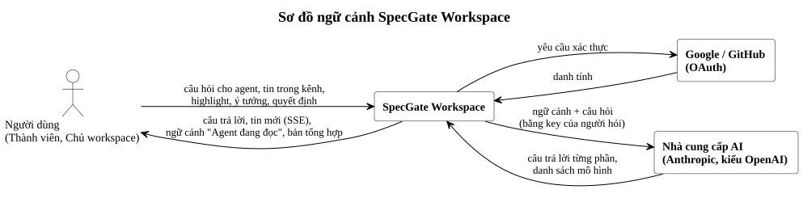
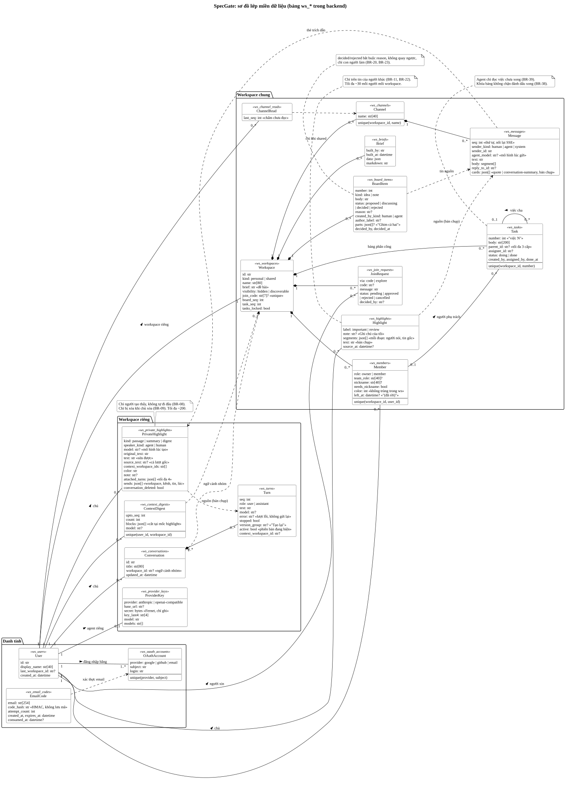
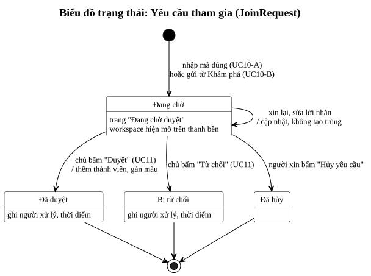
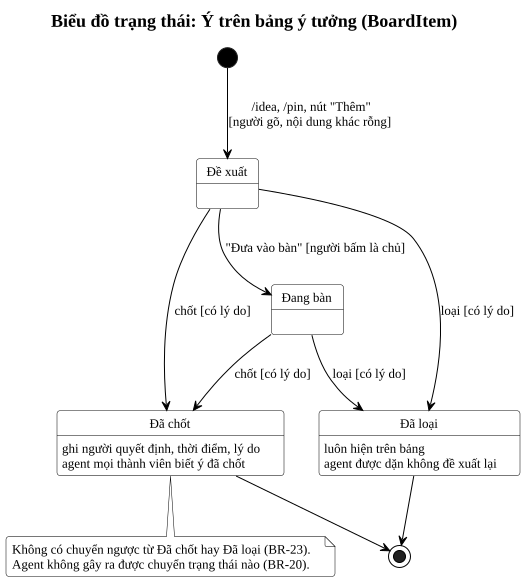

# Đặc tả yêu cầu phần mềm (Software Requirements Specification)

## cho SpecGate Workspace (Sàng Ý), bản phát hành 1

Phiên bản 1.1, bản duyệt
Người lập: Nhóm SpecGate
Ngày 21/11/2026

---

## Mục lục

- [Lịch sử sửa đổi](#lịch-sử-sửa-đổi)
- [1. Giới thiệu (Introduction)](#1-giới-thiệu-introduction)
- [2. Mô tả tổng quát (Overall Description)](#2-mô-tả-tổng-quát-overall-description)
- [3. Các tính năng hệ thống (System Features)](#3-các-tính-năng-hệ-thống-system-features)
- [4. Yêu cầu dữ liệu (Data Requirements)](#4-yêu-cầu-dữ-liệu-data-requirements)
- [5. Yêu cầu giao tiếp bên ngoài (External Interface Requirements)](#5-yêu-cầu-giao-tiếp-bên-ngoài-external-interface-requirements)
- [6. Thuộc tính chất lượng (Quality Attributes)](#6-thuộc-tính-chất-lượng-quality-attributes)
- [Phụ lục A: Mô hình phân tích (Analysis Models)](#phụ-lục-a-mô-hình-phân-tích-analysis-models)

## Lịch sử sửa đổi

| Người sửa | Ngày | Lý do thay đổi | Phiên bản |
| --- | --- | --- | --- |
| Nhóm SpecGate | 13/11/2026 | Bản nháp đầu | 1.0 nháp 1 |
| Nhóm SpecGate | 18/11/2026 | Theo `flow.md` đã chốt; trình bày theo mẫu SRS của Wiegers, cùng nội dung với `SRS.md` 0.3 | 1.0 bản duyệt |
| Nhóm SpecGate | 21/11/2026 | Theo website đang chạy, cùng nội dung với `SRS.md` 0.4: đăng nhập bằng mã email, Google Gemini, bảng phân công; bỏ phần dữ liệu còn sót của tính năng đã gỡ (thẻ stats/task, trạng thái chạy) | 1.1 bản duyệt |

---

## 1. Giới thiệu (Introduction)

### 1.1. Mục đích (Purpose)

Tài liệu đặc tả các yêu cầu chức năng và phi chức năng của bản phát hành 1 của SpecGate Workspace. Tài liệu dành cho các thành viên dự án sẽ cài đặt và kiểm chứng hệ thống, và cho giảng viên đánh giá đồ án. Trừ khi ghi khác, mọi yêu cầu ở đây đều cam kết cho bản 1.

### 1.2. Quy ước tài liệu (Document Conventions)

- Yêu cầu chức năng viết theo nhãn phân cấp `Tính năng.Nhóm.Yêu cầu`, ví dụ `Join.Code.Normalize`. Cuối mỗi yêu cầu, mã trong ngoặc là mã yêu cầu tương ứng trong [SRS.md](SRS.md) (ví dụ `FR-58`), để truy vết với Test Plan và biểu đồ.
- Mức ưu tiên: **Cao** là bắt buộc trong bản 1 (mức M của SRS.md); **Trung bình** là bản tối thiểu trong bản 1 (mức T); **Thấp** là làm sau (mức S, không cam kết cho bản 1).
- Mã quy tắc nghiệp vụ `BR-nn` theo [business-rules.md](business-rules.md); mã ca sử dụng `UCnn` và mã luồng theo [use-cases.md](use-cases.md).
- "Hệ thống" là SpecGate Workspace; "agent" là mô hình AI một người chọn sau khi nhập API key.

### 1.3. Phạm vi dự án và tính năng sản phẩm (Project Scope and Product Features)

SpecGate Workspace cho phép các thành viên một nhóm, mỗi người dùng một agent AI riêng bằng API key của mình, chuyển ngữ cảnh giữa chat riêng với agent và kênh nhóm mà không phải copy và dán: highlight đoạn đáng giá rồi gửi vào kênh kèm tên người nói, agent tự đọc tin của chủ nó, tin của người khác chỉ vào agent qua highlight cho agent. Nhóm ghi quyết định trên bảng ý tưởng kèm lý do, và chia việc trên bảng phân công. Mô tả chi tiết, mục tiêu nghiệp vụ và phạm vi từng bản phát hành nằm trong [Tài liệu Tầm nhìn và Phạm vi](vision-and-scope.md) [1]. Bản 1 gồm các tính năng FE-1 đến FE-7, với FE-3 (tóm tắt hội thoại cho nhóm) ở bản tối thiểu.

### 1.4. Tài liệu tham khảo (References)

1. Nhóm SpecGate. *Tầm nhìn và Phạm vi SpecGate Workspace*, [docs/vision-and-scope.md](vision-and-scope.md).
2. Nhóm SpecGate. *Cách website hoạt động*, [docs/flow.md](flow.md).
3. Nhóm SpecGate. *SpecGate Workspace: Đặc tả yêu cầu phần mềm 0.4*, [docs/SRS.md](SRS.md).
4. Nhóm SpecGate. *Ca sử dụng*, [docs/use-cases.md](use-cases.md); *Quy tắc nghiệp vụ*, [docs/business-rules.md](business-rules.md).
5. Nhóm SpecGate. *API của SpecGate Workspace*, [backend/WORKSPACE_API.md](../backend/WORKSPACE_API.md).
6. Nhóm SpecGate. *Quy ước cho người và agent viết mã*, [AGENTS.md](../AGENTS.md).
7. Nhóm SpecGate. *Kế hoạch kiểm thử*, [docs/testplan.md](testplan.md).

---

## 2. Mô tả tổng quát (Overall Description)

### 2.1. Góc nhìn sản phẩm (Product Perspective)

SpecGate Workspace là một hệ thống mới, thay cho cách làm hiện tại: dùng song song các trang chat riêng của từng nhà cung cấp AI cộng với một ứng dụng chat nhóm, và copy, dán qua lại giữa chúng. Hình 1 là sơ đồ ngữ cảnh của bản 1: hệ thống giao tiếp với người dùng qua trình duyệt, với Google và GitHub để xác thực, với máy chủ gửi thư để gửi mã đăng nhập qua email, và với các nhà cung cấp AI để gọi agent bằng key của từng người. Hệ thống dự kiến phát triển qua nhiều bản, thêm mời thành viên qua email, sửa và xóa tin, lệnh `/check`.

*Hình 1. Sơ đồ ngữ cảnh của bản 1. Mã nguồn: [context-diagram.puml](../uml/vision/context-diagram.puml)*

### 2.2. Các lớp người dùng và đặc điểm (User Classes and Characteristics)

| Lớp người dùng | Đặc điểm |
| --- | --- |
| Thành viên (lớp ưu tiên) | Sinh viên hoặc nhà nghiên cứu trong một nhóm 3–6 người cùng làm đồ án hay nghiên cứu, mỗi người dùng một agent riêng (Claude, DeepSeek, ChatGPT…) bằng API key của mình. Dùng hằng ngày trong giai đoạn lên ý tưởng: chat với agent, highlight, gửi vào kênh, highlight cho agent, thêm và chốt ý. Quen chat trên trang của nhà cung cấp; cần thao tác highlight nhanh, không tốn công hơn copy và dán. |
| Chủ workspace | Một thành viên đã tạo workspace; thường là trưởng nhóm. Ngoài quyền thành viên: duyệt yêu cầu tham gia, đưa ý vào bàn, `/summarize`, `/brief`, sửa đề bài, đổi mã, tạo kênh, xóa thành viên. Mỗi người làm chủ tối đa khoảng 10 workspace. |
| Người dùng chưa vào nhóm | Đã đăng nhập, có workspace riêng, dùng SpecGate như một trang chat với agent của mình, hoặc đang chờ được duyệt vào một nhóm. |
| Khách | Chưa đăng nhập; chỉ vào được trang đăng nhập. |

### 2.3. Môi trường vận hành (Operating Environment)

**OE-1:** Hệ thống chạy đúng trên các trình duyệt desktop bản mới: Google Chrome, Microsoft Edge, Mozilla Firefox, Apple Safari. Bố cục co giãn tới độ rộng 390 px.

**OE-2:** Phần giao diện chạy trên Node.js 24 (Next.js 16, React 19); phần máy chủ chạy trên Python 3.13 trở lên (FastAPI, SQLAlchemy 2); cả hai đóng gói bằng Docker và chạy bằng Docker Compose trên máy chủ Linux.

**OE-3:** CSDL là SQLite khi phát triển và kiểm thử; Postgres 15 trở lên (Supabase) khi triển khai.

**OE-4:** Người dùng truy cập qua Internet bằng HTTPS; máy chủ cần kết nối ra Internet tới Google, GitHub, máy chủ gửi thư (SMTP) và các nhà cung cấp AI.

### 2.4. Ràng buộc thiết kế và cài đặt (Design and Implementation Constraints)

**CO-1:** Mã nguồn, tài liệu và quy trình tuân theo [AGENTS.md](../AGENTS.md): cấu trúc theo tính năng, tên bằng tiếng Anh, mọi chữ hiển thị nằm trong tệp ngôn ngữ (`locales/vi.json`, `locales/en.json`), Conventional Commits.

**CO-2:** Mọi lời gọi mô hình AI đi qua máy chủ SpecGate, không gọi từ trình duyệt.

**CO-3:** Chỉ hai bộ chuyển đổi mô hình: Anthropic Messages API và định dạng kiểu OpenAI (`/models`, `/chat/completions`).

**CO-4:** API có phiên bản trong đường dẫn `/api/v1`; lỗi trả về dạng `{"error": {"code", "message", "details"}}`.

**CO-5:** Chỉ đăng nhập bằng OAuth Google và GitHub, hoặc mã một lần gửi qua email; không có mật khẩu riêng.

**CO-6:** Máy chủ chạy một tiến trình; bộ phát tin thời gian thực nằm trong tiến trình.

**CO-7:** Giao diện mặc định tiếng Việt.

### 2.5. Giả định và phụ thuộc (Assumptions and Dependencies)

**AS-1:** Người dùng tự có API key hợp lệ và tự chịu chi phí của key đó.

**AS-2:** Người dùng có tài khoản Google, GitHub, hoặc một địa chỉ email nhận được thư, và có Internet khi làm việc.

**DE-1:** Hoạt động của hệ thống phụ thuộc OAuth của Google, GitHub, máy chủ gửi thư (SMTP) và API của các nhà cung cấp AI.

---

## 3. Các tính năng hệ thống (System Features)

### 3.1. Tài khoản và Trang chủ (FE-1)

#### 3.1.1. Mô tả

Người dùng vào website bằng tài khoản Google hoặc GitHub có sẵn, hoặc bằng mã một lần gửi tới email; lần đầu hệ thống tạo tài khoản kèm workspace riêng. Sau khi đăng nhập, người dùng tự chọn nơi muốn vào từ một Trang chủ gọn, và biết workspace nào có việc cần làm nhờ dấu báo ở thanh bên. Ca sử dụng: UC01, UC02. Ưu tiên = Cao.

#### 3.1.2. Yêu cầu chức năng

| Nhãn | Yêu cầu |
| --- | --- |
| **Auth.Guard** | Mọi trang trừ trang đăng nhập yêu cầu đăng nhập. Chưa đăng nhập thì hệ thống chuyển về trang đăng nhập, ghi nhớ trang định mở và quay lại đúng trang đó sau khi đăng nhập. (FR-01) |
| **Auth.Provider** | Hệ thống có ba cách đăng ký và đăng nhập: Google và GitHub qua trang chọn tài khoản của nhà cung cấp, với tham số `state` được ký để chống giả mạo; và mã một lần gửi qua email. (FR-02) |
| **Auth.Email.Show** | Trang đăng nhập có ô email nhận mã khi máy chủ đã cấu hình gửi thư; chưa cấu hình thì ẩn. (FR-111) |
| **Auth.Email.Code** | Mã gồm 6 chữ số, dùng một lần, hết hạn sau 10 phút, chỉ lưu dạng băm; gửi mã mới làm mã cũ hết hiệu lực. (FR-112, BR-34) |
| **Auth.Email.Account** | Email đã có tài khoản thì đăng nhập; email mới thì hỏi tên hiển thị (tối đa 40 ký tự) rồi tạo tài khoản và workspace riêng. (FR-113) |
| **Auth.Email.Limit** | Gửi mã cách nhau ít nhất 60 giây, tối đa 5 mã mỗi giờ cho một email; sai 5 lần thì mã hết hiệu lực; mã sai và hết hạn cùng một câu báo; câu trả lời khi gửi mã không lộ email đã có tài khoản hay chưa. (FR-114, BR-34) |
| **Auth.SignUp** | Lần đầu một danh tính đăng nhập, hệ thống tạo tài khoản, workspace riêng, rồi mở màn nhập key kèm lời chào. (FR-03) |
| **Auth.SignIn** | Danh tính đã đăng ký thì hệ thống đăng nhập và mở Trang chủ; không bao giờ tạo tài khoản trùng cho cùng một danh tính. (FR-04) |
| **Auth.Cancel** | Khách hủy ở trang nhà cung cấp thì hệ thống quay về trang đăng nhập kèm thông báo "Bạn đã hủy đăng nhập" và không tạo gì. (FR-06) |
| **Auth.Session** | Hệ thống nhớ phiên 30 ngày trong cookie httpOnly và tính lại từ đầu mỗi lần người dùng quay lại. (FR-06, BR-26) |
| **Auth.SignOut** | Người dùng đăng xuất được từ menu tài khoản hoặc khung người dùng; mất kết nối thì phiên trên trình duyệt vẫn bị xóa. (FR-05) |
| **Auth.DevLogin** | Khi máy chủ chưa cấu hình OAuth và bật chế độ phát triển, hệ thống hiện màn giả lập chọn hoặc tạo tài khoản; tạo tài khoản mới phải xác thực email bằng mã (Google: email đăng nhập; GitHub: email nhập thêm); màn này không có khi đã cấu hình OAuth thật. (FR-115, UC01 1.A.A4) |
| **Home.Layout** | Trang chủ chỉ gồm thanh workspace, hình minh họa, câu chào, menu tài khoản và vài nút đi vào chức năng chính; logo ở mọi trang dẫn về Trang chủ. (FR-07, BR-03) |
| **Home.Actions** | Nút thứ nhất là "Chat với agent của tôi", hoặc "Nhập API key để có agent" khi chưa có key; nút thứ hai là "Vào làm việc với nhóm" (mở workspace chung dùng gần nhất), hoặc "Tìm nhóm để tham gia" khi chưa vào nhóm nào. (UC02) |
| **Home.Badges** | Thanh bên hiện chấm tin chưa đọc, chấm được nhắc tên, số yêu cầu đang chờ ở workspace mình làm chủ; tên kênh có chấm tin chưa đọc; workspace đang chờ duyệt hiện mờ. (FR-08, FR-60) |
| **Home.Badges.Refresh** | Dấu báo tự cập nhật không cần tải lại và tự mất khi đã đọc hoặc đã xử lý. (FR-09) |

### 3.2. Agent riêng (FE-2)

#### 3.2.1. Mô tả

Người dùng nhập API key của một nhà cung cấp, chọn mô hình làm agent riêng, rồi chat với agent trong workspace riêng: câu trả lời hiện dần, dừng được, tạo lại có phiên bản, quản lý danh sách hội thoại. Ca sử dụng: UC03, UC04. Ưu tiên = Cao.

#### 3.2.2. Yêu cầu chức năng

| Nhãn | Yêu cầu |
| --- | --- |
| **Key.Provider** | Người dùng chọn nhà cung cấp Anthropic hoặc kiểu OpenAI; với kiểu OpenAI phải nhập địa chỉ API, ô địa chỉ gợi ý OpenAI, Google Gemini, OpenRouter, DeepSeek, Groq. Địa chỉ trỏ vào mạng nội bộ bị từ chối trừ khi máy chủ cho phép. (FR-10, FR-116) |
| **Key.Verify** | Hệ thống kiểm key ngay với nhà cung cấp; hợp lệ thì lưu key đã mã hóa và hiện danh sách mô hình chat được để chọn (bỏ mô hình tạo vector, tạo ảnh, giọng nói…). (FR-11, FR-116) |
| **Key.Error** | Key sai, hết tiền, hoặc không kết nối được thì hệ thống báo bằng câu tiếng Việt dễ hiểu và không lưu key. (FR-12) |
| **Key.Note** | Màn nhập key ghi rõ gói thuê bao không phải API key. (FR-13) |
| **Key.Mask** | Sau khi lưu, giao diện chỉ hiện 4 ký tự cuối; không phản hồi API nào chứa key đầy đủ. (FR-14, BR-05) |
| **Key.Manage** | Đổi mô hình lưu ngay; đổi key ẩn sau nút "Đổi key"; xóa key có hộp xác nhận và giữ nguyên lịch sử hội thoại. (FR-14) |
| **Chat.List** | Danh sách hội thoại mới nhất ở trên; tạo, mở hội thoại; tên tự lấy từ câu hỏi đầu. (FR-15) |
| **Chat.Ask.Save** | Câu hỏi được lưu trước khi agent trả lời. (FR-17) |
| **Chat.Ask.History** | Mỗi lời gọi gửi kèm các lượt trước, bỏ lượt lỗi, chỉ lấy phiên bản đang hiện; hội thoại quá dài thì chỉ gửi các lượt gần nhất. (FR-16) |
| **Chat.Ask.Stream** | Câu trả lời hiện dần ngay khi nhà cung cấp trả chữ đầu tiên, có định dạng Markdown (đậm, tiêu đề, danh sách, bảng, khối code). (FR-17) |
| **Chat.Stop** | Có nút "Dừng" khi đang trả lời; phần đã viết được giữ và ghi "Đã dừng". (FR-18) |
| **Chat.Copy** | Có nút "Chép" dưới câu trả lời và nút chép riêng cho từng khối code. (FR-19) |
| **Chat.ProviderError** | Lỗi nhà cung cấp hiện ngay trong hội thoại thay cho câu trả lời; lượt lỗi không gửi lại cho agent ở các lần sau. (FR-20) |
| **Chat.Regenerate** | "Tạo lại" gọi lại mô hình cho cùng câu hỏi, giữ câu cũ thành phiên bản, có nút "‹ 1/2 ›"; lỗi khi tạo lại không ảnh hưởng phiên bản cũ. (FR-21) |
| **Chat.Version** | Agent chỉ đọc phiên bản đang hiển thị; highlight của phiên bản cũ vẫn gắn và mở đúng phiên bản đó. (FR-22) |
| **Chat.Rename** | Người dùng đổi tên hội thoại, tối đa 80 ký tự. (FR-23) |
| **Chat.Delete** | Xóa hội thoại có highlight riêng thì hỏi giữ hay xóa, mặc định giữ; giữ thì highlight ghi "hội thoại gốc đã bị xóa". (FR-23, BR-09) |
| **Chat.Privacy** | Chỉ chủ hội thoại mở được hội thoại; người khác nhận "không tìm thấy". (BR-07) |

### 3.3. Đưa kết quả từ workspace riêng vào kênh (FE-3)

#### 3.3.1. Mô tả

Người dùng highlight đoạn đáng giá trong hội thoại, lưu vào danh sách Highlight riêng, xem lại, rồi gửi vào kênh nhóm dưới dạng thẻ trích dẫn ghi rõ người nói và mức trung thực. Khi chưa lọc được ý, người dùng nhờ agent viết bản tóm tắt hội thoại cho nhóm. Không có nút gửi thẳng câu trả lời vào kênh. Ca sử dụng: UC05, UC07, UC08. Ưu tiên = Cao (tóm tắt hội thoại cho nhóm: Trung bình).

#### 3.3.2. Yêu cầu chức năng

| Nhãn | Yêu cầu |
| --- | --- |
| **PrivateHighlight.Select** | Bôi đen trong câu trả lời hoặc câu hỏi của mình (trong một lượt đã lưu) thì hiện thanh chọn màu và ghi chú. (FR-24) |
| **PrivateHighlight.Save** | Highlight được tô màu ngay và lưu nguyên văn, người nói, tên mô hình lúc tạo, lượt gốc, ngữ cảnh nhóm lúc agent viết; hệ thống báo "Chưa có gì được gửi vào nhóm". (FR-25, FR-26) |
| **PrivateHighlight.List** | Danh sách xếp theo thời gian, lọc theo màu, hội thoại, loại, đã gửi hay chưa, tìm theo chữ; mỗi mục hiện các lần đã gửi và nhãn ngữ cảnh. (FR-27) |
| **PrivateHighlight.Open** | Bấm một highlight mở đúng hội thoại, đúng chỗ. (FR-28) |
| **PrivateHighlight.Edit** | Sửa nội dung, màu, ghi chú; sửa chữ của agent thì báo trước thẻ sẽ ghi "(‹tên› đã chỉnh)". (FR-29, BR-12) |
| **PrivateHighlight.Cleanup** | Xóa từng mục; "Dọn dẹp" xóa nhiều mục theo màu, hội thoại hoặc đã gửi, báo số đã xóa và còn lại. (FR-29) |
| **PrivateHighlight.Limit** | Tối đa khoảng 200 highlight riêng mỗi người; gần đủ thì nhắc dọn bớt; đủ thì không lưu thêm. (FR-30, BR-28) |
| **Send.Dialog** | Từ danh sách gửi được một hoặc nhiều mục vào một kênh: chọn workspace, kênh, viết thêm lời, sửa nội dung trước khi gửi. (FR-42) |
| **Send.Fidelity** | Hộp thoại hiện trước nhãn người nói theo ba mức: trọn câu giữ nhãn gốc; cắt giữa câu có "…" và "(trích một phần)"; xóa hoặc sửa chữ ở giữa ghi "(‹tên› đã chỉnh)". (FR-43, BR-12) |
| **Send.Post** | Tin hiện dưới tên người gửi, mỗi highlight là một thẻ trích dẫn bản chụp ghi người nói; tin giữ tên mô hình lúc gửi. (FR-44, BR-13, BR-15) |
| **Send.Resend** | Gửi lại vào đúng kênh đã gửi thì nhắc và yêu cầu xác nhận. (FR-45) |
| **Send.CrossGroup** | Gửi sang workspace khác với ngữ cảnh lúc agent viết thì cảnh báo có thể chứa thông tin của nhóm đó và yêu cầu xác nhận. (FR-46) |
| **Send.Log** | Danh sách Highlight riêng ghi từng lần gửi: workspace, kênh, thời điểm. (FR-47) |
| **Send.Mention** | Gõ `@` trong ô soạn có mục "Highlight của tôi" đứng đầu; bảng chọn lọc theo màu, tìm theo chữ, chèn nhiều thẻ vào một tin, bỏ được thẻ trước khi gửi. (FR-48, FR-49) |
| **Send.NotMember** | Không còn là thành viên workspace đích thì báo lỗi, không gửi; nội dung trống thì không cho gửi. (UC07 7.A.E1, 7.A.E2) |
| **Summary.Write** | "Tóm tắt cho nhóm" nhờ agent của người dùng viết theo khung bốn phần (vấn đề, hướng đã thử, điểm chưa chắc, câu hỏi cho nhóm), mỗi ý ghi rõ của ai. Ưu tiên = Trung bình. (FR-50) |
| **Summary.Keep** | Bản tóm tắt lưu vào Highlight riêng, không gửi ngay; key lỗi thì không lưu gì. Ưu tiên = Trung bình. (FR-51) |
| **Summary.Attach** | Đính kèm tối đa 4 lượt hỏi đáp gốc. Ưu tiên = Trung bình. (FR-52, BR-33) |
| **Summary.Card** | Trong kênh là thẻ riêng "Tóm tắt hội thoại của ‹tên›, do ‹agent› viết, chưa được lọc"; lượt gốc thu gọn trong thẻ. Ưu tiên = Trung bình. (FR-53, BR-31) |

### 3.4. Ngữ cảnh cho agent (FE-4)

#### 3.4.1. Mô tả

Thành viên chọn một workspace chung làm ngữ cảnh cho hội thoại riêng, để mỗi câu hỏi gửi kèm thông tin của nhóm; chọn những đoạn trong tin của người khác để agent của mình đọc, luôn kèm tên người nói. Ca sử dụng: UC06, UC13. Ưu tiên = Cao.

#### 3.4.2. Yêu cầu chức năng

| Nhãn | Yêu cầu |
| --- | --- |
| **Context.Choose** | Mỗi hội thoại có ô "Ngữ cảnh nhóm" chọn tối đa một workspace chung mình là thành viên; đổi hoặc bỏ bất cứ lúc nào; hội thoại mới chọn được trước câu đầu. (FR-31, BR-10) |
| **Context.Icon** | Hội thoại có ngữ cảnh nhóm có biểu tượng riêng trong danh sách. (FR-32) |
| **Context.Content** | Mỗi câu hỏi gửi kèm: đề bài; thành viên (tên, chủ, vai, agent); ý đã chốt và đã loại kèm lý do cùng lời dặn không đề xuất lại; tin của mình; highlight cho agent của mình. Không gửi tin nào khác của người khác. (FR-33, BR-11) |
| **Context.Fresh** | Ngữ cảnh được lấy mới ở mỗi câu hỏi. (FR-34) |
| **Context.Timeline** | Tin của mình và highlight xếp chung một dòng thời gian, mỗi mục ghi giờ, kênh, người nói và tin đang trả lời. (FR-35) |
| **Context.Panel** | Khung "Agent đang đọc" hiện đúng nội dung gửi cho agent; sửa được vai và bỏ được highlight ngay trong khung; màn hình hẹp thì thành ngăn kéo. (FR-36) |
| **Context.NotMember** | Không còn là thành viên thì hội thoại vẫn còn nhưng agent không nhận thông tin nhóm. (FR-37) |
| **Context.Limit** | Gửi nguyên văn khoảng 50 tin gần nhất của mình; tin cũ hơn tạm không gửi và khung ghi rõ số tin đang bị bỏ. (FR-38, BR-29) |
| **Context.Summary** | Bản `/summarize` không tính là tin của mình, kể cả khi mình là chủ. (BR-14) |
| **Digest.Confirm** | "Tóm tắt tin cũ" chỉ chạy khi người dùng bấm, sau khi cho biết số tin, số khối và số lần gọi agent. (FR-39) |
| **Digest.Blocks** | Tin cũ chia khối tại mốc giờ của từng highlight; khối dưới khoảng 5 tin giữ nguyên văn; mọi khối cần tóm tắt gửi trong một lần gọi; mỗi khối ghi khoảng thời gian. (FR-40, BR-29) |
| **Digest.Keep** | Bản tóm tắt tin cũ được lưu và gửi kèm thay cho tin cũ; lưu được vào Highlight riêng để chia sẻ; key lỗi thì giữ bản cũ. (FR-41) |
| **AgentHighlight.Select** | Bôi đen được trong tin, thẻ trích dẫn, thẻ tóm tắt của người khác; vùng chọn trải được qua nhiều tin liền nhau. (FR-77) |
| **AgentHighlight.Snap** | Vùng chọn tự bắt trọn từ, trọn dòng code, trọn ô bảng. (FR-78) |
| **AgentHighlight.Speakers** | Hộp thoại hiện từng đoạn kèm người nói đúng như nguồn. (FR-79, BR-31) |
| **AgentHighlight.Narrow** | Chỉ thu hẹp hai đầu hoặc bỏ đoạn, không sửa chữ; hiện trước câu agent sẽ đọc kèm "…" và "trích một phần". (FR-80, BR-22) |
| **AgentHighlight.Label** | Highlight có nhãn Quan trọng hoặc Cần xem xét và "Ghi chú của tôi" tách riêng; sửa được nhãn và ghi chú về sau. (FR-81) |
| **AgentHighlight.Own** | Tin của chính mình không highlight được; vùng chọn có lẫn thì phần đó bị bỏ kèm lời nhắc. (FR-82) |
| **AgentHighlight.Private** | Chỉ người tạo thấy highlight: trong danh sách "Highlight cho agent" theo workspace, và vệt phấn trong kênh. (FR-83) |
| **AgentHighlight.Limit** | Tối đa khoảng 30 highlight mỗi người mỗi workspace; đủ thì nhắc tự bỏ bớt, không tự xóa. (FR-84, BR-28) |

### 3.5. Workspace chung và tham gia (FE-5)

#### 3.5.1. Mô tả

Người dùng tạo workspace cho nhóm; người khác xin vào bằng mã hoặc qua trang Khám phá và chờ chủ duyệt; thành viên quản lý tên, vai, tư cách; chủ cấu hình workspace; cả nhóm chia việc trên bảng phân công. Ca sử dụng: UC09, UC10, UC11, UC16. Ưu tiên = Cao.

#### 3.5.2. Yêu cầu chức năng

| Nhãn | Yêu cầu |
| --- | --- |
| **Workspace.Create** | Tạo workspace với tên, đề bài, chế độ hiển thị; workspace mới có kênh "chung" và mã tham gia; người tạo là chủ; không cần API key. (FR-54, FR-56) |
| **Workspace.Create.Validate** | Tên, đề bài bắt buộc; tên không trùng workspace khác mình làm chủ; làm chủ tối đa khoảng 10. (FR-55, BR-28) |
| **Join.Code.Format** | Mã tham gia 7 ký tự chữ in hoa và số, không dùng O, 0, I, L, 1; mọi thành viên xem và chép được. (FR-57, BR-27) |
| **Join.Code.Normalize** | Nhập mã chấp nhận chữ thường, dấu cách, gạch nối; mã sai hoặc đã đổi thì báo không hợp lệ và gợi ý xin mã mới. (FR-58) |
| **Join.Request** | Nhập mã hợp lệ tạo yêu cầu và mở trang "Đang chờ duyệt"; đã là thành viên thì mở thẳng workspace. (FR-59) |
| **Join.Request.Single** | Mỗi người tối đa một yêu cầu đang chờ cho mỗi workspace; xin lại thì cập nhật yêu cầu cũ; người xin tự hủy được. (FR-61) |
| **Join.Wait** | Được duyệt thì trang chờ tự chuyển vào workspace không cần tải lại; bị từ chối thì hiện "Yêu cầu bị từ chối". (FR-59) |
| **Join.Explore** | Trang Khám phá liệt kê workspace "ai cũng tìm thấy", tìm theo tên hoặc đề bài, mỗi mục hiện quan hệ (chưa tham gia, đang chờ, đã là thành viên); workspace ẩn không hiện. (FR-62, FR-63) |
| **Join.Explore.Request** | Gửi yêu cầu kèm lời nhắn từ Khám phá; mở workspace chưa là thành viên thì chuyển sang Khám phá chọn sẵn workspace đó. (FR-64, BR-18) |
| **Approve.Page** | Chỉ chủ thấy trang "Yêu cầu tham gia"; người khác mở thì đưa về kênh "chung"; trang tự cập nhật. (FR-65) |
| **Approve.Decide** | Mỗi yêu cầu hiện người xin, cách xin, lời nhắn; có Duyệt, Từ chối và lịch sử ghi kết quả, người xử lý; yêu cầu đã xử lý không xử lý lại. (FR-66) |
| **Approve.Color** | Thành viên mới được gán màu ảnh đại diện chưa ai dùng trong workspace. (FR-67, BR-32) |
| **Approve.Name** | Tên trùng (kể cả người đã rời) thì người mới nhận tên tạm và được yêu cầu đặt biệt danh; người cũ vào lại lấy lại tên cũ. (FR-68, FR-102, BR-25) |
| **Member.List** | Mọi thành viên xem danh sách: màu, tên, quyền, vai, tài khoản gốc, agent hoặc "chưa nhập key"; không hiện key. (FR-98) |
| **Member.Name** | Tên trong workspace duy nhất, kể cả so với người đã rời; mỗi người tự đổi tên của mình. (FR-99, BR-25) |
| **Member.Role** | Vai trong nhóm tối đa 40 ký tự, chỉ người đó sửa được. (FR-100, BR-32) |
| **Member.Leave** | Thành viên (không phải chủ) rời được; chủ xóa được thành viên; cả hai có hộp xác nhận; người đã rời hiện "‹tên› (đã rời)" ở mọi nơi. (FR-101, FR-102) |
| **Settings.Brief** | Chủ sửa đề bài (không được trống); thành viên khác thấy dạng chỉ đọc; agent mọi thành viên đọc đề bài mới từ câu hỏi sau. (FR-103) |
| **Settings.Code** | Chủ đổi mã tham gia; mã cũ hết hiệu lực ngay. (FR-104, BR-18) |
| **Settings.Channel** | Chủ tạo kênh mới với tên hợp lệ (chữ thường không dấu, số, gạch ngang), không trùng. (FR-105) |
| **Settings.Visibility** | Chủ đổi tên và chế độ hiển thị của workspace. (FR-106) |
| **Tasks.Board** | Mỗi workspace chung có trang "Bảng phân công"; mỗi việc có số riêng ghi "việc N", mô tả tối đa 200 ký tự, người phụ trách hoặc "chưa có người phụ trách", trạng thái Đang làm hoặc Xong. (FR-117, BR-35) |
| **Tasks.Tree** | Việc xếp thành cây tối đa 3 cấp; việc con nằm trong khung việc cha; việc cha hiện số việc con đã xong; mở, thu gọn được. (FR-118, BR-37) |
| **Tasks.Member** | Thành viên tạo việc đứng tên mình (cấp cao nhất hoặc việc con) và nhận việc chưa có người phụ trách, chưa xong; không giao cho người khác. (FR-119, BR-36) |
| **Tasks.Owner** | Chủ giao việc cho bất kỳ thành viên nào, kể cả chính mình, hoặc để trống; sửa, giao lại, xóa việc; xóa kèm mọi việc con, có hộp xác nhận. (FR-120, BR-36, BR-37) |
| **Tasks.Status** | Người phụ trách đánh dấu xong hoặc mở lại việc của mình; chủ đổi trạng thái việc của người khác khi bảng chưa khóa. (FR-121, BR-36) |
| **Tasks.Command** | `/task <mô tả>` tạo việc cấp cao nhất đứng tên người gõ; chủ thêm `@tên` để giao; mỗi việc mới có tin hệ thống. `/task` trong lời agent không chạy. (FR-122, BR-35) |
| **Tasks.Lock** | Chủ khóa, mở khóa bảng; khi khóa không ai thêm, sửa, xóa, giao lại, nhận việc, kể cả bằng `/task`; người phụ trách vẫn đánh dấu xong; mỗi lần khóa, mở có tin hệ thống ở kênh "chung". (FR-123, BR-38) |
| **Tasks.Leave** | Thành viên rời hoặc bị xóa thì việc chưa xong của họ thành chưa có người phụ trách, kể cả khi bảng khóa; kênh "chung" có tin liệt kê. (FR-124, BR-38) |
| **Tasks.Context** | Ngữ cảnh agent của mọi thành viên gồm các việc chưa xong kèm người phụ trách và việc cha; khung "Agent đang đọc" hiện đúng mục này. (FR-125, FR-126, BR-39) |

### 3.6. Kênh chat thời gian thực (FE-6)

#### 3.6.1. Mô tả

Thành viên trao đổi trong kênh theo thời gian thực, dùng lệnh để thao tác với bảng và tổng hợp; khi mạng chập chờn, công sức không bị mất. Ca sử dụng: UC12, UC17. Ưu tiên = Cao.

#### 3.6.2. Yêu cầu chức năng

| Nhãn | Yêu cầu |
| --- | --- |
| **Channel.Realtime** | Tin mới hiện cho mọi người đang mở kênh dưới 2 giây, không cần tải lại. (FR-69) |
| **Channel.Types** | Bốn loại tin phân biệt được bằng mắt: tin của người, thẻ trích dẫn, thẻ tóm tắt hội thoại, tin hệ thống. (FR-70) |
| **Channel.Identity** | Ảnh đại diện màu riêng; thẻ lời agent mang màu và chữ cái đầu của chủ agent; rê chuột vào tên thấy tài khoản gốc (tên GitHub, hoặc email đã che bớt). (FR-71) |
| **Channel.Suggest** | Gõ `@` gợi ý thành viên và "Highlight của tôi"; gõ `/` gợi ý lệnh theo mô-đun của workspace; chọn bằng chuột hoặc bàn phím. (FR-72) |
| **Channel.Commands** | Hỗ trợ `/idea`, `/note`, `/pin`, `/decide`, `/summarize`, `/brief`, `/help`; sai cú pháp thì trả tin hướng dẫn; không đủ quyền thì trả tin "đây là quyền của chủ workspace". (FR-73) |
| **Channel.HumanOnly** | Lệnh chỉ thực hiện khi do người gõ, không thực hiện từ nội dung lời agent. (FR-74, BR-20) |
| **Channel.NoAutoAgent** | Không agent nào tự trả lời trong kênh; nhắc tên người hay agent không kích hoạt lời gọi mô hình. (FR-75, BR-19) |
| **Channel.AgentList** | Cột bên của workspace liệt kê agent của từng thành viên. (FR-76) |
| **Channel.Empty** | Tin trống không được gửi. (UC12 12.0.E1) |
| **Network.Banner** | Mất kết nối thì hiện dải "Mất kết nối, đang thử kết nối lại" và khóa nút gửi. (FR-107) |
| **Network.Draft** | Chữ đang soạn được giữ trên trình duyệt qua mất mạng và tải lại trang. (FR-108) |
| **Network.Resume** | Tự kết nối lại khi có mạng; kênh hiện bù tin đã lỡ theo số thứ tự tin cuối đã nhận. (FR-109) |
| **Network.Partial** | Phần câu trả lời đã nhận được giữ khi mất mạng. (FR-110) |

### 3.7. Bảng ý tưởng và tổng hợp (FE-7)

#### 3.7.1. Mô tả

Nhóm ghi ý, chủ chọn ý để bàn, nhóm chốt hoặc loại ý kèm lý do; chủ tóm tắt kênh và dựng bản tổng hợp tải được dạng Markdown. Ca sử dụng: UC14, UC15. Ưu tiên = Cao.

#### 3.7.2. Yêu cầu chức năng

| Nhãn | Yêu cầu |
| --- | --- |
| **Board.Columns** | Bảng có bốn cột Đề xuất, Đang bàn, Đã chốt, Đã loại và một mục ghi chú; trạng thái phân biệt bằng cột và chữ, không bằng màu. (FR-85) |
| **Board.Add** | Thêm ý bằng `/idea` hoặc nút trên trang Bảng; thêm ghi chú bằng `/note`; ý mới luôn ở cột Đề xuất; nội dung trống thì không thêm. (FR-86) |
| **Board.Pin** | `/pin` khi trả lời một tin ghim theo nội dung tin: chỉ lời người thì ghim lời; chỉ một thẻ thì ghim thẻ giữ người nói và nhãn; có cả hai thì hỏi ghim phần nào, ghim cả hai tạo một ý nhiều phần mỗi phần một người nói; không trả lời tin nào thì nhắc. (FR-87, BR-31) |
| **Board.Card** | Mỗi thẻ ghi số thứ tự, ai đưa lên (người hay agent của ai), thời điểm, tin và kênh nguồn. (FR-88) |
| **Board.Discuss** | Chỉ chủ chuyển ý từ Đề xuất sang Đang bàn. (FR-89, BR-21) |
| **Board.Decide** | Chốt hoặc loại bắt buộc lý do, qua nút trên thẻ hoặc `/decide #‹số› chốt\|loại ‹lý do›`; hộp thoại hiện lệnh tương đương. (FR-90, BR-23) |
| **Board.Decide.Log** | Ghi người quyết định và thời điểm; kênh có tin hệ thống về quyết định. (FR-91) |
| **Board.Final** | Ý đã chốt hoặc đã loại không quay lại cột khác; cột Đã loại luôn hiển thị. (FR-92, BR-23) |
| **Summarize.Owner** | `/summarize` chỉ chủ dùng được; agent của chủ chỉ đọc đề bài và tin của chính kênh. (FR-93, BR-24) |
| **Summarize.Post** | Bản tóm tắt hiện dưới tên agent của chủ, mỗi ý ghi của ai, ghi "chưa ai lọc"; key lỗi thì tin báo lỗi trong kênh. (FR-94) |
| **Summarize.NoKey** | Chủ chưa có key thì nhắc nhập key; bản tóm tắt không tự vào ngữ cảnh agent của chủ. (FR-95, BR-14) |
| **Brief.Build** | `/brief` hoặc nút trên trang Bản tổng hợp (chỉ chủ) dựng bản tổng hợp từ bảng: đề bài, đã chốt kèm lý do và người chốt, đã loại kèm lý do, đang bàn, ghi chú; ghi thời điểm dựng, người dựng, số thành viên. (FR-96) |
| **Brief.Export** | Mọi thành viên xem bản mới nhất, sao chép, tải dạng Markdown; chưa có bản nào thì hiện trạng thái rỗng kèm hướng dẫn. (FR-97) |

## 4. Yêu cầu dữ liệu (Data Requirements)

### 4.1. Mô hình dữ liệu logic (Logical Data Model)

Hình 2 là mô hình dữ liệu của bản 1: mỗi lớp là một bảng `ws_*` trong `backend/app/ws/models.py`.

*Hình 2. Mô hình dữ liệu logic của bản 1. Mã nguồn: [domain.puml](../uml/class/domain.puml)*

### 4.2. Từ điển dữ liệu (Data Dictionary)

| Phần tử dữ liệu | Mô tả | Thành phần hoặc kiểu | Độ dài | Giá trị |
| --- | --- | --- | --- | --- |
| user | một người có tài khoản SpecGate | user id + display name + 1:m{oauth account} + last workspace id | | |
| user id | mã duy nhất của người dùng | chuỗi `u_` + 16 ký tự hex | 18 | |
| display name | tên hiển thị của tài khoản, lấy từ nhà cung cấp danh tính | chữ | 40 | |
| oauth account | danh tính Google, GitHub hoặc email gắn với một người dùng | provider + subject + login | | (provider, subject) duy nhất |
| provider | nhà cung cấp danh tính | chữ | 6 | google, github, email |
| login | email Google, tên GitHub, hoặc địa chỉ email, để hiển thị tài khoản gốc | chữ và số | 254 | email được che bớt khi hiển thị cho người khác |
| email code | mã đăng nhập một lần gửi qua email | email + code hash + attempt count + created at + expires at + consumed at | | mã mới nhất chưa dùng, chưa hết hạn là mã có hiệu lực |
| code hash | HMAC-SHA256 của mã 6 chữ số | chữ hex | 64 | mã gốc không lưu |
| attempt count | số lần nhập sai | số nguyên | | 5 lần thì mã hết hiệu lực |
| workspace | một không gian làm việc | workspace id + kind + name + brief + visibility + owner id + join code + tasks locked + 1:m{member} + 1:m{channel} + 1:m{task} | | |
| tasks locked | bảng phân công đang khóa | boolean | | mặc định không khóa |
| kind | loại workspace | chữ | 8 | personal, shared |
| name | tên workspace | chữ | 80 | không trùng với workspace khác cùng chủ |
| brief | đề bài của workspace chung | chữ | 4000 | bắt buộc với workspace chung |
| visibility | chế độ hiển thị ở trang Khám phá | chữ | 12 | hidden, discoverable; mặc định hidden |
| join code | mã tham gia hiện hành | chữ in hoa và số | 7 | bảng chữ `ABCDEFGHJKMNPQRSTUVWXYZ23456789`; duy nhất |
| member | tư cách thành viên của một người trong một workspace | role + team role + nickname + color + joined at + left at | | (workspace, user) duy nhất |
| role | quyền trong workspace | chữ | 6 | owner, member |
| team role | vai trong nhóm do thành viên tự ghi | chữ | 40 | tùy chọn |
| nickname | tên trong workspace khi khác tên hiển thị | chữ | 40 | duy nhất trong workspace, kể cả người đã rời |
| color | chỉ số màu ảnh đại diện | số nguyên | | không trùng trong workspace khi bảng màu còn đủ |
| left at | thời điểm rời hoặc bị xóa | ngày giờ UTC | | rỗng = đang là thành viên |
| join request | yêu cầu tham gia | via + code + message + status + decided by + decided at | | tối đa một yêu cầu pending mỗi (workspace, user) |
| join request status | trạng thái yêu cầu | chữ | 9 | pending, approved, rejected, cancelled |
| provider key | API key và agent riêng của một người | provider + base url + secret + key last4 + model + 1:m{model} | | tối đa một mỗi người |
| secret | API key đã mã hóa Fernet | nhị phân | | chỉ ghi; không bao giờ trả ra |
| key last4 | 4 ký tự cuối của key để hiển thị | chữ và số | 4 | |
| model | mã mô hình đang dùng làm agent | chữ | | phải có trong danh sách mô hình của key |
| conversation | hội thoại với agent riêng | conversation id + owner id + title + workspace id + 1:m{turn} | | |
| title | tên hội thoại | chữ | 80 | mặc định lấy từ câu hỏi đầu |
| turn | một lượt hỏi hoặc trả lời | seq + role + text + model + error + stopped + version group + active + context workspace id | | |
| active | phiên bản đang hiển thị của một câu trả lời | boolean | | chỉ một phiên bản active trong mỗi version group |
| private highlight | đoạn người dùng giữ lại từ hội thoại của mình | kind + speaker kind + model + original text + text + source text + context workspace ids + color + note + 0:4{attached turn} + 0:m{send} | | tối đa khoảng 200 mỗi người |
| private highlight kind | loại mục | chữ | 8 | passage, summary, digest |
| highlight color | màu do người dùng chọn | chữ | 6 | yellow, green, blue, pink, purple |
| send | một lần gửi highlight vào kênh | workspace id + channel id + message id + thời điểm | | |
| channel | kênh của workspace chung | name | 40 | chữ thường không dấu, số, gạch ngang; duy nhất trong workspace |
| message | tin trong kênh | seq + sender kind + sender id + agent model + text + body + reply to id + 0:m{card} | | |
| seq | thứ tự toàn cục của tin, dùng nối lại thời gian thực | số nguyên | | tăng dần |
| sender kind | loại người gửi | chữ | 6 | human, agent, system |
| card | bản chụp đi kèm tin | type + nội dung | | quote, conversation-summary |
| agent highlight | highlight cho agent | label + note + 1:m{segment} | | tối đa khoảng 30 mỗi người mỗi workspace |
| segment | một đoạn trong highlight cho agent | speaker + text + message id + run | | chữ là chuỗi con liền của tin gốc |
| label | nhãn của highlight cho agent | chữ | 9 | important, review |
| context digest | bản tóm tắt tin cũ của một người trong một workspace | upto seq + count + model + 1:m{block} | | (user, workspace) duy nhất |
| block | một khối tin cũ | first seq + last seq + from + to + count + verbatim + text | | khối dưới khoảng 5 tin verbatim |
| board item | một ý hoặc ghi chú trên bảng | number + kind + body + status + reason + created by + author label + parts + decided by + decided at | | (workspace, number) duy nhất |
| board item status | trạng thái ý | chữ | 10 | proposed, discussing, decided, rejected; decided, rejected bắt buộc reason |
| brief snapshot | bản tổng hợp | built by + built at + data + markdown | | bản mới nhất là bản hiển thị |
| task | một việc trên bảng phân công | number + body + parent id + assignee id + status + created by + assigned by + done at | | (workspace, number) duy nhất |
| task number | số của việc, ghi "việc N" | số nguyên | | tăng dần trong workspace, tách khỏi số ý |
| task body | mô tả việc | chữ | 200 | không được trống |
| parent id | việc cha | mã việc | | rỗng = việc cấp cao nhất; tối đa 3 cấp |
| task status | trạng thái việc | chữ | 5 | doing, done |
| session token | phiên đăng nhập trong cookie `sg_session` | user id + hạn, ký HMAC | | hạn 30 ngày |

### 4.3. Báo cáo (Reports)

#### 4.3.1. Bản tổng hợp (Brief)

| Mục | Nội dung |
| --- | --- |
| Mã báo cáo | SG-RPT-1 |
| Tên báo cáo | Bản tổng hợp |
| Mục đích | Nhóm có một văn bản tổng kết các quyết định của mình (đã chốt, đã loại kèm lý do, còn đang bàn) để nộp, báo cáo hoặc đưa vào bài viết |
| Ưu tiên | Cao |
| Người dùng | Chủ workspace dựng; mọi thành viên xem và tải |
| Nguồn dữ liệu | Đề bài, bảng ý tưởng (`ws_board_items`), thành viên |
| Tần suất và cách dùng | Dựng khi chủ gõ `/brief` hoặc bấm "Dựng"; nội dung là bản chụp tĩnh tại lúc dựng; hiển thị trên trình duyệt, sao chép hoặc tải tệp `.md` |
| Độ trễ | Bản tổng hợp hiện trong 3 giây sau khi bấm dựng |
| Bố cục | Văn bản Markdown một cột |
| Đầu và cuối | Đầu: tên workspace, thời điểm dựng, người dựng, số thành viên. Cuối: không có |
| Thân báo cáo | Đề bài; "Đã chốt": số ý, nội dung, lý do, người chốt; "Đã loại": số ý, nội dung, lý do; "Còn đang bàn": số ý, nội dung, người nêu; "Ghi chú". Thứ tự theo số ý |
| Dấu kết thúc | Không có |
| Tương tác | Bấm số ý mở thẻ trên trang Bảng ý tưởng |
| Hạn chế truy cập | Chỉ thành viên của workspace xem được; chỉ chủ dựng được |

### 4.4. Toàn vẹn, lưu giữ và hủy dữ liệu (Data Integrity, Retention, and Disposal)

**DI-1:** Hệ thống không tự xóa Highlight riêng, Highlight cho agent, hội thoại hay tin trong kênh; chúng chỉ bị xóa khi người có quyền xóa (BR-09, BR-28).

**DI-2:** Xóa một hội thoại xóa toàn bộ các lượt của nó; các thẻ đã gửi vào kênh từ hội thoại đó vẫn còn vì là bản chụp (BR-13).

**DI-3:** Thành viên rời workspace thì dòng thành viên được giữ (ghi `left at`) để giữ chỗ tên và hiển thị "(đã rời)" (BR-25).

**DI-4:** Xóa API key xóa bản mã của key; lịch sử hội thoại giữ nguyên.

**DI-5:** Yêu cầu tham gia đã xử lý được giữ trong lịch sử kèm kết quả và người xử lý.

**DI-6:** Bản tổng hợp cũ được giữ; trang hiển thị bản mới nhất.

**DI-7:** Thứ tự tin (`seq`), số ý trên bảng và số việc trên bảng phân công (`number`) không trùng và không đổi sau khi tạo.

**DI-8:** Xóa một việc trên bảng phân công xóa luôn mọi việc con (BR-37). Thành viên rời thì việc chưa xong của họ bỏ trống người phụ trách; việc đã xong giữ tên (BR-38).

**DI-9:** Mã đăng nhập email chỉ lưu dạng băm; mã đã dùng, hết hạn hoặc bị thay được giữ làm căn cứ giới hạn gửi (BR-34).

---

## 5. Yêu cầu giao tiếp bên ngoài (External Interface Requirements)

### 5.1. Giao diện người dùng (User Interfaces)

**UI-1:** Giao diện theo bố cục ba vùng: thanh workspace bên trái, nội dung ở giữa, cột phụ bên phải (khung "Agent đang đọc", danh sách agent, bảng thu gọn); cột phụ thành ngăn kéo khi màn hình hẹp.

**UI-2:** Mọi chữ hiển thị nằm trong tệp ngôn ngữ; mặc định tiếng Việt, có tiếng Anh.

**UI-3:** Thao tác chính dùng được chỉ bằng bàn phím (Tab, Enter, Esc, mũi tên trong gợi ý `@` và `/`); độ tương phản chữ đạt WCAG AA.

**UI-4:** Mỗi màn có trạng thái đang tải, rỗng và lỗi; thao tác xóa và rời có hộp xác nhận trong ứng dụng, không dùng hộp thoại mặc định của trình duyệt.

**UI-5:** Trạng thái không truyền đạt chỉ bằng màu: ý trên bảng phân biệt bằng cột và chữ; việc trên bảng phân công ghi "Xong" hay "Đang làm" và người phụ trách bằng chữ.

### 5.2. Giao tiếp phần mềm (Software Interfaces)

**SI-1: Nhà cung cấp AI**

- SI-1.1: Hệ thống lấy danh sách mô hình để kiểm key: Anthropic `GET /v1/models` với tiêu đề `x-api-key`; kiểu OpenAI `GET {base url}/models` với `Authorization: Bearer`.
- SI-1.2: Hệ thống gửi câu hỏi kèm lịch sử và ngữ cảnh, nhận câu trả lời từng phần: Anthropic `POST /v1/messages` (stream); kiểu OpenAI `POST {base url}/chat/completions` (stream).
- SI-1.3: Lỗi của nhà cung cấp được chuyển thành câu tiếng Việt cố định; nội dung lỗi gốc (có thể chứa key) không được ghi log hay trả ra.

**SI-2: Google và GitHub (OAuth 2.0)**

- SI-2.1: Chuyển người dùng tới trang cấp quyền với `state` đã ký; nhận `code` tại `/api/v1/auth/{provider}/callback`.
- SI-2.2: Đổi `code` lấy token, đọc danh tính (Google: `sub`, email, tên; GitHub: id, login, tên).

**SI-4: Máy chủ gửi thư (SMTP)**

- SI-4.1: Hệ thống gửi thư chứa mã đăng nhập qua SMTP cấu hình bằng `SMTP_HOST`, `SMTP_PORT`, `SMTP_USERNAME`, `SMTP_PASSWORD`, `SMTP_FROM_ADDRESS`; cổng 465 dùng TLS ngay từ đầu, cổng khác dùng STARTTLS.
- SI-4.2: Lỗi gửi thư được báo bằng câu tiếng Việt; log chỉ ghi loại lỗi, không ghi mã hay mật khẩu.

**SI-3: CSDL**

- SI-3.1: Hệ thống truy cập CSDL qua SQLAlchemy theo chuỗi kết nối `DATABASE_URL` (SQLite hoặc Postgres).

### 5.3. Giao tiếp phần cứng (Hardware Interfaces)

Chưa xác định giao tiếp phần cứng nào.

### 5.4. Giao tiếp truyền thông (Communications Interfaces)

**CI-1:** Trình duyệt giao tiếp với hệ thống qua HTTPS; giao diện chuyển mọi đường `/api/*` tới máy chủ.

**CI-2:** Tin mới trong kênh và câu trả lời của agent được đẩy tới trình duyệt bằng Server-Sent Events; kênh nối lại bằng tham số `after=<seq>` để nhận bù tin đã lỡ.

**CI-3:** Phiên đăng nhập gửi bằng cookie httpOnly `sg_session`.

**CI-4:** Email duy nhất hệ thống gửi là thư chứa mã đăng nhập; hệ thống không gửi tin nhắn hay email thông báo; mọi thông báo khác hiện trong ứng dụng (dấu báo ở thanh bên, trang chờ duyệt, tin hệ thống trong kênh).

---

## 6. Thuộc tính chất lượng (Quality Attributes)

### 6.1. Yêu cầu dễ dùng (Usability Requirements)

**USE-1:** Lỗi nhà cung cấp (key sai, hết tiền, quá giới hạn, mất kết nối) hiện thành câu tiếng Việt dễ hiểu. (NFR-09)

**USE-2:** Gửi một highlight riêng vào kênh cần không quá 3 thao tác kể từ danh sách Highlight riêng (chọn, "Gửi vào nhóm", Gửi), và không quá 4 thao tác bằng `@` từ ô soạn.

**USE-3:** 90% người dùng mới hoàn thành vòng "hỏi agent, highlight, gửi vào kênh" ngay lần đầu mà không cần hướng dẫn, đo trong buổi thử với người dùng.

**USE-4:** Mỗi màn có trạng thái đang tải, rỗng và lỗi. (NFR-10)

### 6.2. Yêu cầu hiệu năng (Performance Requirements)

**PER-1:** Tin mới tới các thành viên khác đang mở kênh trong dưới 2 giây ở 95% trường hợp. (NFR-06)

**PER-2:** Câu trả lời của agent bắt đầu hiện ngay khi nhà cung cấp trả chữ đầu tiên; phần do hệ thống thêm vào (dựng ngữ cảnh, lưu câu hỏi) không quá 500 ms. (NFR-07)

**PER-3:** Hệ thống phục vụ ít nhất 25 người dùng đồng thời (vài nhóm cùng làm việc) trên một tiến trình máy chủ với tỉ lệ lỗi dưới 1% và thời gian phản hồi gửi tin dưới 500 ms ở 95% trường hợp.

**PER-4:** Mở một kênh có 10.000 tin hoặc danh sách 200 highlight riêng trong dưới 2 giây.

### 6.3. Yêu cầu bảo mật (Security Requirements)

**SEC-1:** API key mã hóa khi lưu, chỉ ghi không đọc lại; không xuất hiện trong log, phản hồi API hay tab Network của trình duyệt. (NFR-01, BR-05)

**SEC-2:** Mọi lời gọi mô hình đi qua máy chủ SpecGate. (NFR-02)

**SEC-3:** Đăng nhập dùng OAuth Google, GitHub với `state` chống giả mạo, hoặc mã email lưu dạng băm HMAC có giới hạn gửi và giới hạn nhập sai; phiên lưu trong cookie httpOnly. (NFR-03, BR-34)

**SEC-4:** Mỗi thao tác kiểm quyền ở máy chủ (thành viên, chủ workspace, chủ hội thoại, chủ highlight), không dựa vào việc ẩn nút. (NFR-04)

**SEC-5:** Hội thoại, Highlight riêng, Highlight cho agent chỉ chủ của chúng đọc được, kể cả qua API; truy cập tài nguyên của người khác trả "không tìm thấy". (NFR-05, BR-07)

**SEC-6:** Người dùng phải đăng nhập cho mọi thao tác; không có chế độ khách. (BR-02)

**SEC-7:** Địa chỉ API kiểu OpenAI trỏ vào mạng nội bộ bị từ chối trừ khi máy chủ được cấu hình cho phép.

### 6.4. Yêu cầu an toàn (Safety Requirements)

**SAF-1:** Không lời gọi mô hình nào chạy khi người dùng chưa bấm, để người dùng không bị tính tiền key ngoài ý muốn; ngữ cảnh nhóm có giới hạn kích thước. (NFR-08)

**SAF-2:** Agent không thể gây ra thay đổi trong nhóm: không tự gửi tin, không tự chốt hay loại ý, không tự tạo, nhận hay đổi trạng thái việc; lệnh trong lời agent không được thực hiện. (BR-19, BR-20, BR-35)

### 6.5. Yêu cầu sẵn sàng (Availability Requirements)

**AVL-1:** Hệ thống sẵn sàng ít nhất 98% thời gian từ 7:00 tới 24:00 (giờ Việt Nam) trong đợt làm đồ án, trừ giờ bảo trì báo trước.

### 6.6. Yêu cầu bền vững (Robustness Requirements)

**ROB-1:** Mất kết nối giữa người dùng và hệ thống không làm mất chữ đang soạn hay phần câu trả lời đã nhận; khi có mạng, kênh hiện bù tin đã lỡ. (NFR-15)

**ROB-2:** Nhà cung cấp AI lỗi giữa chừng không làm mất câu hỏi; lượt lỗi không làm hỏng các lượt hỏi sau.

---

## Phụ lục A: Mô hình phân tích (Analysis Models)

Các mô hình dưới đây là một phần của đặc tả; cách đọc ký hiệu ở [diagram-reading-guide.md](diagram-reading-guide.md).

| Mô hình | Nội dung | Nơi xem |
| --- | --- | --- |
| Sơ đồ ngữ cảnh | Hệ thống và các thực thể bên ngoài | Hình 1, [vs-context-diagram.svg](../uml/img/vs-context-diagram.svg) |
| Cây tính năng | FE-1 đến FE-7 | [vs-feature-tree.svg](../uml/img/vs-feature-tree.svg) |
| Sơ đồ ca sử dụng | 17 ca, tác nhân chính và phụ | [uc-00-overview.svg](../uml/img/uc-00-overview.svg) |
| Biểu đồ hoạt động và tuần tự | Một cặp cho mỗi phần luồng của 17 ca | Đặt ngay dưới từng luồng trong [SRS.md](SRS.md) mục 4 |
| Mô hình dữ liệu | Các bảng `ws_*` | Hình 2, [cls-domain.svg](../uml/img/cls-domain.svg) |
| Kiến trúc thành phần | web_ui, backend, CSDL, hệ thống ngoài | [cls-architecture.svg](../uml/img/cls-architecture.svg) |
| Bảng phân quyền | Vai × quyền | [rbac.svg](../uml/img/rbac.svg) |

Các biểu đồ chuyển trạng thái của thực thể:

*Hình 3. Biểu đồ chuyển trạng thái của yêu cầu tham gia.*

*Hình 4. Biểu đồ chuyển trạng thái của một ý trên bảng ý tưởng.*

Các biểu đồ trạng thái khác: [mã đăng nhập email](../uml/img/st-email-code.svg), [việc trên bảng phân công](../uml/img/st-task.svg), [agent riêng theo API key](../uml/img/st-provider-key.svg), [câu trả lời của agent](../uml/img/st-answer-turn.svg), [Highlight riêng](../uml/img/st-private-highlight.svg), [Highlight cho agent](../uml/img/st-agent-highlight.svg), [thành viên](../uml/img/st-member.svg), [kết nối của trình duyệt](../uml/img/st-connection.svg).
