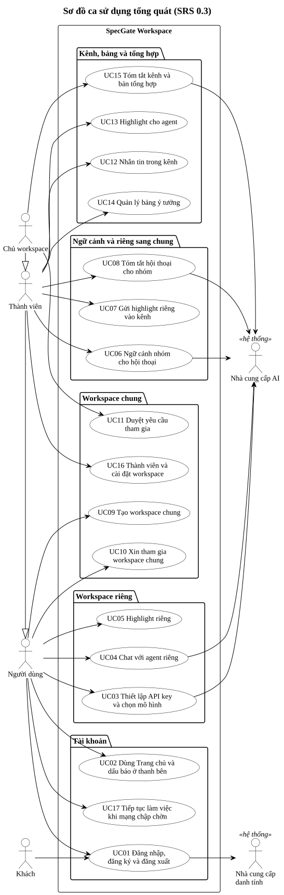

# Ca sử dụng (Use Cases)

## cho SpecGate Workspace (Sàng Ý), bản phát hành 1

Phiên bản 1.1, bản duyệt
Người lập: Nhóm SpecGate
Ngày 21/11/2026

## Lịch sử sửa đổi

| Người sửa | Ngày | Lý do thay đổi | Phiên bản |
| --- | --- | --- | --- |
| Nhóm SpecGate | 13/11/2026 | Bản nháp đầu, 15 ca theo SRS 0.2 | 1.0 nháp 1 |
| Nhóm SpecGate | 18/11/2026 | Viết lại 20 ca theo `flow.md` đã chốt và SRS 0.3 | 1.0 bản duyệt |
| Nhóm SpecGate | 21/11/2026 | Theo website đang chạy và SRS 0.4: UC01 thêm phần C (đăng nhập bằng mã email) và xác thực email trên màn giả lập; UC03 thêm Google Gemini; UC16 thêm phần C (bảng phân công) | 1.1 bản duyệt |

## Quy ước

- Mỗi ca dùng mẫu bảng: mã và tên, người lập, tác nhân, mô tả, kích hoạt, tiền điều kiện, hậu điều kiện, luồng chính, luồng thay thế, ngoại lệ, mức ưu tiên, tần suất, quy tắc nghiệp vụ, thông tin khác, giả định.
- **Mã luồng.** Luồng chính của phần A trong UC10 là `10.A`; luồng thay thế A1 của phần đó là `10.A.A1`; ngoại lệ E1 là `10.A.E1`. Ca không chia phần dùng `9.0`, `9.0.A1`, `9.0.E1`. Bỏ số ca ở đầu thì ra đúng mã dùng trong [SRS](SRS.md) mục 4 và trên các biểu đồ trong `uml/` (`A.A1`, `A.E1`, `E1`).
- **Biểu đồ.** Mỗi phần luồng có một biểu đồ hoạt động và một biểu đồ tuần tự, đặt trong SRS ngay dưới luồng đó; tên ảnh `act-uc10a.svg`, `seq-uc10a.svg` (xem [diagram-reading-guide.md](diagram-reading-guide.md)).
- **Mức ưu tiên.** Cao: bắt buộc trong bản 1 (mức M của SRS). Trung bình: bản tối thiểu trong bản 1 (mức T).
- **Tần suất** là ước lượng cho một nhóm 5 người dùng trong một tuần làm đồ án.
- Mã quy tắc BR theo [business-rules.md](business-rules.md).

## Tác nhân chính và ca sử dụng

| Tác nhân chính | Ca sử dụng |
| --- | --- |
| Khách | UC01 Đăng nhập, đăng ký và đăng xuất |
| Người dùng | UC01 (đăng xuất); UC02 Dùng Trang chủ và dấu báo ở thanh bên; UC03 Thiết lập API key và chọn mô hình; UC04 Chat với agent riêng; UC05 Highlight riêng; UC09 Tạo workspace chung; UC10 Xin tham gia workspace chung; UC17 Tiếp tục làm việc khi mạng chập chờn |
| Thành viên | UC06 Ngữ cảnh nhóm cho hội thoại; UC07 Gửi highlight riêng vào kênh; UC08 Tóm tắt hội thoại cho nhóm; UC12 Nhắn tin trong kênh; UC13 Highlight cho agent; UC14 Quản lý bảng ý tưởng (thêm ý, chốt, loại); UC16 Thành viên và cài đặt workspace (phần A; phần C: thêm việc đứng tên mình, nhận việc, đánh dấu xong) |
| Chủ workspace | UC11 Duyệt yêu cầu tham gia; UC14 (đưa vào bàn); UC15 Tóm tắt kênh và bản tổng hợp; UC16 (phần B; phần C: giao việc, sửa, xóa, khóa bảng phân công) |

Tác nhân phụ: Google/GitHub và Máy chủ gửi thư (UC01), Nhà cung cấp AI (UC03, UC04, UC06, UC08, UC15). Chủ workspace là một Thành viên; Thành viên là một Người dùng.

*Hình 1. Sơ đồ ca sử dụng tổng quát. Chi tiết: [uc-01-private-workspace.svg](../uml/img/uc-01-private-workspace.svg), [uc-02-shared-workspace.svg](../uml/img/uc-02-shared-workspace.svg)*

---

## UC01. Đăng nhập, đăng ký và đăng xuất

| Mục | Nội dung |
| --- | --- |
| Mã và tên | UC01 Đăng nhập, đăng ký và đăng xuất |
| Người lập / Ngày lập | Nhóm SpecGate / 13/11/2026 |
| Tác nhân chính | Khách (đăng nhập, đăng ký); Người dùng (đăng xuất) |
| Tác nhân phụ | Google, GitHub; Máy chủ gửi thư (SMTP) |
| Mô tả | Khách vào website bằng tài khoản Google hoặc GitHub có sẵn, hoặc bằng mã một lần gửi tới email; lần đầu thì hệ thống tạo tài khoản kèm workspace riêng. Người dùng rời phiên khi muốn. |
| Kích hoạt | Khách mở bất kỳ trang nào khi chưa đăng nhập; Khách nhập email ở trang đăng nhập; Người dùng chọn "Đăng xuất" |
| Tiền điều kiện | PRE-1. Chưa đăng nhập (phần A, C). PRE-2. Đã đăng nhập (phần B). PRE-3. Máy chủ đã cấu hình gửi thư (phần C). |
| Hậu điều kiện | POST-1. Có phiên 30 ngày trên trình duyệt. POST-2. Lần đầu: có tài khoản và workspace riêng. POST-3. Đăng xuất: phiên bị xóa. |
| Luồng chính | **1.A Đăng ký hoặc đăng nhập** 1. Khách mở một trang. Hệ thống chuyển về trang đăng nhập và ghi nhớ trang định mở. 2. Trang đăng nhập có hai thẻ (Đăng nhập, Tạo tài khoản), hai nút "Tiếp tục với Google", "Tiếp tục với GitHub" và ô email (1.C). 3. Khách bấm một nút; hệ thống chuyển sang trang chọn tài khoản của nhà cung cấp. 4. Khách chọn tài khoản và đồng ý chia sẻ tên, email. 5. Nhà cung cấp trả danh tính về hệ thống. (xem 1.A.E1, 1.A.E2) 6. Danh tính đã có tài khoản: hệ thống đăng nhập và mở Trang chủ (UC02). (xem 1.A.A1, 1.A.A2) 7. Phiên được lưu 30 ngày. **1.B Đăng xuất** 1. Người dùng chọn "Đăng xuất". 2. Hệ thống xóa phiên và về trang đăng nhập. (xem 1.B.E1) **1.C Đăng nhập bằng mã gửi qua email** 1. Khách nhập email, bấm "Gửi mã đăng nhập". (xem 1.C.E1, 1.C.E2) 2. Hệ thống hủy mã cũ, tạo mã 6 chữ số hết hạn sau 10 phút, lưu dạng băm, gửi tới email; câu trả lời như nhau dù email đã có tài khoản hay chưa. (xem 1.C.E4) 3. Trang chuyển sang bước nhập mã. 4. Khách nhập mã, bấm "Xác nhận và đăng nhập". (xem 1.C.E3) 5. Email đã có tài khoản: dùng mã, lưu phiên 30 ngày, mở Trang chủ hoặc trang định mở. (xem 1.C.A1) |
| Luồng thay thế | **1.A.A1 Lần đầu dùng danh tính này** (thay bước 6): tạo tài khoản kèm workspace riêng, mở màn nhập API key kèm lời chào (UC03). **1.A.A2 Có trang định mở** (thay bước 6): mở đúng trang đó thay vì Trang chủ. **1.A.A3 Quay lại trong 30 ngày**: bỏ qua trang đăng nhập, tính lại 30 ngày. **1.A.A4 Chưa cấu hình OAuth** (môi trường phát triển): hiện màn giả lập; chọn tài khoản có sẵn thì đăng nhập ngay; tạo tài khoản mới thì nhập email Google (hoặc tên GitHub kèm email nhận mã) và tên hiển thị, bấm "Gửi mã xác thực tới email", nhập mã rồi "Xác nhận mã và tạo tài khoản". Có "Sửa thông tin", "Gửi lại mã", "Hủy đăng ký". (xem 1.A.E4) **1.C.A1 Email chưa có tài khoản** (thay bước 5): hỏi tên hiển thị (tối đa 40 ký tự), mã giữ nguyên; xác nhận lại thì tạo tài khoản kèm workspace riêng và mở màn nhập API key (UC03). (xem 1.C.E5) **1.C.A2 Gửi lại mã**: mã mới thay mã cũ. **1.C.A3 Đổi email**: quay lại bước 1. |
| Ngoại lệ | **1.A.E1 Khách hủy ở trang nhà cung cấp**: về trang đăng nhập "Bạn đã hủy đăng nhập", không tạo gì. **1.A.E2 Nhà cung cấp lỗi hoặc dữ liệu không hợp lệ**: về trang đăng nhập kèm thông báo lỗi. **1.A.E3 Không kết nối được máy chủ**: báo máy chủ tạm không phản hồi, không đăng xuất phiên đang có. **1.A.E4 Màn giả lập: mã sai hoặc hết hạn, thông tin sai dạng**: báo lỗi ở đúng ô, không tạo tài khoản. **1.B.E1 Mất kết nối khi đăng xuất**: vẫn xóa phiên trên trình duyệt, về trang đăng nhập. **1.C.E1 Email sai dạng**: báo lỗi, không gửi mã. **1.C.E2 Gửi quá dày** (dưới 60 giây, hoặc đã 5 mã trong một giờ): báo đợi, không gửi. **1.C.E3 Mã sai hoặc hết hạn**: báo "Mã sai hoặc đã hết hạn"; sai 5 lần thì mã hết hiệu lực. **1.C.E4 Không gửi được email**: báo thử lại sau. **1.C.E5 Tên hiển thị quá 40 ký tự**: không tạo tài khoản. |
| Mức ưu tiên | Cao |
| Tần suất | Mỗi người khoảng 1 lần đăng nhập mỗi 30 ngày nhờ phiên nhớ; đăng ký 1 lần mỗi người |
| Quy tắc nghiệp vụ | BR-01, BR-02, BR-26, BR-34 |
| Thông tin khác | Không có mật khẩu riêng, không có chế độ khách. Tham số `state` của OAuth được ký để chống giả mạo. Ô email chỉ hiện khi máy chủ đã cấu hình gửi thư. Ba loại danh tính (Google, GitHub, email) là riêng, không tự gộp. |
| Giả định | Người dùng có tài khoản Google, GitHub, hoặc một địa chỉ email nhận được thư. |

## UC02. Dùng Trang chủ và dấu báo ở thanh bên

| Mục | Nội dung |
| --- | --- |
| Mã và tên | UC02 Dùng Trang chủ và dấu báo ở thanh bên |
| Người lập / Ngày lập | Nhóm SpecGate / 13/11/2026 |
| Tác nhân chính | Người dùng |
| Tác nhân phụ | Không có |
| Mô tả | Người dùng tự chọn nơi muốn vào từ một Trang chủ gọn, và biết workspace nào có việc cần làm nhờ dấu báo ở thanh bên. |
| Kích hoạt | Đăng nhập xong, hoặc bấm logo SpecGate ở bất kỳ đâu |
| Tiền điều kiện | PRE-1. Đã đăng nhập. |
| Hậu điều kiện | POST-1. Người dùng đi tới workspace riêng, một workspace chung, trang Khám phá hoặc màn nhập key. |
| Luồng chính | **2.0 Dùng Trang chủ** 1. Hệ thống hiện Trang chủ: thanh workspace bên trái, hình robot kèm câu chào, menu tài khoản, vài nút chức năng chính. (xem 2.0.A1, 2.0.A2) 2. Người dùng bấm "Chat với agent của tôi" để mở workspace riêng, hoặc "Vào làm việc với nhóm" để mở workspace chung dùng gần nhất. (xem 2.0.A3) |
| Luồng thay thế | **2.0.A1 Chưa có API key**: nút thứ nhất là "Nhập API key để có agent", mở UC03. **2.0.A2 Chưa tham gia workspace chung nào**: nút thứ hai là "Tìm nhóm để tham gia", mở Khám phá; kèm gợi ý "Nhập mã" hoặc "Tạo mới". **2.0.A3 Dùng thanh bên**: bấm một workspace, hoặc Tạo mới (UC09), Nhập mã (UC10 phần A), Khám phá (UC10 phần B). |
| Ngoại lệ | Không có |
| Mức ưu tiên | Cao |
| Tần suất | Mỗi người vài lần mỗi ngày làm việc |
| Quy tắc nghiệp vụ | BR-03 |
| Thông tin khác | Dấu báo có ở mọi trang và tự cập nhật: chấm tin chưa đọc (không kèm số); chấm nổi hơn khi có tin chưa đọc nhắc tên mình; con số yêu cầu tham gia đang chờ ở workspace mình làm chủ; chấm cạnh tên kênh; workspace đang chờ duyệt hiện mờ. Dấu báo tự mất khi đọc tin hoặc xử lý xong yêu cầu. |
| Giả định | Không có |

## UC03. Thiết lập API key và chọn mô hình

| Mục | Nội dung |
| --- | --- |
| Mã và tên | UC03 Thiết lập API key và chọn mô hình |
| Người lập / Ngày lập | Nhóm SpecGate / 13/11/2026 |
| Tác nhân chính | Người dùng |
| Tác nhân phụ | Nhà cung cấp AI |
| Mô tả | Người dùng nhập API key của một nhà cung cấp, hệ thống kiểm key ngay, rồi người dùng chọn một mô hình làm agent riêng. |
| Kích hoạt | Đăng ký lần đầu (1.A.A1), bấm ô "Agent của bạn", hoặc mở "Key và mô hình" |
| Tiền điều kiện | PRE-1. Đã đăng nhập. |
| Hậu điều kiện | POST-1. Key được lưu mã hóa, giao diện chỉ hiện 4 ký tự cuối. POST-2. Mô hình đã chọn là agent riêng. |
| Luồng chính | **3.0 Thiết lập key** 1. Người dùng chọn nhà cung cấp: Anthropic hoặc "Kiểu OpenAI" (OpenAI, Google Gemini, OpenRouter, DeepSeek, Groq, Ollama…). 2. Với kiểu OpenAI, nhập thêm địa chỉ API; ô địa chỉ gợi ý sẵn OpenAI, Google Gemini, OpenRouter, DeepSeek, Groq. (xem 3.0.E2) 3. Dán key, bấm "Kiểm và lưu key". 4. Hệ thống kiểm key với nhà cung cấp. (xem 3.0.E1) 5. Key dùng được: lưu key đã mã hóa, lấy danh sách mô hình, bỏ các mô hình không chat được. 6. Người dùng chọn một mô hình. |
| Luồng thay thế | **3.0.A1 Đổi mô hình**: chọn mô hình khác, lưu ngay. **3.0.A2 Đổi key**: bấm "Đổi key", làm lại bước 1–6; "Hủy đổi key" để giữ key cũ. **3.0.A3 Xóa key**: xác nhận trong hộp thoại; không chat được tới khi nhập key mới; lịch sử hội thoại giữ nguyên. |
| Ngoại lệ | **3.0.E1 Key sai, hết tiền, hoặc không kết nối được nhà cung cấp**: báo bằng một câu tiếng Việt dễ hiểu, không lưu key. **3.0.E2 Địa chỉ API không hợp lệ**: báo lỗi ở ô địa chỉ, không lưu key. |
| Mức ưu tiên | Cao |
| Tần suất | Mỗi người 1 lần khi đăng ký; đổi mô hình vài lần mỗi tuần |
| Quy tắc nghiệp vụ | BR-04, BR-05 |
| Thông tin khác | Màn nhập key ghi rõ gói thuê bao không phải API key. Đổi key hay đổi mô hình không làm mất highlight riêng; tin cũ trong kênh giữ tên mô hình lúc gửi. |
| Giả định | AS-1 của [vision-and-scope.md](vision-and-scope.md): người dùng tự có API key. |

## UC04. Chat với agent riêng

| Mục | Nội dung |
| --- | --- |
| Mã và tên | UC04 Chat với agent riêng |
| Người lập / Ngày lập | Nhóm SpecGate / 13/11/2026 |
| Tác nhân chính | Người dùng |
| Tác nhân phụ | Nhà cung cấp AI |
| Mô tả | Người dùng hỏi agent riêng trong workspace riêng, nhận câu trả lời hiện dần có định dạng, tạo lại câu trả lời có phiên bản, và quản lý danh sách hội thoại. |
| Kích hoạt | Người dùng gửi câu hỏi; bấm "Tạo lại"; bấm sửa tên hoặc xóa hội thoại |
| Tiền điều kiện | PRE-1. Đã có key hợp lệ (UC03). |
| Hậu điều kiện | POST-1. Câu hỏi, câu trả lời và các phiên bản được lưu. POST-2. Chỉ chủ hội thoại xem được. |
| Luồng chính | **4.A Chat** 1. Tạo hội thoại mới hoặc mở hội thoại cũ. (xem 4.A.A1) 2. Gõ câu hỏi và gửi. 3. Câu hỏi hiện ngay và được lưu trước khi agent trả lời. 4. Hệ thống gửi cho mô hình, bằng key của người dùng, các lượt trước và ngữ cảnh nhóm nếu có (UC06). (xem 4.A.E2) 5. Câu trả lời hiện dần, có định dạng. (xem 4.A.A2, 4.A.E1, 4.A.E3) 6. Câu trả lời được lưu; có nút "Chép", "Tạo lại". **4.B Tạo lại câu trả lời** 1. Bấm "Tạo lại". (xem 4.B.A1) 2. Hệ thống gọi lại mô hình cho cùng câu hỏi. (xem 4.B.E1) 3. Câu cũ giữ thành phiên bản; có nút "‹ 1/2 ›". 4. Khi hỏi tiếp, agent chỉ đọc phiên bản đang hiển thị. **4.C Quản lý hội thoại** 1. Bấm sửa tên, nhập tên mới (tối đa 80 ký tự), Lưu. (xem 4.C.A1, 4.C.A2) 2. Danh sách cập nhật tên. |
| Luồng thay thế | **4.A.A1 Hội thoại mới**: tên lấy từ câu hỏi đầu; có thể chọn ngữ cảnh nhóm trước câu đầu. **4.A.A2 Dừng**: giữ phần đã viết, ghi "Đã dừng". **4.B.A1 Mở highlight của phiên bản cũ**: mở đúng phiên bản và đúng chỗ đã đánh dấu. **4.C.A1 Xóa hội thoại không có highlight riêng**: xóa ngay. **4.C.A2 Xóa hội thoại có highlight riêng**: hỏi "Hội thoại này có N highlight. Giữ lại hay xóa luôn?", mặc định giữ lại; giữ lại thì highlight ghi "hội thoại gốc đã bị xóa". |
| Ngoại lệ | **4.A.E1 Nhà cung cấp lỗi giữa chừng**: câu hỏi vẫn còn; câu báo lỗi thay câu trả lời; lượt lỗi không gửi lại cho agent. **4.A.E2 Chưa có key**: mở màn nhập key (UC03). **4.A.E3 Mất mạng khi đang trả lời**: theo UC17. **4.B.E1 Lỗi nhà cung cấp khi tạo lại**: như 4.A.E1; phiên bản cũ không bị ảnh hưởng. **4.C.E1 Đoán đường dẫn hội thoại của người khác**: chỉ báo "không tìm thấy". |
| Mức ưu tiên | Cao |
| Tần suất | Mỗi người 20–50 câu hỏi mỗi ngày làm việc; cao điểm khi cả nhóm cùng brainstorm |
| Quy tắc nghiệp vụ | BR-06, BR-07, BR-09, BR-13 |
| Thông tin khác | Khi hội thoại quá dài chỉ gửi các lượt gần nhất (SRS điểm mở 9.1). Những gì đã gửi vào kênh vẫn còn khi xóa hội thoại vì là bản chụp. |
| Giả định | Không có |

## UC05. Highlight riêng

| Mục | Nội dung |
| --- | --- |
| Mã và tên | UC05 Highlight riêng |
| Người lập / Ngày lập | Nhóm SpecGate / 13/11/2026 |
| Tác nhân chính | Người dùng |
| Tác nhân phụ | Không có |
| Mô tả | Người dùng giữ lại những đoạn đáng giá trong hội thoại với agent, xem lại, chỉnh và dọn dẹp trước khi quyết định gửi cho nhóm. |
| Kích hoạt | Bôi đen một đoạn trong một lượt; mở "Highlight riêng" |
| Tiền điều kiện | PRE-1. Có hội thoại có lượt đã lưu (phần A); đã đăng nhập (phần B). |
| Hậu điều kiện | POST-1. Danh sách Highlight riêng phản ánh đúng thay đổi. POST-2. Các thẻ đã gửi vào kênh không đổi. |
| Luồng chính | **5.A Tạo highlight riêng** 1. Bôi đen một đoạn trong một lượt. (xem 5.A.E1) 2. Thanh màu hiện cạnh vùng chọn. 3. Chọn màu, ghi chú nếu muốn. 4. Bấm Lưu. (xem 5.A.A1, 5.A.E2) 5. Đoạn được tô màu và lưu kèm nguyên văn, người nói, mô hình lúc tạo, lượt gốc, ngữ cảnh nhóm lúc viết. 6. Hệ thống báo "Đã lưu vào Highlight riêng. Chưa có gì được gửi vào nhóm." **5.B Quản lý danh sách** 1. Hiện mọi highlight theo thời gian kèm màu, người nói, mô hình, hội thoại gốc, các lần đã gửi, nhãn ngữ cảnh. (xem 5.B.E1) 2. Lọc theo màu, hội thoại, loại, đã gửi; hoặc gõ chữ để tìm. 3. Bấm một highlight để mở đúng hội thoại, đúng chỗ. (xem 5.B.A1 – 5.B.A5) |
| Luồng thay thế | **5.A.A1 Hủy**: không lưu gì. **5.B.A1 Sửa**: sửa chữ, màu, ghi chú; sửa chữ của agent thì báo trước thẻ sẽ ghi "(‹tên› đã chỉnh)". **5.B.A2 Xóa một mục**: thẻ đã gửi vẫn còn. **5.B.A3 Dọn dẹp**: xóa theo màu, hội thoại, hoặc chỉ mục đã gửi; báo số đã xóa và số còn lại. **5.B.A4 Gửi**: chọn mục, "Gửi vào nhóm" (UC07 phần A). **5.B.A5 Đính kèm lượt gốc** cho bản tóm tắt: tối đa 4 lượt (UC08). |
| Ngoại lệ | **5.A.E1 Vùng chọn qua hai lượt, hoặc trong lượt lỗi, lượt đang viết**: không hiện thanh lưu. **5.A.E2 Đã đủ khoảng 200 highlight riêng**: không lưu, nhắc dọn bớt. **5.B.E1 Gần đủ giới hạn**: nhắc "Bạn đã dùng N/200 highlight riêng". |
| Mức ưu tiên | Cao |
| Tần suất | Mỗi người 5–15 highlight mỗi ngày làm việc |
| Quy tắc nghiệp vụ | BR-08, BR-09, BR-12, BR-28 |
| Thông tin khác | Màu do người dùng tự đặt nghĩa và không đi theo khi gửi. Highlight riêng không gửi cho agent nên không tốn tiền key. |
| Giả định | Danh sách màu gồm vàng, xanh lá, xanh dương, hồng, tím (SRS điểm mở 9.7). |

## UC06. Ngữ cảnh nhóm cho hội thoại

| Mục | Nội dung |
| --- | --- |
| Mã và tên | UC06 Ngữ cảnh nhóm cho hội thoại |
| Người lập / Ngày lập | Nhóm SpecGate / 13/11/2026 |
| Tác nhân chính | Thành viên |
| Tác nhân phụ | Nhà cung cấp AI (khi tóm tắt tin cũ) |
| Mô tả | Thành viên chọn một workspace chung làm ngữ cảnh cho hội thoại riêng, để agent biết nhóm đang bàn gì; khi tin của mình quá nhiều thì chủ động tóm tắt tin cũ. |
| Kích hoạt | Chọn một workspace ở ô "Ngữ cảnh nhóm"; bấm "Tóm tắt tin cũ" |
| Tiền điều kiện | PRE-1. Đang mở hội thoại. PRE-2. Là thành viên của ít nhất một workspace chung. |
| Hậu điều kiện | POST-1. Mỗi câu hỏi gửi kèm ngữ cảnh mới nhất của workspace đã chọn. POST-2. Khung "Agent đang đọc" hiện đúng phần này. |
| Luồng chính | **6.A Chọn ngữ cảnh nhóm** 1. Chọn một workspace chung ở ô "Ngữ cảnh nhóm". (xem 6.A.A1, 6.A.A2) 2. Hệ thống lưu ngay; hội thoại có biểu tượng nhóm. 3. Khung "Agent đang đọc" hiện: đề bài; thành viên, chủ, vai, agent; ý đã chốt và đã loại kèm lý do; một dòng thời gian gồm tin của mình và highlight cho agent của mình, ghi giờ, kênh, người nói. (xem 6.A.A3 – 6.A.A6) 4. Câu hỏi tiếp theo gửi kèm ngữ cảnh mới nhất. (xem 6.A.E1) **6.B Tóm tắt tin cũ** 1. Hệ thống báo trước số tin, số khối, số khối cần gọi agent, số tin giữ nguyên văn. 2. Thành viên bấm "Tóm tắt tin cũ". 3. Chia tin cũ thành khối tại mốc giờ của từng highlight. 4. Khối dưới khoảng 5 tin giữ nguyên văn; các khối còn lại gửi chung một lần gọi agent bằng key của thành viên. (xem 6.B.E1) 5. Agent trả tóm tắt theo từng khối, mỗi khối ghi khoảng thời gian, đặt đúng chỗ trên dòng thời gian. 6. Khung hiện bản tóm tắt; các câu hỏi sau gửi kèm bản này. (xem 6.B.A1, 6.B.A2) |
| Luồng thay thế | **6.A.A1 Bỏ ngữ cảnh**: chọn "Không gắn"; khung biến mất. **6.A.A2 Đổi workspace**: mỗi lúc một workspace; câu trả lời cũ giữ ngữ cảnh lúc viết. **6.A.A3 Sửa vai** trong khung (UC16, 16.A.A2). **6.A.A4 Bỏ một highlight** trong khung. **6.A.A5 Tin của mình vượt giới hạn**: khung ghi "N tin cũ của bạn đang không được gửi cho agent", kèm nút "Tóm tắt tin cũ". **6.A.A6 Màn hình hẹp**: khung thành ngăn kéo. **6.B.A1 Lại có tin cũ vượt giới hạn**: khung lại báo; thành viên tự quyết. **6.B.A2 Chia sẻ bản tóm tắt**: lưu vào Highlight riêng rồi gửi như UC07. |
| Ngoại lệ | **6.A.E1 Không còn là thành viên workspace đã chọn**: hội thoại vẫn còn, agent không nhận thông tin nhóm. **6.B.E1 Key lỗi khi tóm tắt**: báo lỗi dễ hiểu, giữ bản tóm tắt cũ. |
| Mức ưu tiên | Cao |
| Tần suất | Phần lớn câu hỏi trong đồ án nhóm có chọn ngữ cảnh; tóm tắt tin cũ khoảng 1 lần mỗi tuần mỗi người |
| Quy tắc nghiệp vụ | BR-06, BR-10, BR-11, BR-14, BR-29 |
| Thông tin khác | Ngoài đoạn đã highlight, agent không đọc tin nào của người khác; bị nhắc tên cũng không làm tin lọt vào. Bản `/summarize` không tính là tin của mình. Agent được dặn nói rõ dựa vào ý của ai. Hệ thống không bao giờ tự tóm tắt khi người dùng chưa bấm. |
| Giả định | Hội thoại mới không tự chọn sẵn ngữ cảnh (SRS điểm mở 9.8). |

## UC07. Gửi highlight riêng vào kênh

| Mục | Nội dung |
| --- | --- |
| Mã và tên | UC07 Gửi highlight riêng vào kênh |
| Người lập / Ngày lập | Nhóm SpecGate / 13/11/2026 |
| Tác nhân chính | Thành viên |
| Tác nhân phụ | Không có |
| Mô tả | Thành viên đưa ý đã lọc từ workspace riêng vào kênh nhóm dưới dạng thẻ trích dẫn ghi rõ người nói, không phải copy và dán. |
| Kích hoạt | Bấm "Gửi vào nhóm" trong danh sách Highlight riêng; gõ `@` và chọn "Highlight của tôi" trong ô soạn |
| Tiền điều kiện | PRE-1. Có ít nhất một highlight riêng. PRE-2. Là thành viên của ít nhất một workspace chung. |
| Hậu điều kiện | POST-1. Kênh có một tin dưới tên thành viên, mỗi highlight là một thẻ trích dẫn. POST-2. Danh sách Highlight riêng ghi lại lần gửi. |
| Luồng chính | **7.A Gửi từ danh sách** 1. Hộp thoại gửi mở ra. 2. Chọn workspace chung và kênh. 3. Viết thêm lời của mình (tùy chọn). 4. Mỗi highlight hiện nội dung sẽ gửi và nhãn người nói: "Claude của Lan nói", "… (trích một phần)", "… (Lan đã chỉnh)". (xem 7.A.A1, 7.A.A2) 5. Bấm Gửi. (xem 7.A.E1, 7.A.E2) 6. Kênh hiện tin kèm các thẻ trích dẫn; thẻ có "…" ở chỗ bị cắt. 7. Hộp thoại báo đã gửi, kèm nút mở kênh. **7.B Chèn bằng @** 1. Gõ `@`; danh sách gợi ý có "Highlight của tôi" đứng đầu. 2. Chọn mục đó; bảng chọn highlight hiện ra. 3. Lọc theo màu hoặc gõ chữ, chọn một highlight. 4. Highlight được chèn thành thẻ trích dẫn. (xem 7.B.A1, 7.B.A2) 5. Viết lời xung quanh và gửi. (xem 7.B.A3, 7.B.A4) |
| Luồng thay thế | **7.A.A1 Đã từng gửi vào kênh này**: nhắc trước, yêu cầu xác nhận "Vẫn gửi lại". **7.A.A2 Ngữ cảnh lúc agent viết là nhóm khác**: cảnh báo "Đoạn này được viết khi agent đang đọc thông tin của nhóm ‹A›…"; phải xác nhận. **7.B.A1 Bỏ thẻ** trước khi gửi. **7.B.A2 Chèn nhiều highlight** vào một tin. **7.B.A3** như 7.A.A1. **7.B.A4** như 7.A.A2. |
| Ngoại lệ | **7.A.E1 Không còn là thành viên workspace đích**: báo lỗi, không gửi. **7.A.E2 Nội dung trống**: không cho gửi. |
| Mức ưu tiên | Cao |
| Tần suất | Mỗi người 3–10 lần mỗi ngày làm việc |
| Quy tắc nghiệp vụ | BR-12, BR-13, BR-15, BR-30 |
| Thông tin khác | Không có nút gửi thẳng câu trả lời của agent vào kênh. Hội thoại chứa highlight không cần chọn ngữ cảnh nhóm. Tin gửi vào kênh tự vào ngữ cảnh agent của người gửi. |
| Giả định | Không có |

## UC08. Tóm tắt hội thoại cho nhóm

| Mục | Nội dung |
| --- | --- |
| Mã và tên | UC08 Tóm tắt hội thoại cho nhóm |
| Người lập / Ngày lập | Nhóm SpecGate / 13/11/2026 |
| Tác nhân chính | Thành viên |
| Tác nhân phụ | Nhà cung cấp AI |
| Mô tả | Khi chưa phân định được ý nào đáng giữ, thành viên nhờ agent của mình viết bản tóm tắt hội thoại theo khung cố định để cả nhóm cùng lọc. |
| Kích hoạt | Bấm "Tóm tắt cho nhóm" ở đầu hội thoại |
| Tiền điều kiện | PRE-1. Hội thoại có ít nhất một câu trả lời. PRE-2. Đã có key. |
| Hậu điều kiện | POST-1. Bản tóm tắt được lưu vào Highlight riêng như mục "bản tóm tắt", chưa gửi đi. |
| Luồng chính | **8.0 Tóm tắt cho nhóm** 1. Agent của thành viên, bằng key của thành viên, viết theo khung: vấn đề đang xét; hướng đã thử và kết quả; điểm còn chưa chắc; câu hỏi muốn nhóm trả lời. (xem 8.0.E1) 2. Mỗi ý ghi rõ của ai: "[Lan] muốn…", "[Claude] đề xuất…". 3. Lưu vào Highlight riêng, ghi "bản tóm tắt". 4. Thành viên xem lại, sửa hoặc xóa bớt (UC05 phần B). 5. Đính kèm tối đa 4 lượt gốc nếu muốn. 6. Gửi như một highlight riêng (UC07). 7. Trong kênh là thẻ "Tóm tắt hội thoại của Lan, do Claude của Lan viết, chưa được lọc"; lượt gốc thu gọn trong thẻ. |
| Luồng thay thế | Không có |
| Ngoại lệ | **8.0.E1 Key lỗi**: báo lỗi dễ hiểu, không lưu gì. |
| Mức ưu tiên | Trung bình (bản tối thiểu trong bản 1) |
| Tần suất | Mỗi người khoảng 1–3 lần mỗi tuần |
| Quy tắc nghiệp vụ | BR-15, BR-16, BR-31, BR-33 |
| Thông tin khác | Không có cách gửi nguyên văn cả hội thoại. Cảnh báo gửi sang nhóm khác (7.A.A2) áp dụng như highlight riêng. |
| Giả định | Không có |

## UC09. Tạo workspace chung

| Mục | Nội dung |
| --- | --- |
| Mã và tên | UC09 Tạo workspace chung |
| Người lập / Ngày lập | Nhóm SpecGate / 13/11/2026 |
| Tác nhân chính | Người dùng |
| Tác nhân phụ | Không có |
| Mô tả | Người dùng tạo một workspace cho nhóm làm việc trên một đề bài và trở thành chủ. |
| Kích hoạt | Bấm "Tạo mới" trên thanh bên |
| Tiền điều kiện | PRE-1. Đã đăng nhập (không bắt buộc có API key). |
| Hậu điều kiện | POST-1. Workspace mới có kênh "chung" và một mã tham gia. POST-2. Người tạo là chủ. |
| Luồng chính | **9.0 Tạo workspace** 1. Hộp thoại tạo workspace mở ra. 2. Nhập tên, đề bài, chọn "Ẩn, không ai tìm thấy" hoặc "Ai cũng tìm thấy, vào phải xin". 3. Bấm "Tạo workspace". (xem 9.0.E1 – 9.0.E3) 4. Hệ thống tạo workspace kèm kênh "chung" và mã tham gia, rồi mở kênh "chung". |
| Luồng thay thế | Không có |
| Ngoại lệ | **9.0.E1 Thiếu tên hoặc đề bài**: không cho tạo, chỉ rõ phần thiếu. **9.0.E2 Trùng tên workspace khác do mình làm chủ**: không cho tạo. **9.0.E3 Đã làm chủ khoảng 10 workspace**: không cho tạo, báo đạt giới hạn. |
| Mức ưu tiên | Cao |
| Tần suất | Mỗi nhóm 1 lần mỗi đồ án |
| Quy tắc nghiệp vụ | BR-17, BR-27, BR-28 |
| Thông tin khác | Chủ chỉ cần key khi dùng `/summarize`. |
| Giả định | Không có |

## UC10. Xin tham gia workspace chung

| Mục | Nội dung |
| --- | --- |
| Mã và tên | UC10 Xin tham gia workspace chung |
| Người lập / Ngày lập | Nhóm SpecGate / 13/11/2026 |
| Tác nhân chính | Người dùng |
| Tác nhân phụ | Không có |
| Mô tả | Người dùng xin vào một workspace chung bằng mã được gửi, hoặc tìm và xin vào qua trang Khám phá; yêu cầu chờ chủ duyệt. |
| Kích hoạt | Bấm "Nhập mã" hoặc "Khám phá" trên thanh bên; mở đường dẫn tới workspace chưa tham gia |
| Tiền điều kiện | PRE-1. Đã đăng nhập. PRE-2. Chưa là thành viên workspace đó. |
| Hậu điều kiện | POST-1. Có yêu cầu tham gia đang chờ. POST-2. Người dùng ở trang "Đang chờ duyệt" và được chuyển vào khi chủ duyệt. |
| Luồng chính | **10.A Bằng mã** 1. Một thành viên chép mã 7 ký tự và gửi cho người dùng ngoài hệ thống. 2. Người dùng nhập mã (chữ thường, dấu cách, gạch nối đều được). (xem 10.A.E1, 10.A.A2, 10.A.A3) 3. Hệ thống tạo yêu cầu và mở trang "Đang chờ duyệt". 4. Workspace đang chờ hiện mờ trên thanh bên. 5. Khi chủ duyệt (UC11), trang chờ tự chuyển vào workspace. (xem 10.A.A1, 10.A.E2) **10.B Qua Khám phá** 1. Trang Khám phá liệt kê workspace "ai cũng tìm thấy". (xem 10.B.A1, 10.B.E1) 2. Tìm theo tên hoặc đề bài. 3. Mỗi workspace cho biết đề bài, chủ, số thành viên, quan hệ của người dùng. (xem 10.B.A2, 10.B.A3) 4. Chọn workspace, viết lời nhắn, bấm "Gửi yêu cầu". 5. Hệ thống tạo yêu cầu, mở trang "Đang chờ duyệt" (như 10.A bước 3–5). |
| Luồng thay thế | **10.A.A1 Hủy yêu cầu** ở trang chờ. **10.A.A2 Đã có yêu cầu đang chờ**: cập nhật yêu cầu cũ, không tạo mới. **10.A.A3 Đã là thành viên**: mở thẳng workspace. **10.B.A1 Mở đường dẫn tới workspace chưa tham gia**: mở Khám phá, chọn sẵn workspace đó. **10.B.A2 Đang chờ duyệt**: sửa được lời nhắn. **10.B.A3 Đã là thành viên**: nút "Mở workspace". |
| Ngoại lệ | **10.A.E1 Mã sai, sai định dạng, hoặc chủ đã đổi mã**: báo mã không hợp lệ, gợi ý xin mã mới. **10.A.E2 Bị từ chối**: trang chờ hiện "Yêu cầu bị từ chối", kèm nút về workspace riêng và tìm nhóm khác. **10.B.E1 Workspace để chế độ ẩn**: không hiện ở Khám phá; phải có mã. |
| Mức ưu tiên | Cao |
| Tần suất | Mỗi thành viên 1 lần mỗi workspace |
| Quy tắc nghiệp vụ | BR-18, BR-27 |
| Thông tin khác | Mỗi người tối đa một yêu cầu đang chờ cho mỗi workspace. Số workspace một người tham gia không giới hạn. |
| Giả định | Không có |

## UC11. Duyệt yêu cầu tham gia

| Mục | Nội dung |
| --- | --- |
| Mã và tên | UC11 Duyệt yêu cầu tham gia |
| Người lập / Ngày lập | Nhóm SpecGate / 13/11/2026 |
| Tác nhân chính | Chủ workspace |
| Tác nhân phụ | Không có |
| Mô tả | Chủ quyết định ai được vào nhóm. |
| Kích hoạt | Chủ mở "Yêu cầu tham gia" (thanh bên có số yêu cầu đang chờ) |
| Tiền điều kiện | PRE-1. Là chủ workspace. |
| Hậu điều kiện | POST-1. Người được duyệt thành thành viên. POST-2. Yêu cầu đã xử lý vào lịch sử. |
| Luồng chính | **11.0 Duyệt yêu cầu** 1. Trang hiện yêu cầu đang chờ và tự cập nhật. (xem 11.0.E2) 2. Mỗi yêu cầu: ai xin, bằng mã hay Khám phá, lời nhắn, thời điểm. 3. Chủ bấm "Duyệt" hoặc "Từ chối". (xem 11.0.E1) 4. Duyệt: người xin thành thành viên, được gán màu ảnh đại diện chưa ai dùng. (xem 11.0.A1, 11.0.A2) 5. Yêu cầu vào lịch sử, ghi kết quả và người xử lý. |
| Luồng thay thế | **11.0.A1 Tên hiển thị trùng tên một thành viên, kể cả người đã rời**: đặt tên tạm "Lan 2", yêu cầu chọn biệt danh khi vào (UC16 16.A.A1). **11.0.A2 Người từng rời xin vào lại**: lấy lại tên cũ, tin cũ hiện lại bình thường. |
| Ngoại lệ | **11.0.E1 Yêu cầu đã xử lý hoặc đã bị hủy**: không xử lý lại, danh sách làm mới. **11.0.E2 Người không phải chủ mở trang**: đưa về kênh "chung". |
| Mức ưu tiên | Cao |
| Tần suất | Mỗi workspace vài lần lúc lập nhóm |
| Quy tắc nghiệp vụ | BR-18, BR-25, BR-32 |
| Thông tin khác | Không có |
| Giả định | AS-4: mỗi nhóm có một người làm chủ. |

## UC12. Nhắn tin trong kênh

| Mục | Nội dung |
| --- | --- |
| Mã và tên | UC12 Nhắn tin trong kênh |
| Người lập / Ngày lập | Nhóm SpecGate / 13/11/2026 |
| Tác nhân chính | Thành viên |
| Tác nhân phụ | Không có |
| Mô tả | Thành viên trao đổi với nhóm theo thời gian thực và dùng lệnh để thao tác với bảng ý tưởng và tổng hợp. |
| Kích hoạt | Thành viên soạn và gửi tin |
| Tiền điều kiện | PRE-1. Là thành viên. PRE-2. Đang mở một kênh. |
| Hậu điều kiện | POST-1. Tin hiện ngay cho mọi người đang mở kênh. POST-2. Tin vào ngữ cảnh agent của người gửi. |
| Luồng chính | **12.0 Nhắn tin** 1. Soạn tin: `@` gợi ý tên và "Highlight của tôi"; `/` gợi ý lệnh; chọn bằng chuột hoặc bàn phím. 2. Gửi tin. (xem 12.0.E1) 3. Tin hiện ngay cho mọi người đang mở kênh. (xem 12.0.A1) 4. Tin bắt đầu bằng lệnh thì hệ thống thực hiện: `/idea`, `/note`, `/pin`, `/decide` (UC14); `/summarize`, `/brief` (UC15); `/help`. (xem 12.0.A2, 12.0.E2) |
| Luồng thay thế | **12.0.A1 Kết nối chập chờn**: tự nối lại, hiện bù tin đã lỡ (UC17). **12.0.A2 Lệnh của người không có quyền**: trả tin "đây là quyền của chủ workspace". |
| Ngoại lệ | **12.0.E1 Tin trống**: không gửi. **12.0.E2 Lệnh sai cú pháp**: trả tin hướng dẫn cú pháp đúng. |
| Mức ưu tiên | Cao |
| Tần suất | Mỗi nhóm 100–300 tin mỗi ngày làm việc |
| Quy tắc nghiệp vụ | BR-19, BR-20 |
| Thông tin khác | Bốn loại tin phân biệt bằng mắt: tin của người, thẻ trích dẫn, thẻ tóm tắt hội thoại, tin hệ thống. Ảnh đại diện màu không trùng. Người đã rời hiện "(đã rời)". Không agent nào tự trả lời; nhắc tên người hay agent không làm agent nào lên tiếng. |
| Giả định | Không có |

## UC13. Highlight cho agent

| Mục | Nội dung |
| --- | --- |
| Mã và tên | UC13 Highlight cho agent |
| Người lập / Ngày lập | Nhóm SpecGate / 13/11/2026 |
| Tác nhân chính | Thành viên |
| Tác nhân phụ | Không có |
| Mô tả | Thành viên chọn những đoạn trong tin của người khác để agent của mình đọc, luôn kèm tên người nói. |
| Kích hoạt | Bôi đen một hoặc nhiều đoạn trong kênh |
| Tiền điều kiện | PRE-1. Là thành viên. PRE-2. Đang mở một kênh. |
| Hậu điều kiện | POST-1. Highlight được lưu, có vệt phấn trong kênh (chỉ mình thấy). POST-2. Có trong ngữ cảnh mọi hội thoại chọn workspace này. |
| Luồng chính | **13.0 Highlight cho agent** 1. Bôi đen trong tin, thẻ trích dẫn, thẻ tóm tắt của người khác; có thể qua nhiều tin liền nhau. (xem 13.0.A1, 13.0.A2) 2. Vùng chọn tự bắt trọn từ, trọn dòng code, trọn ô bảng. 3. Bấm "Highlight cho agent của tôi". 4. Hộp thoại hiện từng đoạn kèm người nói. 5. Chỉ thu hẹp hai đầu hoặc bỏ đoạn; xem trước câu agent sẽ đọc. (xem 13.0.E1) 6. Chọn nhãn Quan trọng hoặc Cần xem xét; ghi "Ghi chú của tôi" nếu muốn. 7. Bấm "Lưu highlight". (xem 13.0.E2) 8. Hệ thống báo đã lưu; vệt phấn vàng nhạt; vào danh sách "Highlight cho agent" và ngữ cảnh agent. (xem 13.0.A3, 13.0.A4) |
| Luồng thay thế | **13.0.A1 Chỉ gồm tin của mình**: không có nút lưu, nhắc "Tin của bạn đã tự vào ngữ cảnh agent của bạn". **13.0.A2 Có lẫn tin của mình**: bỏ phần đó kèm lời nhắc, phần còn lại vẫn lưu. **13.0.A3 Sửa nhãn, ghi chú** về sau. **13.0.A4 Bỏ highlight** ở danh sách hoặc khung "Agent đang đọc". |
| Ngoại lệ | **13.0.E1 Sửa chữ ở giữa đoạn**: báo chỉ được thu hẹp, khóa nút lưu. **13.0.E2 Đã đủ khoảng 30 highlight ở workspace**: không lưu, nhắc tự bỏ bớt. |
| Mức ưu tiên | Cao |
| Tần suất | Mỗi người 5–10 highlight mỗi ngày làm việc |
| Quy tắc nghiệp vụ | BR-11, BR-12, BR-22, BR-28, BR-31 |
| Thông tin khác | Mỗi đoạn giữ người nói và tin gốc riêng; agent không gộp lời hai người. Highlight lưu nguyên văn lúc chọn; nguồn bị xóa thì highlight vẫn còn. |
| Giả định | Chưa có chức năng sửa, xóa tin nên chưa xử lý highlight khi tin gốc đổi (SRS điểm mở 9.9). |

## UC14. Quản lý bảng ý tưởng

| Mục | Nội dung |
| --- | --- |
| Mã và tên | UC14 Quản lý bảng ý tưởng |
| Người lập / Ngày lập | Nhóm SpecGate / 13/11/2026 |
| Tác nhân chính | Thành viên (thêm ý, chốt, loại); Chủ workspace (đưa vào bàn) |
| Tác nhân phụ | Không có |
| Mô tả | Nhóm ghi ý, chọn ý để bàn, và ghi lại quyết định kèm lý do. |
| Kích hoạt | Lệnh `/idea`, `/note`, `/pin`, `/decide`; nút "Thêm", "Đưa vào bàn", "Chốt", "Loại" trên trang Bảng ý tưởng |
| Tiền điều kiện | PRE-1. Là thành viên. |
| Hậu điều kiện | POST-1. Bảng phản ánh đúng trạng thái từng ý. POST-2. Quyết định ghi người, thời điểm, lý do; kênh có tin hệ thống. |
| Luồng chính | **14.A Đưa ý lên bảng** 1. Gõ `/idea ‹nội dung›`. (xem 14.A.A1 – 14.A.A3, 14.A.E1) 2. Thêm thẻ vào cột Đề xuất: số thứ tự, người đưa lên, thời điểm, tin và kênh nguồn. 3. Kênh có tin hệ thống "Đã thêm #‹số›…". **14.B Đưa vào bàn** 1. Chủ bấm "Đưa vào bàn" trên thẻ ở cột Đề xuất. (xem 14.B.E1, 14.B.E2) 2. Thẻ chuyển sang Đang bàn. **14.C Chốt hoặc loại** 1. Bấm "Chốt" hoặc "Loại" trên thẻ. (xem 14.C.A1) 2. Hộp thoại hỏi lý do, hiện lệnh `/decide` tương đương. 3. Nhập lý do, xác nhận. (xem 14.C.E1 – 14.C.E4) 4. Thẻ chuyển cột; kênh có tin hệ thống ghi quyết định. |
| Luồng thay thế | **14.A.A1 `/note`**: thêm vào mục ghi chú. **14.A.A2 Nút trên trang Bảng**: chọn loại, nhập nội dung, Thêm. **14.A.A3 `/pin` khi trả lời một tin**: chỉ lời người thì ghim lời; chỉ một thẻ thì ghim thẻ giữ người nói; có cả hai thì hỏi ghim lời, ghim thẻ hay cả hai (một ý hai phần); bản tóm tắt kênh ghi "Bản tóm tắt kênh do ‹agent› viết (chưa lọc)". **14.C.A1 Dùng `/decide #‹số› chốt\|loại ‹lý do›`** trong kênh. |
| Ngoại lệ | **14.A.E1 Nội dung trống**: không thêm, hướng dẫn cú pháp. **14.A.E2 `/pin` khi không trả lời tin nào**: nhắc trả lời một tin trước. **14.B.E1 Người không phải chủ**: không có nút; gọi trực tiếp bị từ chối. **14.B.E2 Ý đã chốt hoặc đã loại**: không chuyển được. **14.C.E1 Thiếu lý do**: không cho xác nhận. **14.C.E2 Ý đã chốt hoặc đã loại**: không đổi được nữa. **14.C.E3 Số thẻ không tồn tại hoặc là ghi chú**: báo lỗi. **14.C.E4 Lệnh trong tin không do người gõ**: không thực hiện. |
| Mức ưu tiên | Cao |
| Tần suất | Mỗi nhóm 10–30 ý mỗi tuần; 5–15 quyết định mỗi tuần |
| Quy tắc nghiệp vụ | BR-20, BR-21, BR-23, BR-31 |
| Thông tin khác | Ý mới luôn ở Đề xuất. Cột Đã loại luôn hiển thị để nhóm và agent nhớ những gì đã bị gạt bỏ. Highlight không tự lên bảng. |
| Giả định | Chốt và loại do mọi thành viên làm được (SRS điểm mở 9.3). |

## UC15. Tóm tắt kênh và bản tổng hợp

| Mục | Nội dung |
| --- | --- |
| Mã và tên | UC15 Tóm tắt kênh và bản tổng hợp |
| Người lập / Ngày lập | Nhóm SpecGate / 13/11/2026 |
| Tác nhân chính | Chủ workspace (tạo); Thành viên (xem, tải) |
| Tác nhân phụ | Nhà cung cấp AI (khi tóm tắt kênh) |
| Mô tả | Chủ có bản tóm tắt các ý chính của kênh, và văn bản tổng kết các quyết định của nhóm tải được dạng Markdown. |
| Kích hoạt | Chủ gõ `/summarize` hoặc `/brief`; bấm "Dựng" trên trang Bản tổng hợp |
| Tiền điều kiện | PRE-1. Là chủ để tạo. PRE-2. Tóm tắt kênh cần API key. |
| Hậu điều kiện | POST-1. Bản tóm tắt hiện trong kênh dưới tên agent của chủ. POST-2. Bản tổng hợp mới nhất xem và tải được. |
| Luồng chính | **15.A Tóm tắt kênh** 1. Agent của chủ, bằng key của chủ, đọc đúng đề bài và tin gần đây của chính kênh. (xem 15.A.E1, 15.A.E2) 2. Agent viết ý chính, ai đề xuất gì, điểm còn tranh luận; mỗi ý ghi của ai. (xem 15.A.E3) 3. Bản tóm tắt hiện trong kênh dưới tên agent của chủ. **15.B Bản tổng hợp** 1. Dựng từ bảng ý tưởng: đề bài; ý đã chốt kèm lý do và người chốt; ý đã loại kèm lý do; ý đang bàn; ghi chú. (xem 15.B.A1, 15.B.E1) 2. Ghi thời điểm dựng, người dựng, số thành viên. 3. Mọi thành viên xem, "Sao chép" hoặc "Tải Markdown". |
| Luồng thay thế | **15.B.A1 Chưa có bản tổng hợp**: trạng thái rỗng, hướng dẫn chủ bấm Dựng; thành viên thấy lời giải thích. |
| Ngoại lệ | **15.A.E1 Người không phải chủ gõ lệnh**: trả lời đây là quyền của chủ. **15.A.E2 Chủ chưa có key**: nhắc nhập key. **15.A.E3 Key lỗi**: tin báo lỗi trong kênh. **15.B.E1 Người không phải chủ gõ `/brief`**: trả lời đây là quyền của chủ. |
| Mức ưu tiên | Cao |
| Tần suất | `/summarize` 1–3 lần mỗi tuần; `/brief` trước mỗi buổi báo cáo |
| Quy tắc nghiệp vụ | BR-14, BR-24, BR-31 |
| Thông tin khác | Bản tóm tắt kênh không đọc hội thoại riêng, highlight, kênh hay workspace khác, và không tự vào ngữ cảnh agent của ai. |
| Giả định | Giữ cả `/summarize` và `/brief` (SRS điểm mở 9.2). |

## UC16. Thành viên và cài đặt workspace

| Mục | Nội dung |
| --- | --- |
| Mã và tên | UC16 Thành viên và cài đặt workspace |
| Người lập / Ngày lập | Nhóm SpecGate / 13/11/2026 |
| Tác nhân chính | Thành viên (tên, vai, rời nhóm, nhận việc); Chủ workspace (đề bài, mã, kênh, xóa thành viên, giao việc, khóa bảng phân công) |
| Tác nhân phụ | Không có |
| Mô tả | Giữ danh tính rõ ràng trong nhóm cho cả người lẫn agent, giữ thông tin workspace đúng, và cho cả nhóm cùng agent của mọi người biết ai đang làm việc gì. |
| Kích hoạt | Mở trang "Thành viên và agent", khung "Agent đang đọc", hộp nhắc đặt biệt danh, nút "Tạo kênh", trang "Bảng phân công", lệnh `/task` |
| Tiền điều kiện | PRE-1. Là thành viên; một số thao tác yêu cầu là chủ. |
| Hậu điều kiện | POST-1. Thay đổi có hiệu lực ở mọi nơi và trong ngữ cảnh agent từ câu hỏi sau. |
| Luồng chính | **16.A Tên, vai, tư cách thành viên** 1. Trang liệt kê mỗi người: ảnh màu, tên trong workspace, chủ hay thành viên, vai, tài khoản gốc, agent hoặc "chưa nhập key". (xem 16.A.A1 – 16.A.A5) 2. Không ai thấy key của người khác. **16.B Cấu hình workspace** (xem 16.B.E3) 1. Chủ sửa đề bài, bấm "Lưu đề bài". (xem 16.B.A1 – 16.B.A3, 16.B.E1) 2. Hệ thống báo đã lưu; agent mọi thành viên đọc đề bài mới từ câu hỏi sau. **16.C Bảng phân công** (xem 16.C.E1, 16.C.E2) 1. Thành viên mở trang "Bảng phân công": cây việc tối đa 3 cấp, mỗi việc ghi "việc N", mô tả, người phụ trách, trạng thái; việc cha hiện số việc con đã xong. 2. Gõ mô tả (tối đa 200 ký tự) ở cuối cây và thêm. (xem 16.C.E5) 3. Hệ thống tạo việc cấp cao nhất, đứng tên người tạo, "Đang làm". (xem 16.C.A1, 16.C.A2) 4. Kênh "chung" hiện tin hệ thống về việc mới. 5. Agent mọi thành viên đọc các việc chưa xong từ câu hỏi sau. |
| Luồng thay thế | **16.A.A1 Đặt biệt danh khi tên trùng** (từ 11.0.A1); có thể để sau. **16.A.A2 Sửa vai** (tối đa 40 ký tự) trong khung "Agent đang đọc". **16.A.A3 Đổi tên trong workspace**. (xem 16.A.E1) **16.A.A4 Rời workspace** (không phải chủ). (xem 16.A.E2) **16.A.A5 Chủ xóa thành viên**. **16.B.A1 Đổi mã tham gia**: mã cũ hết hiệu lực ngay. **16.B.A2 Tạo kênh**: tên chữ thường không dấu, số, gạch ngang. (xem 16.B.E2) **16.B.A3 Đổi tên và chế độ hiển thị** của workspace. **16.C.A1 Thêm việc con** trong khung việc cấp 1 hoặc 2. (xem 16.C.E3) **16.C.A2 Chủ giao việc** cho một thành viên, cho chính mình, hoặc để trống. **16.C.A3 Nhận việc** chưa có người phụ trách, chưa xong. (xem 16.C.E4) **16.C.A4 Đánh dấu xong, mở lại**: người phụ trách làm được cả khi bảng khóa; chủ làm với việc người khác khi chưa khóa. **16.C.A5 Chủ sửa, giao lại**. **16.C.A6 Chủ xóa việc**, xác nhận; xóa luôn việc con. **16.C.A7 Lệnh `/task <mô tả>`**: việc cấp cao nhất đứng tên người gõ; chủ thêm `@tên` để giao. **16.C.A8 Chủ khóa, mở khóa bảng**; kênh "chung" có tin hệ thống. **16.C.A9 Thành viên rời hoặc bị xóa**: việc chưa xong của họ thành chưa có người phụ trách, kể cả khi bảng khóa; kênh "chung" có tin. |
| Ngoại lệ | **16.A.E1 Tên mới trùng tên một thành viên, kể cả người đã rời**: không cho lưu. **16.A.E2 Chủ chọn rời workspace của mình**: không có lựa chọn này. **16.B.E1 Đề bài trống**: không cho lưu. **16.B.E2 Tên kênh không hợp lệ hoặc trùng**: báo lỗi. **16.B.E3 Thành viên không phải chủ**: đề bài chỉ đọc; không có nút đổi mã, tạo kênh. **16.C.E1 Bảng đang khóa**: thêm, sửa, xóa, giao lại, nhận việc đều bị từ chối, kể cả `/task`. **16.C.E2 Thành viên giao việc cho người khác**: bị từ chối, chỉ chủ giao được. **16.C.E3 Việc con dưới việc cấp 3**: báo tối đa 3 cấp. **16.C.E4 Việc đã có người phụ trách hoặc đã xong**: không nhận được. **16.C.E5 Mô tả trống hoặc quá 200 ký tự**: không tạo. |
| Mức ưu tiên | Cao |
| Tần suất | Vài lần khi lập nhóm; thỉnh thoảng sau đó |
| Quy tắc nghiệp vụ | BR-17, BR-18, BR-20, BR-25, BR-32, BR-35 – BR-39 |
| Thông tin khác | Mỗi tin, thẻ, highlight gắn với thành viên chứ không chỉ chuỗi tên; người đã rời hiện "‹tên› (đã rời)" ở mọi nơi. Bảng phân công không có hạn chót hay mức ưu tiên; agent không tự tạo, nhận hay đổi trạng thái việc. |
| Giả định | Xử lý highlight và hội thoại khi rời nhóm còn mở (SRS điểm mở 9.4). Giữ cả vai và bảng phân công, chưa giới hạn số việc (SRS điểm mở 9.10, 9.11). |

## UC17. Tiếp tục làm việc khi mạng chập chờn

| Mục | Nội dung |
| --- | --- |
| Mã và tên | UC17 Tiếp tục làm việc khi mạng chập chờn |
| Người lập / Ngày lập | Nhóm SpecGate / 13/11/2026 |
| Tác nhân chính | Người dùng |
| Tác nhân phụ | Không có |
| Mô tả | Người dùng không mất công sức khi mất mạng. |
| Kích hoạt | Trình duyệt mất kết nối Internet |
| Tiền điều kiện | PRE-1. Đang dùng website. |
| Hậu điều kiện | POST-1. Khi có mạng lại, người dùng tiếp tục đúng chỗ, không mất chữ đang soạn hay phần trả lời đã nhận. |
| Luồng chính | **17.0 Mất kết nối và nối lại** 1. Dải "Mất kết nối, đang thử kết nối lại" hiện trên cùng. 2. Nút gửi tạm khóa. 3. Chữ đang soạn được giữ trên trình duyệt. (xem 17.0.A1, 17.0.A2) 4. Khi có mạng, tự nối lại; dải báo biến mất; kênh hiện bù tin đã lỡ. |
| Luồng thay thế | **17.0.A1 Mất mạng khi agent đang trả lời**: giữ phần đã viết; bấm "Tạo lại" nếu muốn đủ. **17.0.A2 Tải lại trang khi đang soạn**: chữ đang soạn hiện lại. |
| Ngoại lệ | Không có |
| Mức ưu tiên | Cao |
| Tần suất | Không định trước |
| Quy tắc nghiệp vụ | BR-26 |
| Thông tin khác | Website không có chế độ ngoại tuyến. |
| Giả định | AS-3: người dùng thường có Internet. |
