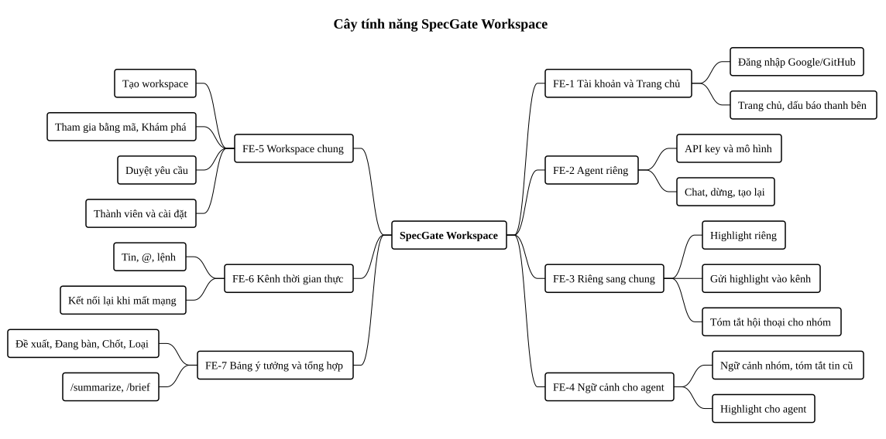

# Tài liệu Tầm nhìn và Phạm vi (Vision and Scope Document)

## cho SpecGate Workspace (Sàng Ý)

Phiên bản 1.0, bản duyệt
Người lập: Nhóm SpecGate
Ngày 18/11/2026

---

## Mục lục

- [Lịch sử sửa đổi](#lịch-sử-sửa-đổi)
- [1. Yêu cầu nghiệp vụ (Business Requirements)](#1-yêu-cầu-nghiệp-vụ-business-requirements)
  - [1.1. Bối cảnh (Background)](#11-bối-cảnh-background)
  - [1.2. Cơ hội nghiệp vụ (Business Opportunity)](#12-cơ-hội-nghiệp-vụ-business-opportunity)
  - [1.3. Mục tiêu nghiệp vụ (Business Objectives)](#13-mục-tiêu-nghiệp-vụ-business-objectives)
  - [1.4. Chỉ số thành công (Success Metrics)](#14-chỉ-số-thành-công-success-metrics)
  - [1.5. Tuyên bố tầm nhìn (Vision Statement)](#15-tuyên-bố-tầm-nhìn-vision-statement)
  - [1.6. Rủi ro nghiệp vụ (Business Risks)](#16-rủi-ro-nghiệp-vụ-business-risks)
  - [1.7. Giả định và phụ thuộc (Business Assumptions and Dependencies)](#17-giả-định-và-phụ-thuộc-business-assumptions-and-dependencies)
- [2. Phạm vi và giới hạn (Scope and Limitations)](#2-phạm-vi-và-giới-hạn-scope-and-limitations)
  - [2.1. Tính năng chính (Major Features)](#21-tính-năng-chính-major-features)
  - [2.2. Phạm vi các bản phát hành (Scope of Initial and Subsequent Releases)](#22-phạm-vi-các-bản-phát-hành-scope-of-initial-and-subsequent-releases)
  - [2.3. Giới hạn và loại trừ (Limitations and Exclusions)](#23-giới-hạn-và-loại-trừ-limitations-and-exclusions)
- [3. Bối cảnh nghiệp vụ (Business Context)](#3-bối-cảnh-nghiệp-vụ-business-context)
  - [3.1. Hồ sơ các bên liên quan (Stakeholder Profiles)](#31-hồ-sơ-các-bên-liên-quan-stakeholder-profiles)
  - [3.2. Thứ tự ưu tiên của dự án (Project Priorities)](#32-thứ-tự-ưu-tiên-của-dự-án-project-priorities)
  - [3.3. Lưu ý khi triển khai (Deployment Considerations)](#33-lưu-ý-khi-triển-khai-deployment-considerations)

## Lịch sử sửa đổi

| Người sửa | Ngày | Lý do thay đổi | Phiên bản |
| --- | --- | --- | --- |
| Nhóm SpecGate | 13/11/2026 | Bản nháp đầu, cùng SRS 0.2 | 1.0 nháp 1 |
| Nhóm SpecGate | 18/11/2026 | Cập nhật theo `flow.md` đã chốt và SRS 0.3 | 1.0 bản duyệt |

---

## 1. Yêu cầu nghiệp vụ (Business Requirements)

### 1.1. Bối cảnh (Background)

Khi một nhóm cùng lên ý tưởng cho một đồ án hay một nghiên cứu, mỗi thành viên thường hỏi một agent AI riêng: người dùng Claude, người dùng DeepSeek, người dùng ChatGPT. Mỗi người một phiên chat, và các phiên này không thấy nhau. Agent của người này không biết người kia đã bàn gì, đã gạt bỏ ý nào, nên hay đề xuất lại những ý nhóm đã loại, hoặc trả lời lạc khỏi hướng nhóm đang đi.

Để agent hiểu được, mọi người phải tự copy và dán qua lại. Ví dụ Lan lo phần dựng khung và dùng Claude, Long làm runner và dùng DeepSeek. Claude của Lan viết "hãy hỏi runner những câu này"; Lan copy sang chat nhóm, Long copy vào DeepSeek, lọc câu trả lời rồi dán lại vào chat nhóm, Lan lại copy vào Claude. Mỗi vòng hỏi đáp mất bốn lần copy và dán, và agent không biết câu nào do ai nói. Khi chat nhóm dài ra, những quyết định đã chốt và lý do loại một ý chìm trong lịch sử tin nhắn, không ai và không agent nào nhớ lại được.

### 1.2. Cơ hội nghiệp vụ (Business Opportunity)

Một website đặt chat riêng với agent và kênh nhóm cạnh nhau, với cơ chế chuyển ngữ cảnh có kiểm soát giữa hai nơi, sẽ bỏ được vòng copy và dán: người dùng highlight đoạn đáng giá trong câu trả lời của agent rồi gửi vào kênh kèm tên người nói; agent của mỗi người tự đọc tin chủ của nó đã gửi; tin của người khác chỉ vào agent khi người dùng highlight cho agent. Kỹ thuật này gọi là dựng ngữ cảnh cho agent có con người tham gia (human-in-the-loop context engineering): con người chọn lọc những gì agent được đọc, mỗi đoạn đều ghi rõ người nói.

Bảng ý tưởng có cột Đã loại kèm lý do, được gửi kèm cho agent của mọi thành viên, giúp agent không đề xuất lại ý đã bị gạt bỏ.

Mỗi người dùng tự mang API key của mình, nên website không phải trả tiền gọi mô hình, và nhóm được dùng song song nhiều nhà cung cấp AI khác nhau.

### 1.3. Mục tiêu nghiệp vụ (Business Objectives)

**BO-1:** Bỏ thao tác copy và dán giữa chat riêng và chat nhóm trong một vòng hỏi đáp giữa hai thành viên, trong vòng 1 tháng sau bản phát hành đầu.

| Thước đo | Nội dung |
| --- | --- |
| Đại lượng (Scale) | Số lần copy và dán thủ công trong một vòng hỏi đáp mẫu giữa hai người dùng hai agent khác nhau |
| Cách đo (Meter) | Buổi thử nghiệm có quan sát theo kịch bản "Một vòng làm việc mẫu" của `flow.md`; kịch bản tự động Playwright tương ứng |
| Hiện tại (Past) | 4 lần mỗi vòng khi dùng các trang chat riêng của nhà cung cấp (`flow.md`) |
| Mục tiêu (Goal) | 0 lần |
| Mục tiêu vượt (Stretch) | 0 lần và thời gian một vòng giảm ít nhất 50% so với cách cũ |

**BO-2:** Agent của thành viên không đề xuất lại ý nhóm đã loại trong các hội thoại có chọn ngữ cảnh nhóm.

| Thước đo | Nội dung |
| --- | --- |
| Đại lượng | Tỉ lệ câu trả lời của agent có đề xuất lại một ý đang nằm ở cột Đã loại |
| Cách đo | 20 câu hỏi kiểm tra trên workspace mẫu có 5 ý đã loại, chạy với ít nhất hai nhà cung cấp; người chấm đọc từng câu trả lời |
| Hiện tại | Chưa đo; đo cùng bộ câu hỏi khi không chọn ngữ cảnh nhóm để làm mốc |
| Mục tiêu | Dưới 10% |
| Mục tiêu vượt | Dưới 5% |

**BO-3:** Mọi quyết định của nhóm được ghi lại kèm lý do và xuất được thành bản tổng hợp, trong vòng 1 tháng sau bản phát hành đầu.

| Thước đo | Nội dung |
| --- | --- |
| Đại lượng | Tỉ lệ ý ở cột Đã chốt, Đã loại có lý do, người quyết định, thời điểm |
| Cách đo | Đếm trong CSDL (`ws_board_items`) của các workspace dùng thật |
| Hiện tại | Không có ghi nhận có cấu trúc; quyết định nằm rải rác trong chat nhóm |
| Mục tiêu | 100% (hệ thống không cho chốt hay loại khi thiếu lý do) |

### 1.4. Chỉ số thành công (Success Metrics)

**SM-1:** Ít nhất 3 nhóm (mỗi nhóm từ 3 người, mỗi người một agent riêng) dùng SpecGate cho đồ án của mình ít nhất 2 buổi mỗi tuần trong 4 tuần sau bản phát hành đầu.

**SM-2:** Điểm hài lòng trung bình của người dùng trong khảo sát sau 4 tuần đạt từ 4 trên thang 5; ít nhất 80% người trả lời đồng ý rằng "agent hiểu nhóm đang bàn gì".

**SM-3:** 95% kịch bản kiểm thử chấp nhận đạt; 100% kiểm thử bảo mật đạt (xem [testplan.md](testplan.md)).

### 1.5. Tuyên bố tầm nhìn (Vision Statement)

Dành cho **các nhóm cùng lên ý tưởng, mỗi người dùng một agent AI riêng**, những người **phải copy và dán qua lại để agent của mình hiểu nhóm đang bàn gì**, **SpecGate Workspace** là **một website làm việc nhóm** giúp **mỗi agent đọc đúng những gì con người đã chọn lọc từ cuộc bàn bạc của nhóm, luôn kèm tên người nói, và giúp nhóm ghi lại quyết định kèm lý do cùng số liệu làm bằng chứng**. Khác với **việc dùng song song các trang chat riêng của từng nhà cung cấp cộng với một ứng dụng chat nhóm**, SpecGate **nối chat riêng và kênh nhóm bằng highlight có ghi người nói, không để agent tự hành động trong nhóm, và cho mỗi người tự mang key, tự chọn nhà cung cấp**.

### 1.6. Rủi ro nghiệp vụ (Business Risks)

Xác suất từ 0 đến 1; mức ảnh hưởng từ 1 (thấp) đến 10 (cao).

**RI-1:** Người dùng ngại tạo và trả tiền API key, vì quen dùng gói thuê bao (Claude Pro, ChatGPT Plus) không dùng được ở đây. (Xác suất = 0,5; Ảnh hưởng = 8)

**RI-2:** Người dùng không highlight cho agent mà chỉ chat nhóm như cũ, nên agent vẫn thiếu ngữ cảnh và giá trị của hệ thống không thể hiện. (Xác suất = 0,4; Ảnh hưởng = 7)

**RI-3:** Ngữ cảnh nhóm làm mỗi câu hỏi dài hơn, tăng chi phí key của người dùng hơn mức họ chấp nhận. (Xác suất = 0,3; Ảnh hưởng = 5)

**RI-4:** Nhà cung cấp AI đổi API, giới hạn tần suất hoặc giá, làm agent của một số người ngừng chạy. (Xác suất = 0,3; Ảnh hưởng = 6)

**RI-5:** Lộ API key hoặc hội thoại riêng làm mất niềm tin của người dùng. (Xác suất = 0,1; Ảnh hưởng = 10)

### 1.7. Giả định và phụ thuộc (Business Assumptions and Dependencies)

**AS-1:** Người dùng tự có API key hợp lệ của Anthropic hoặc một dịch vụ kiểu OpenAI (OpenAI, DeepSeek, OpenRouter, Groq, Ollama) và tự chịu chi phí của key đó.

**AS-2:** Người dùng có tài khoản Google hoặc GitHub.

**AS-3:** Người dùng có kết nối Internet khi làm việc; website không có chế độ ngoại tuyến.

**AS-4:** Mỗi nhóm có một người đứng ra làm chủ workspace, chịu trách nhiệm duyệt thành viên và chọn ý đưa vào bàn.

**DE-1:** Đăng nhập phụ thuộc OAuth của Google và GitHub.

**DE-2:** Agent phụ thuộc API của các nhà cung cấp AI; hệ thống hỗ trợ hai kiểu: Anthropic và định dạng kiểu OpenAI.

---

## 2. Phạm vi và giới hạn (Scope and Limitations)

### 2.1. Tính năng chính (Major Features)

**FE-1:** Đăng nhập bằng Google hoặc GitHub; Trang chủ gọn; dấu báo tin chưa đọc, tin nhắc tên và yêu cầu tham gia ở thanh bên.

**FE-2:** Agent riêng bằng API key của mỗi người: kiểm key, chọn mô hình, chat với câu trả lời hiện dần, dừng, tạo lại có phiên bản.

**FE-3:** Đưa kết quả từ workspace riêng vào kênh nhóm: Highlight riêng (lưu, xem lại, sửa, dọn dẹp), gửi highlight vào kênh kèm nhãn người nói và mức trung thực, tóm tắt hội thoại cho nhóm.

**FE-4:** Ngữ cảnh nhóm cho agent: chọn workspace làm ngữ cảnh cho hội thoại, khung "Agent đang đọc", tóm tắt tin cũ theo khối; Highlight cho agent trên tin của người khác.

**FE-5:** Workspace chung: tạo, tham gia bằng mã hoặc qua trang Khám phá, chủ duyệt yêu cầu, quản lý thành viên, tên trong workspace, vai trong nhóm, cài đặt.

**FE-6:** Kênh chat thời gian thực: tin, nhắc tên, gợi ý lệnh, bốn loại tin, kết nối lại và hiện bù tin khi mạng chập chờn.

**FE-7:** Bảng ý tưởng bốn cột (Đề xuất, Đang bàn, Đã chốt, Đã loại) với lý do bắt buộc; tóm tắt kênh (`/summarize`) và bản tổng hợp tải được dạng Markdown (`/brief`).

*Hình 1. Cây tính năng SpecGate Workspace. Mã nguồn: [feature-tree.puml](../uml/vision/feature-tree.puml)*

### 2.2. Phạm vi các bản phát hành (Scope of Initial and Subsequent Releases)

Bản 1 là đợt này của đồ án; bản 2, bản 3 là việc làm sau ghi trong SRS mục 8.2.

| Tính năng | Bản 1 | Bản 2 | Bản 3 |
| --- | --- | --- | --- |
| FE-1 Tài khoản, Trang chủ | Google, GitHub; phiên 30 ngày; dấu báo ở thanh bên | Mời thành viên qua email hoặc GitHub | |
| FE-2 Agent riêng | Anthropic và kiểu OpenAI; chat, dừng, tạo lại có phiên bản | | Dùng gói thuê bao qua kết nối từ ứng dụng của nhà cung cấp |
| FE-3 Riêng sang chung | Highlight riêng; gửi vào kênh từ danh sách và bằng `@`; tóm tắt hội thoại cho nhóm ở bản tối thiểu | Tóm tắt hội thoại cho nhóm đầy đủ | |
| FE-4 Ngữ cảnh cho agent | Ngữ cảnh nhóm, khung "Agent đang đọc", tóm tắt tin cũ theo khối, Highlight cho agent | | |
| FE-5 Workspace chung | Tạo, tham gia bằng mã, Khám phá, duyệt, thành viên, tên, vai, cài đặt | Xóa workspace; xử lý highlight khi rời nhóm (SRS điểm mở 9.4) | |
| FE-6 Kênh | Tin, `@`, lệnh, thời gian thực, kết nối lại | Sửa và xóa tin | |
| FE-7 Bảng, tổng hợp | Bốn cột, `/idea`, `/note`, `/pin`, `/decide`, `/summarize`, `/brief` | Lệnh `/check` do chủ gọi để đối chiếu ý mới với bảng | |

### 2.3. Giới hạn và loại trừ (Limitations and Exclusions)

**LI-1:** Chỉ dùng API key; gói thuê bao như Claude Pro, ChatGPT Plus không dùng được. Không lấy thông tin đăng nhập của gói thuê bao, không viết tiện ích điều khiển trang của nhà cung cấp, vì trái điều khoản.

**LI-2:** Agent chỉ nhận chữ và trả lời bằng chữ: không tìm kiếm web, không đọc tệp hay ảnh, không chạy code. Không tải tệp hay ảnh vào chat.

**LI-3:** Workspace chung không có agent của riêng nó; không có agent trọng tài tự đọc kênh; không agent nào tự trả lời khi được nhắc tên, tự gửi tin, tự chốt ý hay gọi agent khác.

**LI-4:** Không gửi nguyên văn cả hội thoại riêng vào kênh; không xuất hội thoại riêng ra tệp.

**LI-5:** Mỗi người một key và một agent.

**LI-6:** Không có chế độ ngoại tuyến; không có chức năng quản trị viên hệ thống.

---

## 3. Bối cảnh nghiệp vụ (Business Context)

### 3.1. Hồ sơ các bên liên quan (Stakeholder Profiles)

| Bên liên quan | Giá trị chính | Thái độ | Quan tâm chính | Ràng buộc |
| --- | --- | --- | --- | --- |
| Thành viên nhóm (người dùng chính) | Không phải copy và dán; agent hiểu nhóm đang bàn gì; biết ai nói gì | Hào hứng, nhưng có thể quay về chat nhóm quen thuộc nếu highlight tốn công | Dễ dùng; câu trả lời nhanh; riêng tư cho hội thoại riêng; chi phí key | Cần API key và Internet |
| Chủ workspace | Kiểm soát ai vào nhóm; điều phối ý nào được bàn; bản tổng hợp cho báo cáo | Ủng hộ, cần công cụ quản lý gọn | Duyệt nhanh; bảng ý tưởng rõ; `/summarize`, `/brief` | Chịu chi phí key cho `/summarize` |
| Giảng viên hướng dẫn | Đồ án đúng quy trình phần mềm: tài liệu, kiểm thử, triển khai | Trung lập, đánh giá theo tiêu chí môn học | Tài liệu đầy đủ, kiểm thử tự động, sản phẩm chạy được | Lịch nộp cố định |
| Nhóm phát triển | Sản phẩm hoàn chỉnh, mã sạch, dễ bảo trì | Cam kết | Phạm vi vừa sức trong một học kỳ | Nhóm sinh viên, làm song song việc học khác |
| Nhà cung cấp AI, Google, GitHub | Không áp dụng (hệ thống ngoài) | | | Điều khoản sử dụng; giới hạn tần suất |

### 3.2. Thứ tự ưu tiên của dự án (Project Priorities)

| Khía cạnh | Ràng buộc (cố định) | Động lực (ưu tiên đạt) | Bậc tự do (chấp nhận điều chỉnh) |
| --- | --- | --- | --- |
| Tính năng | Mọi tính năng mức M của bản 1 phải chạy đầy đủ | | Tính năng mức T (tóm tắt hội thoại cho nhóm) chấp nhận bản tối thiểu |
| Chất lượng | 95% kiểm thử chấp nhận đạt; 100% kiểm thử bảo mật đạt; không lộ key, không đọc được dữ liệu riêng của người khác | | |
| Lịch | Bản 1 hoàn thành 02/12/2026, nộp và bảo vệ 03/12/2026 (kế hoạch 2 tuần ở [SPRINT_PLAN.md](SPRINT_PLAN.md)) | | Tính năng mức T được giữ ở bản tối thiểu nếu thiếu thời gian |
| Chi phí | Không dùng key AI thật trong kiểm thử tự động; hạ tầng dùng gói miễn phí hoặc một VPS nhỏ | | |
| Nhân lực | | Nhóm sinh viên khoảng 5 người, mỗi người dành khoảng một nửa thời gian | |

### 3.3. Lưu ý khi triển khai (Deployment Considerations)

- Bản 1 chạy trên một VPS bằng Docker Compose: Caddy nhận HTTPS và chia đường `/api/*` cho backend FastAPI, phần còn lại cho web Next.js (xem `deploy/README.md`).
- CSDL chuyển từ SQLite sang Postgres do Supabase quản lý khi triển khai thật; Supabase chỉ dùng làm Postgres, đăng nhập vẫn do backend tự làm OAuth (xem [supabase-setup.md](supabase-setup.md)). Phải khóa Data API của Supabase bằng RLS hoặc tắt hẳn.
- Phải đặt `SECRET_KEY` riêng và giữ nguyên qua các lần triển khai, vì khóa mã hóa API key suy ra từ đây.
- Phải đăng ký ứng dụng OAuth Google, GitHub với địa chỉ callback `<PUBLIC_API_URL>/api/v1/auth/{provider}/callback`; khi chưa có OAuth thật, giữ lớp mật khẩu chung của Caddy và không mở đăng nhập giả lập ra Internet.
- Backend chạy một tiến trình (bộ phát tin thời gian thực nằm trong tiến trình); muốn chạy nhiều bản phải chuyển sang Postgres LISTEN/NOTIFY hoặc Supabase Realtime.
- Cần một video ngắn (không quá 5 phút) hướng dẫn vòng làm việc mẫu: nhập key, tạo nhóm, highlight, gửi vào kênh, highlight cho agent, chốt ý, xuất bản tổng hợp.
