# SpecGate Workspace: tổng quan website

Tài liệu ngắn về website: giải quyết bài toán gì, các luồng chính, những quy tắc đã chốt và công nghệ sử dụng. Rút gọn từ bản phản hồi Script4; phần mô-đun ADOM do nhóm khác phụ trách nên không nằm ở đây.

## 1. Bài toán

Hai người cùng lên ý tưởng, mỗi người hỏi một agent riêng (có thể khác nhà cung cấp, có thể cùng một họ). Các phiên chat không giao nhau, nên khi B gọi agent, agent không biết A đã bàn gì, đã loại gì. Kết quả là agent sinh lại giả thuyết đã bị loại hoặc đi lạc đề, và mọi người phải copy, dán ngữ cảnh qua lại.

Ví dụ: Lan dựng khung và dùng Claude, Long làm runner và dùng DeepSeek. Claude của Lan viết "hãy hỏi runner những câu này". Lan copy sang chat nhóm, Long copy vào DeepSeek, lọc câu trả lời rồi dán lại, Lan lại copy vào Claude: "Runner đã phản hồi…". Mỗi vòng hỏi đáp là bốn lần copy và dán.

SpecGate cho mỗi người một **workspace riêng**, nơi họ chat với **agent riêng** của mình (bằng key của mình, tự mô tả vai của mình). Bên cạnh đó có **workspace chung**, nơi cả nhóm và câu trả lời của các agent gặp nhau. **Agent ở workspace riêng và agent gửi tin vào kênh chung là một**: câu trả lời trong workspace riêng gửi thẳng vào kênh dưới tên "agent của ai", không phải copy.

Ngữ cảnh mà agent riêng đọc từ workspace chung không phải là toàn bộ đoạn chat. Đổ hết vào chỉ chuyển sự nhiễu sang chỗ khác, tốn token và agent vẫn có thể lấy nhầm ý đã bỏ. Agent tự đọc **tin của chính chủ nó** (kể cả tin nó đã gửi); tin của người khác thì chủ nó phải **highlight** mới vào ngữ cảnh. Vì vậy highlight là tính năng trung tâm: con người lọc thông tin của người khác, agent biết rõ đoạn nào do ai nói.

Điểm khác với các sản phẩm chat nhóm của từng nhà cung cấp: mỗi người mang agent của nhà cung cấp mình chọn vào cùng một kênh, ngữ cảnh do người chọn lọc, và bảng ý tưởng có trạng thái chốt hoặc loại kèm lý do.

## 2. Các phần của website

### Workspace riêng: chat với agent bằng key của mình

- Người dùng nhập API key của một nhà cung cấp, hệ thống kiểm key và trả danh sách mô hình để chọn, rồi chat nhiều lượt như một trang LLM, câu trả lời hiện dần (stream).
- Chỉ cần hai bộ chuyển đổi: Anthropic và định dạng kiểu OpenAI. Bộ thứ hai dùng được cho OpenAI, OpenRouter, DeepSeek, Groq, Ollama… chỉ khác địa chỉ API.
- Gọi mô hình qua backend, không gọi thẳng từ trình duyệt, để key không lộ ra tab Network.
- Key mã hóa khi lưu, chỉ ghi không đọc lại, giao diện chỉ hiện 4 ký tự cuối.
- Gói thuê bao như ChatGPT Plus hay Claude Pro không phải API key; màn nhập key ghi rõ điều này.
- Không có kênh, bảng hay thành viên. Hội thoại chỉ người đó thấy.
- Mỗi hội thoại có thể **gắn một workspace chung** làm ngữ cảnh nhóm. Khi gắn, mỗi lời gọi mô hình gửi kèm: đề bài, đội (tên, vai trong nhóm, agent của từng người), ý đã chốt và đã loại kèm lý do, mọi tin của chính mình trong các kênh, và các đoạn mình đã highlight kèm người nói. Khung "Agent đang đọc" cạnh hội thoại cho thấy đúng phần này.

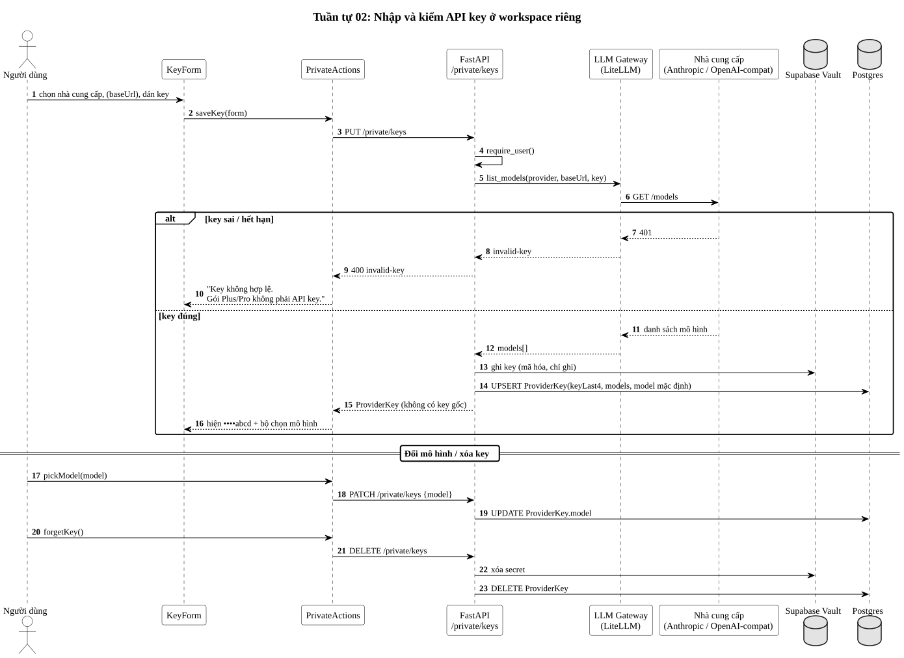

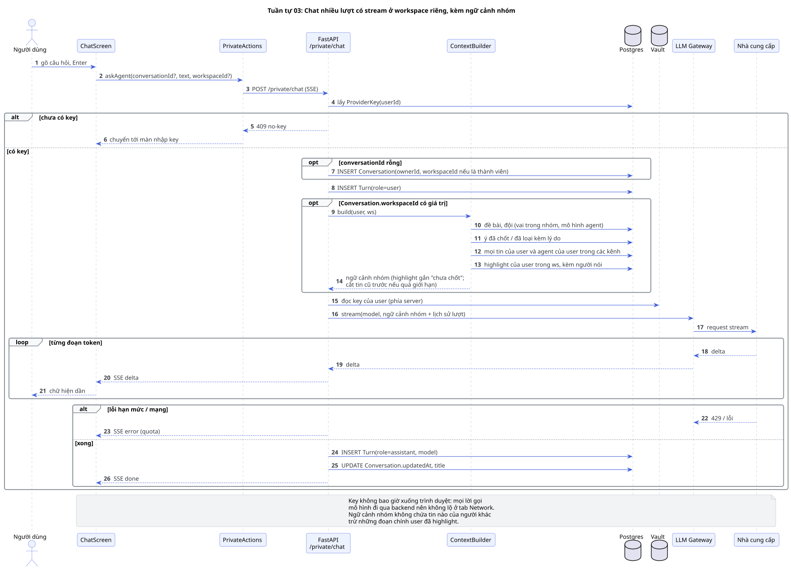

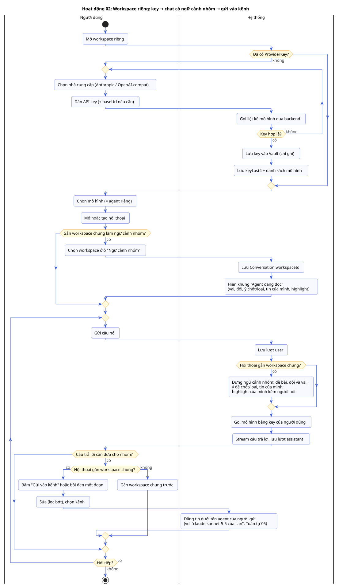

### Gửi câu trả lời của agent vào kênh

1. Trong hội thoại đã gắn workspace chung, bấm "Gửi vào kênh" dưới một câu trả lời, hoặc bôi đen một đoạn rồi bấm "Gửi đoạn này vào kênh".
2. Sửa (lọc bớt) nội dung, chọn kênh, gửi.
3. Tin hiện trong kênh dưới tên agent của người gửi, ví dụ `claude-sonnet-5-5 của Lan`. Hội thoại gốc không đi theo.

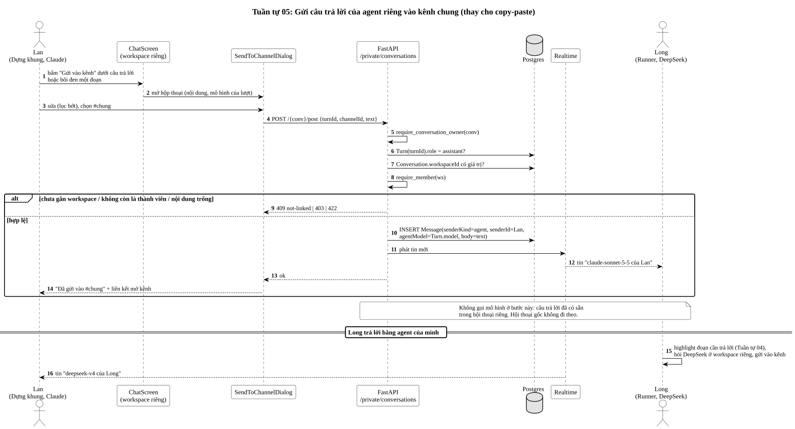

### Highlight: đưa tin của người khác vào ngữ cảnh agent của mình

1. Trong kênh chung, bôi đen một đoạn trong tin của người khác (người hoặc agent của người khác), bấm Highlight, chọn nhãn _Quan trọng_ hoặc _Cần xem xét_.
2. Đoạn vào "Highlight của tôi" và vào ngữ cảnh agent riêng của mình, kèm người nói (ví dụ "Khang nói", "deepseek-v4 của Long nói") và nhãn "chưa chốt".
3. Agent riêng phản hồi được theo người nói, ví dụ "Khang nói như vậy là chưa chính xác".

Tin của chính mình và của agent mình không cần highlight: agent tự đọc. Highlight lưu **bản chụp văn bản** và người nói, không lưu vị trí ký tự; chỉ người tạo thấy highlight của mình.

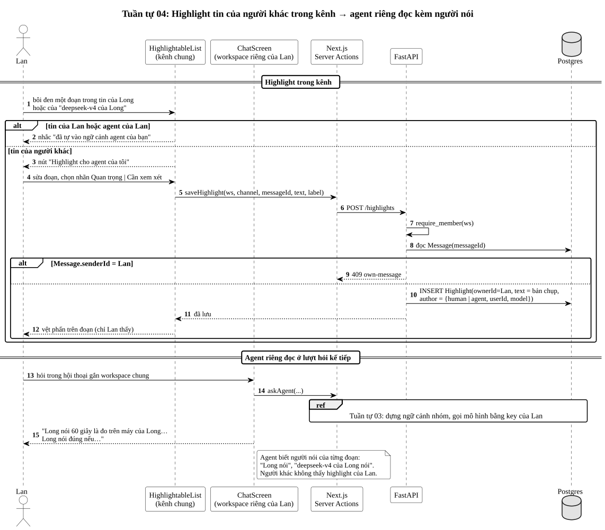

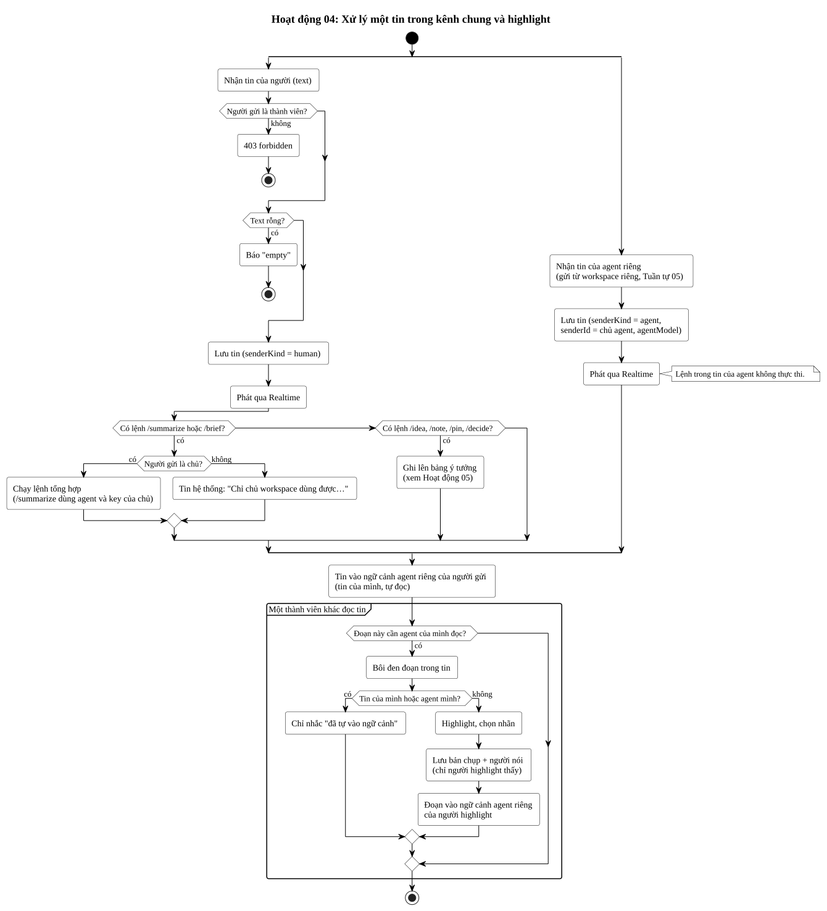

### Workspace chung

- Kênh chat thời gian thực. Người nhắn trực tiếp; agent của mỗi thành viên vào kênh qua "Gửi vào kênh" từ workspace riêng. Không có agent của riêng workspace, không có agent tự trả lời khi được gọi tên.
- Mỗi thành viên tự ghi **vai trong nhóm** (ví dụ "Dựng khung", "Runner"); agent của mọi thành viên đọc được, nên biết trong nhóm còn ai và ai làm gì.
- Bảng ý tưởng có bốn cột: đề xuất, đang bàn, đã chốt, đã loại. Trạng thái phân biệt bằng cột và chữ, không tô màu. Chốt hoặc loại phải kèm lý do và không quay ngược được.
- Bản tổng hợp dựng từ bảng, tải được dạng Markdown.
- Vào workspace chung có hai cách, cả hai đều chờ chủ duyệt: nhập mã 7 ký tự do thành viên chia sẻ, hoặc tìm ở trang Khám phá rồi gửi yêu cầu kèm lời nhắn.

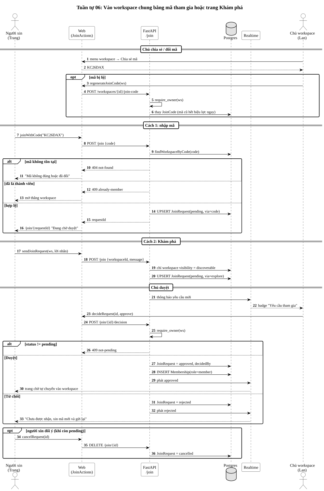

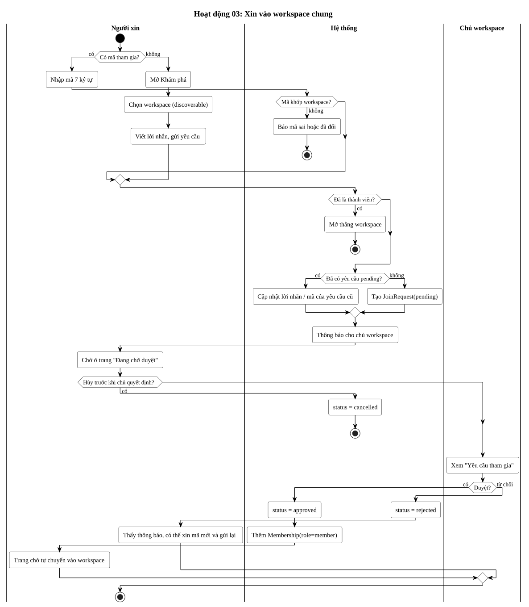

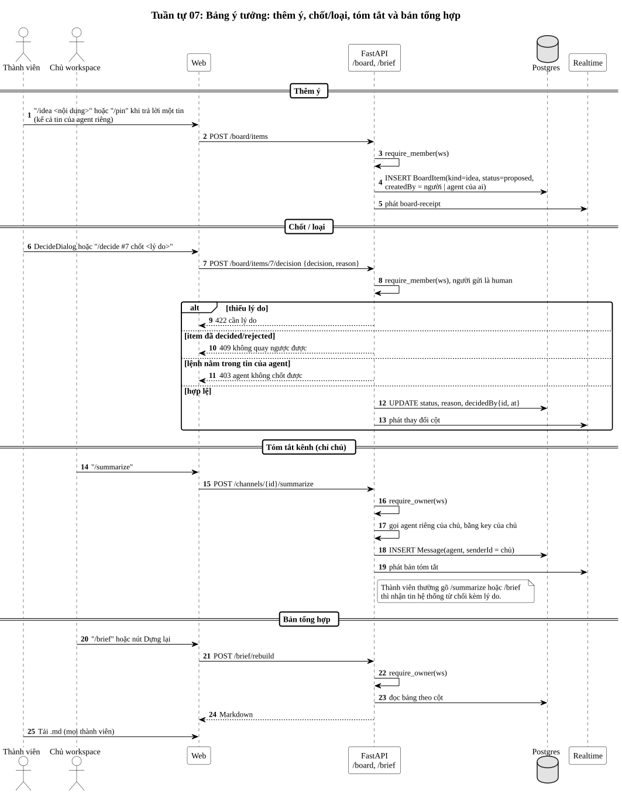

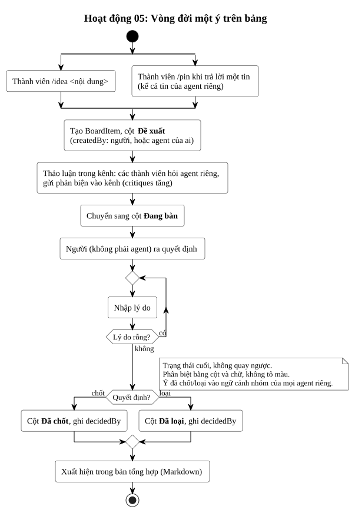

### Đăng nhập và đăng ký

Chỉ dùng Google hoặc GitHub, không có mật khẩu riêng. Lần đầu đăng ký, hệ thống tạo tài khoản kèm workspace riêng rồi chuyển sang màn nhập key. Tài khoản Google/GitHub đã đăng ký thì được đăng nhập luôn, không tạo trùng.

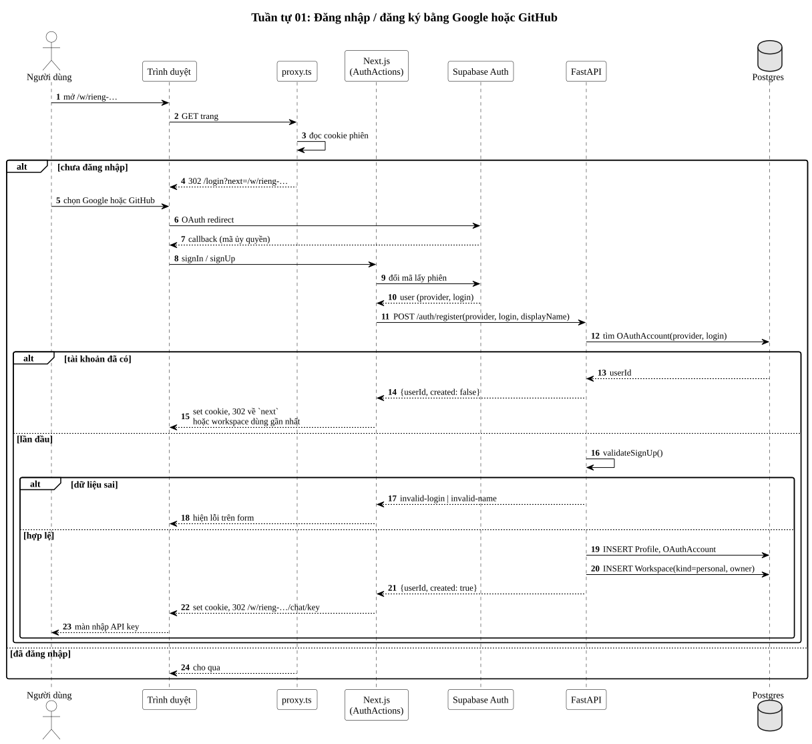

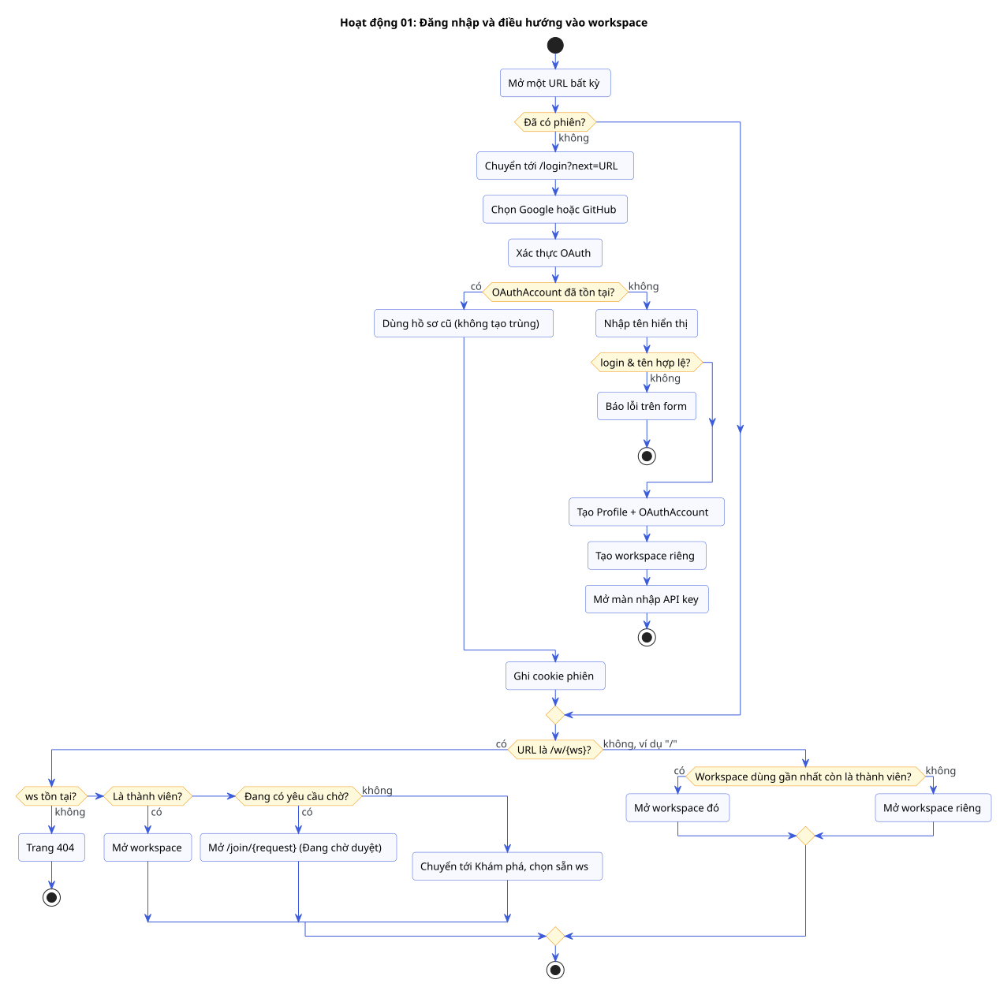

### Làm sau, nếu còn thời gian

- Chia sẻ cả một hội thoại vào kênh chung (bản chụp, chọn lượt, giới hạn số lượt).
- Mời qua email hoặc GitHub, bên cạnh mã tham gia.

## 3. Quy tắc đã chốt

| Chủ đề                | Quy tắc                                                                                                            |
| --------------------- | ------------------------------------------------------------------------------------------------------------------ |
| Chủ đề | Quy tắc |
| --- | --- |
| Agent | Mỗi người một agent riêng; agent ở workspace riêng và agent gửi tin vào kênh là một |
| Key | Agent chạy bằng key của chính chủ nó, ở cả workspace riêng lẫn khi gửi vào kênh; chi phí tính vào key đó |
| Ghi tên | Tin của agent trong kênh luôn ghi mô hình và chủ, ví dụ `deepseek-v4 của Long` |
| Ngữ cảnh agent | Tự đọc tin của chủ nó (kể cả tin agent đó gửi); tin của người khác chỉ đọc khi chủ nó highlight |
| Highlight | Chỉ người tạo thấy; lưu kèm người nói; chỉ đánh dấu, chưa phải chốt; không tự vào bảng ý tưởng |
| Tổng hợp | `/summarize`, `/brief` chỉ chủ workspace dùng được; `/summarize` chạy bằng agent và key của chủ |
| Chốt và loại | Chỉ người làm, bắt buộc lý do; agent không chốt được |

Chưa chốt: xem `docs/SRS.md` mục 8.

## 4. Phạm vi trong 21 ngày (2 người)

15 ngày làm việc, 30 ngày công. Phần bắt buộc chiếm khoảng 29 ngày công:

- lõi workspace chung: đăng nhập, workspace, mã tham gia và duyệt, kênh realtime, vai trong nhóm, bảng ý tưởng, lệnh, bản tổng hợp;
- workspace riêng nhập key, chat nhiều lượt có stream, gắn ngữ cảnh nhóm, gửi câu trả lời vào kênh;
- highlight trong kênh chung.

Mô hình agent riêng bỏ được ba agent theo vai của workspace, hàng đợi gọi agent trong kênh, luật agent gọi agent và trần chi phí trên key của chủ; bù lại có thêm bộ dựng ngữ cảnh nhóm cho hội thoại riêng, nút gửi vào kênh, highlight trong kênh và vai trong nhóm. Tổng công gần như không đổi.

Đệm chỉ khoảng 1 ngày công, nên chia sẻ cả hội thoại và mời qua email/GitHub để sau. Nếu trễ, highlight lùi về "highlight cả tin nhắn" thay vì bôi đen một đoạn.

Chi tiết theo ngày nằm trong kế hoạch sprint.

## 5. Công nghệ

### Frontend (thư mục `web_ui/`, đang dùng)

| Phần          | Công nghệ                                                                                                |
| ------------- | -------------------------------------------------------------------------------------------------------- |
| Khung         | Next.js 16 (App Router, Server Components, Server Actions, Cache Components), React 19                   |
| Ngôn ngữ      | TypeScript ở chế độ strict                                                                               |
| Giao diện     | Tailwind CSS 4, shadcn/ui trên Radix UI, biểu tượng Lucide                                               |
| Font          | Be Vietnam Pro (đủ dấu tiếng Việt), JetBrains Mono cho tên mô hình và mã                                 |
| Màu           | Token CSS trong `src/app/globals.css`, chủ đề sáng trắng dịu và xanh dương; cấm viết mã hex trong `.tsx` |
| Kiểm thử      | Vitest, Testing Library, jsdom; Playwright cho kịch bản đầu-cuối                                         |
| Chất lượng mã | ESLint, Prettier, `tsc`; chạy chung bằng `pnpm check`                                                    |
| Quản lý gói   | pnpm                                                                                                     |

### Backend (theo kế hoạch sprint)

| Phần        | Công nghệ                                                                                   |
| ----------- | ------------------------------------------------------------------------------------------- |
| API         | Python, FastAPI, Pydantic                                                                   |
| Dữ liệu     | Supabase Postgres; SQLAlchemy async với asyncpg; Alembic cho migration                      |
| Đăng nhập   | Supabase Auth với Google và GitHub                                                          |
| Phân quyền  | Row Level Security của Postgres, kèm kiểm tra thành viên ở API                              |
| Realtime    | Supabase Realtime: tin nhắn mới và câu trả lời agent stream tới mọi thành viên              |
| Lưu key     | Supabase Vault (mã hóa, chỉ ghi)                                                            |
| Gọi mô hình | Cổng LLM qua LiteLLM: stream, đếm token, ước tính chi phí; agent giả tất định cho dev và CI |
| Kiểm thử    | pytest, Hypothesis (kiểm thử theo thuộc tính), Schemathesis (kiểm thử theo OpenAPI)         |
| Triển khai  | Backend chạy Docker trên VPS, frontend trên Vercel                                          |

## 6. Hiện trạng

- Giao diện đã làm đủ các luồng ở mục 2 nhưng chạy trên **dữ liệu giả** trong `src/lib/mock/`. Đăng nhập Google/GitHub, kiểm key và câu trả lời của agent đều là giả lập. Dữ liệu chỉ nằm trong bộ nhớ máy chủ, khởi động lại là về ban đầu.
- Dữ liệu demo có 3 tài khoản, dựng theo kịch bản dựng khung và runner:
  - **Lan** (GitHub `lan-pham`): chủ workspace chung "Đồ án Kiểm chứng" (mã tham gia `KC26DAX`), vai "Dựng khung", agent Claude. Có hội thoại "Thống nhất với runner" gắn workspace chung và hai highlight trong #chung.
  - **Long** (GitHub `long-tran`): thành viên, vai "Runner", agent DeepSeek.
  - **Trang** (Google `trang@example.edu`): có key và một hội thoại chưa gắn workspace chung, chưa vào nhóm; dùng để demo nhập mã rồi chờ Lan duyệt.
  - Màn nhập key: đăng ký một tài khoản mới.
- Chuyển sang backend thật theo ba bước:
  1. Tách lớp dữ liệu thành các hàm bất đồng bộ.
  2. Thêm bản gọi FastAPI, bật bằng biến môi trường.
  3. Thay dần từng phần khi backend có endpoint.

Chạy thử:

```bash
pnpm install
pnpm dev
```

Kiểm tra trước khi gộp:

```bash
pnpm check
```

## 7. Sơ đồ tổng thể

Mã nguồn PlantUML và bảng RBAC đầy đủ: [uml/README.md](uml/README.md).

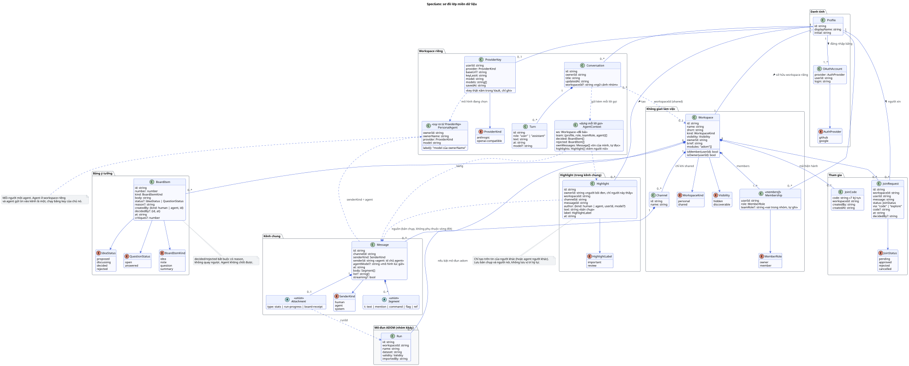

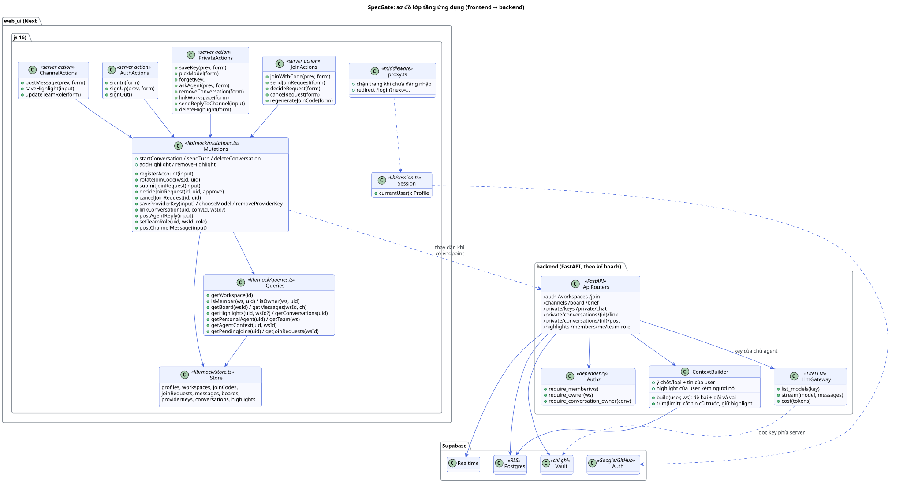


## 8. Ngoài phạm vi

Tiện ích trình duyệt, đăng nhập bằng tài khoản của nhà cung cấp LLM thay cho API key, công cụ của agent (chạy code, duyệt web), tải tệp và ảnh vào chat, nhiều key cho cùng một nhà cung cấp.
