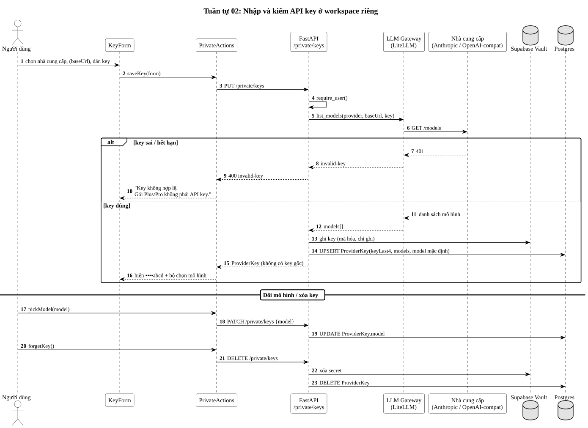
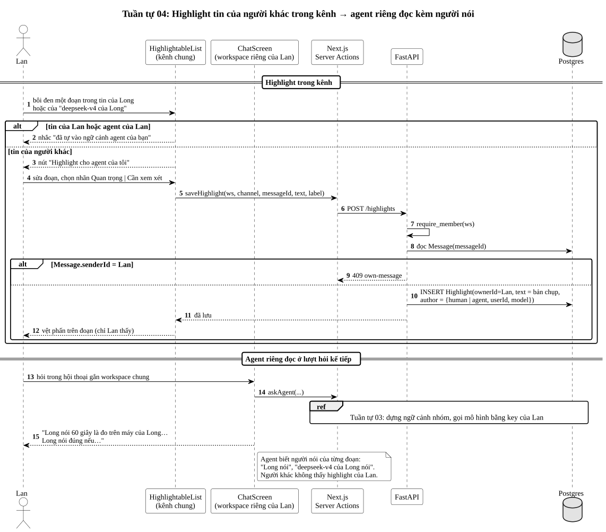
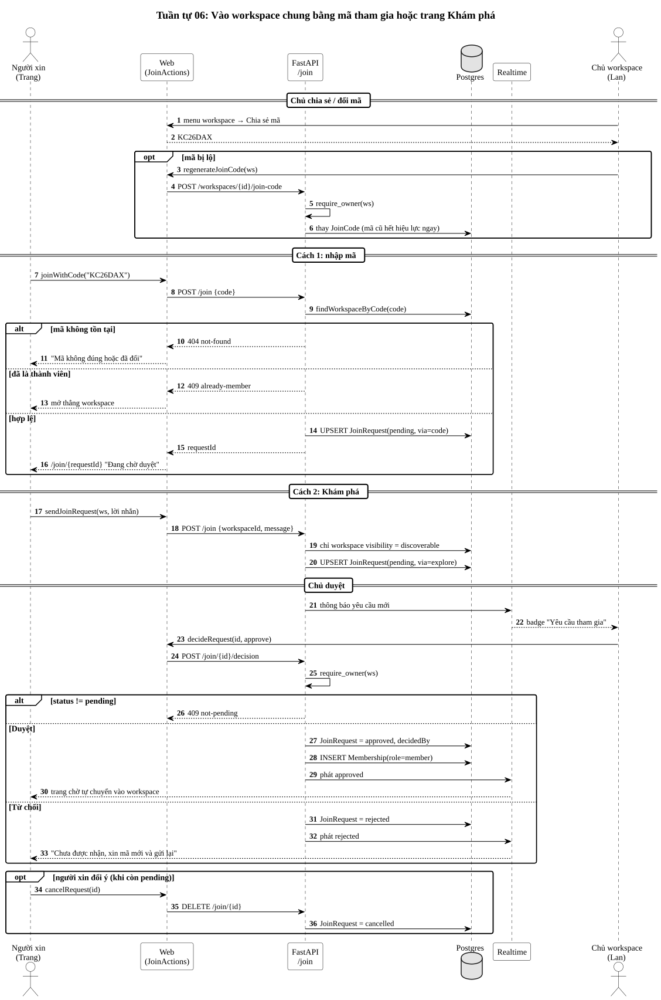
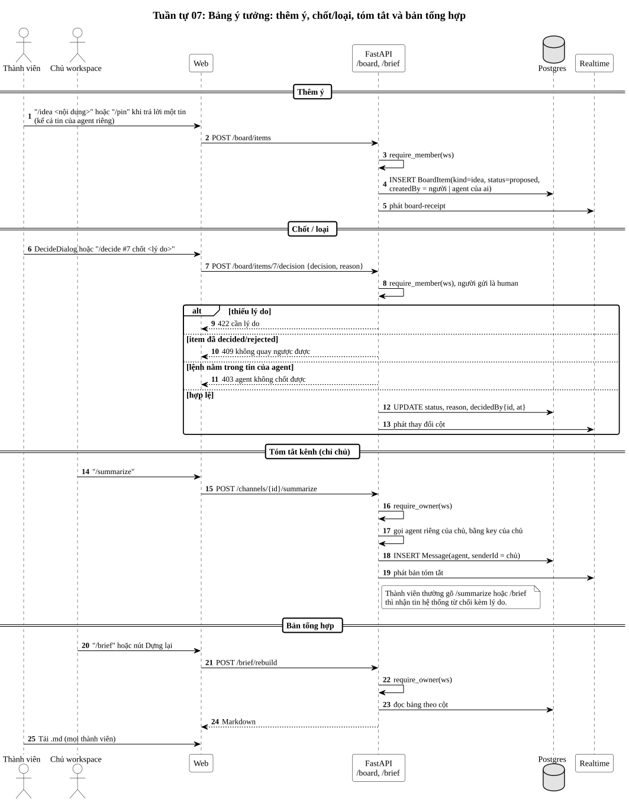
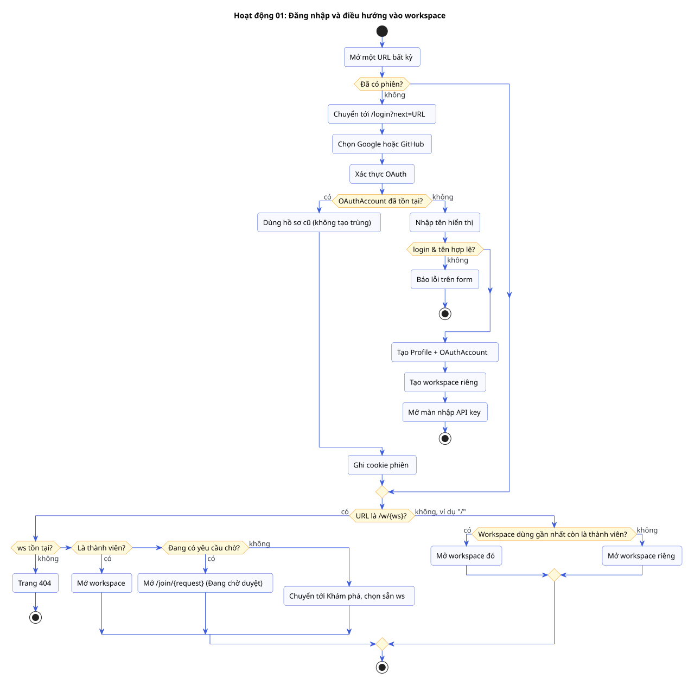
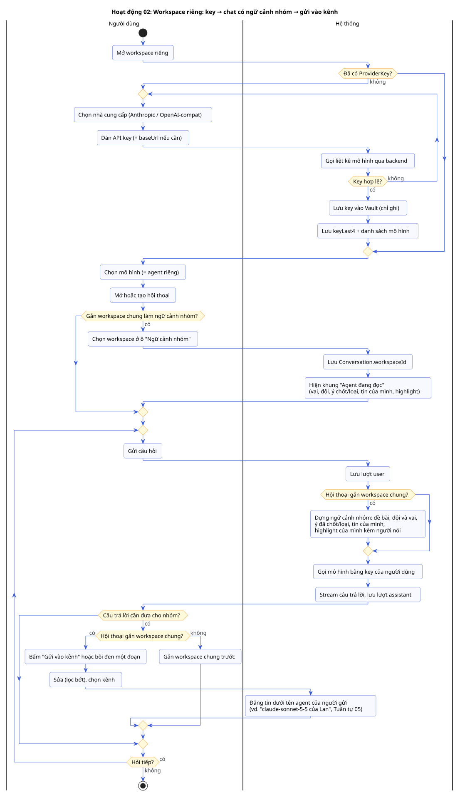
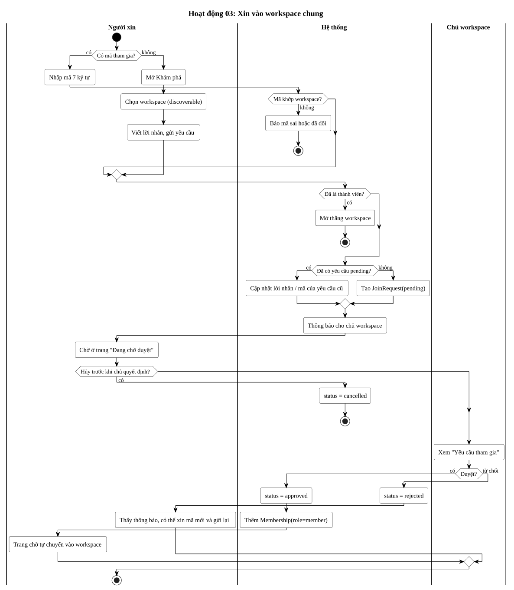
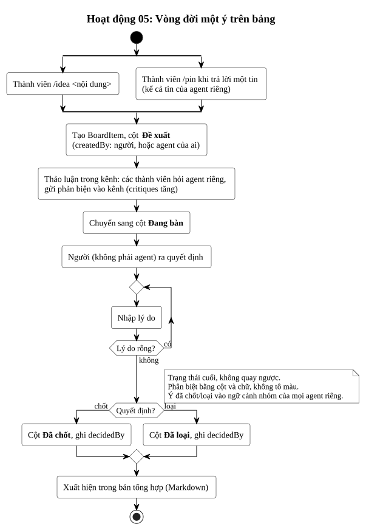

# Sơ đồ UML của SpecGate Workspace

Mã nguồn PlantUML cho các luồng trong [overallweb.md](../overallweb.md), theo mô hình ngữ cảnh của trưởng nhóm (13/11/2026): mỗi người một agent riêng, câu trả lời gửi thẳng vào kênh, highlight tin của người khác trong kênh để agent riêng đọc kèm người nói. Các sơ đồ mô tả kiến trúc **đích** (Next.js → FastAPI → Supabase, LiteLLM). Hiện tại frontend vẫn chạy bằng `web_ui/src/lib/mock/`, nên mỗi lời gọi `FastAPI` trong sơ đồ tương ứng với một hàm trong `mock/mutations.ts`.

## Mục lục

| Loại | File | Nội dung |
|---|---|---|
| Lớp | [class/domain.puml](class/domain.puml) | Miền dữ liệu (theo `web_ui/src/lib/types.ts`) |
| Lớp | [class/architecture.puml](class/architecture.puml) | Các tầng: Server Actions → mock/API → Supabase, LLM Gateway |
| Tuần tự | [sequence/01-login-signup.puml](sequence/01-login-signup.puml) | Đăng nhập / đăng ký Google, GitHub |
| Tuần tự | [sequence/02-save-key.puml](sequence/02-save-key.puml) | Nhập, kiểm, đổi, xóa API key |
| Tuần tự | [sequence/03-private-chat.puml](sequence/03-private-chat.puml) | Chat nhiều lượt có stream, dựng ngữ cảnh nhóm khi hội thoại gắn workspace chung |
| Tuần tự | [sequence/04-highlight-in-channel.puml](sequence/04-highlight-in-channel.puml) | Highlight tin của người khác trong kênh → agent riêng đọc kèm người nói |
| Tuần tự | [sequence/05-agent-reply-to-channel.puml](sequence/05-agent-reply-to-channel.puml) | Gửi câu trả lời của agent riêng vào kênh (thay copy-paste) |
| Tuần tự | [sequence/06-join-workspace.puml](sequence/06-join-workspace.puml) | Mã tham gia / Khám phá → duyệt |
| Tuần tự | [sequence/07-board-and-brief.puml](sequence/07-board-and-brief.puml) | Thêm ý, chốt/loại, `/summarize`, bản tổng hợp |
| Hoạt động | [activity/01-auth-and-routing.puml](activity/01-auth-and-routing.puml) | Đăng nhập và điều hướng |
| Hoạt động | [activity/02-private-chat-context.puml](activity/02-private-chat-context.puml) | Key → chat có ngữ cảnh nhóm → gửi vào kênh |
| Hoạt động | [activity/03-join-workspace.puml](activity/03-join-workspace.puml) | Xin vào workspace chung |
| Hoạt động | [activity/04-channel-message.puml](activity/04-channel-message.puml) | Xử lý tin của người và của agent trong kênh, highlight |
| Hoạt động | [activity/05-board-item-lifecycle.puml](activity/05-board-item-lifecycle.puml) | Vòng đời một ý trên bảng |
| RBAC | [rbac/rbac.puml](rbac/rbac.puml) | Bảng phân quyền dạng ảnh (giống bảng bên dưới) |

`_style.iuml` chứa kiểu dùng chung và được `!include` trong mọi file.

## Xuất ảnh

Ảnh SVG nằm trong [img/](img/). Sau khi sửa một file `.puml`, xuất lại:

```bash
# chạy trong thư mục uml/; cần Java, dùng plantuml.jar kèm extension PlantUML của VS Code
java -jar ~/.vscode/extensions/jebbs.plantuml-*/plantuml.jar -charset UTF-8 -tsvg -o ../img \
  class/*.puml sequence/*.puml activity/*.puml rbac/*.puml
```

Hoặc dùng extension PlantUML trong VS Code (Alt+D để xem trước).

## Sơ đồ lớp

### Miền dữ liệu


### Kiến trúc các tầng


## Sơ đồ tuần tự

### 01. Đăng nhập / đăng ký Google, GitHub


### 02. Nhập, kiểm, đổi, xóa API key



### 03. Chat riêng có stream, dựng ngữ cảnh nhóm


### 04. Highlight tin của người khác trong kênh



### 05. Gửi câu trả lời của agent riêng vào kênh


### 06. Mã tham gia / Khám phá → duyệt



### 07. Bảng ý tưởng và bản tổng hợp



## Sơ đồ hoạt động

### 01. Đăng nhập và điều hướng



### 02. Key → chat có ngữ cảnh nhóm → gửi vào kênh



### 03. Xin vào workspace chung



### 04. Tin trong kênh và highlight


### 05. Vòng đời một ý trên bảng



## Sơ đồ RBAC


## Bảng RBAC

### Vai trò

| Vai trò | Định nghĩa | Kiểm ở đâu |
|---|---|---|
| **Khách** | Chưa đăng nhập | `proxy.ts` chuyển về `/login?next=…` |
| **Người dùng** | Đã đăng nhập, là chủ workspace riêng của mình, chưa thuộc workspace chung đang xét | phiên Supabase Auth |
| **Người xin** | Người dùng có `JoinRequest(status=pending)` với workspace đang xét | `getPendingRequest` |
| **Thành viên** | `Membership(role=member)` của workspace chung | `isMember`, RLS |
| **Chủ WS** | `Membership(role=owner)`, đồng thời là `ownerId` | `isOwner`, RLS |
| **Agent riêng** | Mô hình một người chọn ở workspace riêng, chạy bằng key của người đó. Không tự hành động trong kênh: chỉ chạy khi chủ nó hỏi ở workspace riêng, và tin chỉ vào kênh khi chủ nó gửi | `require_conversation_owner`, ContextBuilder |

Vai trò tính **theo từng workspace**: một người có thể là chủ workspace này và là thành viên ở workspace khác. Chủ WS có mọi quyền của Thành viên.

### Ma trận quyền

✔ được · ✘ không · ◐ có điều kiện · – không áp dụng

| Nhóm | Quyền | Khách | Người dùng | Người xin | Thành viên | Chủ WS | Agent riêng |
|---|---|:-:|:-:|:-:|:-:|:-:|:-:|
| Tài khoản | Đăng nhập / đăng ký Google, GitHub | ✔ | – | – | – | – | ✘ |
| Tài khoản | Đăng xuất | ✘ | ✔ | ✔ | ✔ | ✔ | ✘ |
| WS riêng | Lưu / đổi / xóa API key của mình (tạo agent riêng) | ✘ | ✔ | ✔ | ✔ | ✔ | ✘ |
| WS riêng | Xem key gốc (chỉ thấy 4 ký tự cuối) | ✘ | ✘ | ✘ | ✘ | ✘ | ✘ |
| WS riêng | Chat, xem, xóa hội thoại của mình | ✘ | ✔ | ✔ | ✔ | ✔ | ✘ |
| WS riêng | Xem hội thoại riêng của người khác | ✘ | ✘ | ✘ | ✘ | ✘ | ✘ |
| WS riêng | Gắn hội thoại với workspace chung | ✘ | ✘ | ✘ | ✔ | ✔ | ✘ |
| WS riêng | Gửi câu trả lời của agent mình vào kênh | ✘ | ✘ | ✘ | ✔ | ✔ | ◐⁶ |
| WS chung | Tạo workspace chung (thành chủ) | ✘ | ✔ | ✔ | ✔ | ✔ | ✘ |
| WS chung | Xem kênh, bảng, bản tổng hợp | ✘ | ✘ | ✘ | ✔ | ✔ | ◐¹ |
| WS chung | Xem thành viên, vai, agent riêng (không thấy key) | ✘ | ✘ | ✘ | ✔ | ✔ | ◐¹ |
| WS chung | Đặt vai trong nhóm của mình | ✘ | ✘ | ✘ | ✔ | ✔ | ✘ |
| WS chung | Sửa vai của người khác | ✘ | ✘ | ✘ | ✘ | ✘ | ✘ |
| WS chung | Sửa đề bài, tên, hiển thị ở Khám phá | ✘ | ✘ | ✘ | ✘ | ✔ | ✘ |
| WS chung | Xóa thành viên | ✘ | ✘ | ✘ | ✘ | ✔ | ✘ |
| Tham gia | Xem và chia sẻ mã tham gia | ✘ | ✘ | ✘ | ✔ | ✔ | ✘ |
| Tham gia | Đổi mã (mã cũ hết hiệu lực ngay) | ✘ | ✘ | ✘ | ✘ | ✔ | ✘ |
| Tham gia | Nhập mã / gửi yêu cầu từ Khám phá | ✘ | ✔ | ✔² | ✘³ | ✘³ | ✘ |
| Tham gia | Hủy yêu cầu của mình | ✘ | ✘ | ✔ | ✘ | ✘ | ✘ |
| Tham gia | Xem, duyệt, từ chối yêu cầu | ✘ | ✘ | ✘ | ✘ | ✔ | ✘ |
| Kênh | Gửi tin, @ nhắc người | ✘ | ✘ | ✘ | ✔ | ✔ | ✘ |
| Kênh | Highlight tin của người khác (chỉ mình thấy) | ✘ | ✘ | ✘ | ✔⁴ | ✔⁴ | ✘ |
| Kênh | Xem highlight của người khác | ✘ | ✘ | ✘ | ✘ | ✘ | ✘ |
| Kênh | /idea /note /pin /help | ✘ | ✘ | ✘ | ✔ | ✔ | ✘ |
| Kênh | /summarize /brief | ✘ | ✘ | ✘ | ✘⁵ | ✔ | ✘ |
| Bảng | Thêm ý lên bảng (cột Đề xuất) | ✘ | ✘ | ✘ | ✔ | ✔ | ✘ |
| Bảng | Chốt / loại (bắt buộc lý do) | ✘ | ✘ | ✘ | ✔ | ✔ | ✘ |
| Bảng | Mở lại ý đã chốt / loại | ✘ | ✘ | ✘ | ✘ | ✘ | ✘ |
| Tổng hợp | Dựng lại bản tổng hợp | ✘ | ✘ | ✘ | ✘ | ✔ | ✘ |
| Tổng hợp | Tải bản tổng hợp Markdown | ✘ | ✘ | ✘ | ✔ | ✔ | ✘ |
| Chi phí | Gọi mô hình bằng key của chủ agent | – | – | – | – | – | ◐⁷ |
| ADOM | Xem lượt chạy, chỉ số; /stats /task | ✘ | ✘ | ✘ | ✔ | ✔ | ✘ |
| ADOM | Nhập báo cáo, /run | ✘ | ✘ | ✘ | ✔ | ✔ | ✘ |

1. Agent riêng chỉ "đọc" qua ContextBuilder khi chủ nó hỏi trong hội thoại gắn workspace: đề bài, đội và vai, ý chốt/loại, tin của chủ nó, highlight của chủ nó kèm người nói.
2. Gửi lại thì cập nhật yêu cầu đang chờ, không tạo trùng.
3. Đã là thành viên thì mở thẳng workspace.
4. Chỉ trên tin của người khác hoặc agent người khác; tin của mình và agent mình đã tự vào ngữ cảnh.
5. Hệ thống trả tin từ chối kèm lý do.
6. Agent không tự đăng: tin chỉ vào kênh khi chủ của nó bấm "Gửi vào kênh"; lệnh trong tin của agent không thực thi; agent không chốt được.
7. Mọi lời gọi chạy bằng key của chủ agent; /summarize dùng agent và key của chủ workspace. Không có trần chi phí.

### Ghi chú cài đặt

- API: `require_member(ws)` / `require_owner(ws)` là dependency FastAPI; RLS của Postgres chặn thêm ở tầng dữ liệu.
- Các mục đã có kiểm quyền trong mock: đổi mã, duyệt yêu cầu, gửi tin, `/summarize` `/brief`, gắn hội thoại với workspace, gửi câu trả lời vào kênh, highlight (chặn tin của mình, chỉ thành viên), đặt vai trong nhóm, trang Yêu cầu tham gia, dựng lại bản tổng hợp.
- Các mục chưa có trong mock (sửa đề bài, xóa thành viên, nhập báo cáo ADOM) là quyền đề xuất, cần chốt khi làm backend.
